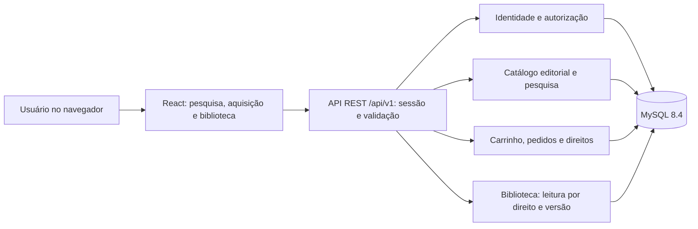
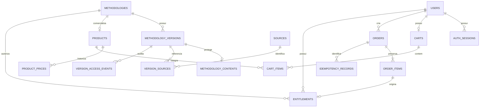

# Arquitetura geral e modelo relacional

O frontend React/TypeScript consome uma API REST Fastify/Node.js 24/TypeScript strict, com validação Zod. MySQL 8.4 persiste usuários, sessões, conhecimento editorial e comércio demonstrativo. O backend é um monólito modular; não há serviço externo de pagamento ou IA.

Cada uma das sete taxonomias possui associação N:N por versão; o [modelo completo](../arquitetura/MODELO-DADOS.md) discrimina todas as entidades, chaves e índices. O diagrama resumido omite apenas essas sete associações e contribuições para facilitar leitura, sem substituí-las por campos de texto.

Sessões usam cookie HttpOnly/SameSite e tokens armazenados como hash; senhas usam Argon2id. Escritas verificam origem/CSRF e autorização. O cliente não define titular, papel, preço ou direito. A confirmação demonstrativa conclui pedido, concede direitos, atualiza carrinho e audita atomicamente; a primeira transação apenas persiste a revisão. Snapshots preservam os fatos originais da aquisição.

A biblioteca verifica usuário, direito ACTIVE, identidade e estado da versão e condições das fontes em cada leitura integral. ADMIN não recebe direito de cliente automaticamente. Suspensão bloqueia a versão sem fallback silencioso; retirada de venda não elimina direito. Respostas protegidas não são armazenadas em cache compartilhado nem nos ativos do frontend.

A demonstração local utiliza containers separados e banco de testes, com porta publicada somente na interface de loopback. Esse arranjo reproduz a integração, sem caracterizar arquitetura de produção. [Arquitetura detalhada](../arquitetura/ARQUITETURA-MVP.md), [identidade](../arquitetura/IDENTIDADE.md) e [biblioteca](../arquitetura/BIBLIOTECA-DIGITAL.md) complementam o modelo.
