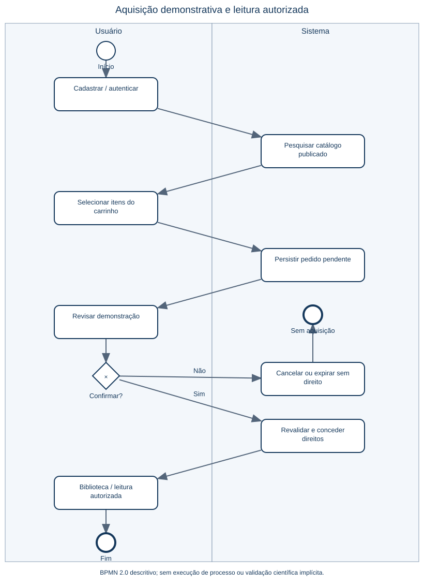
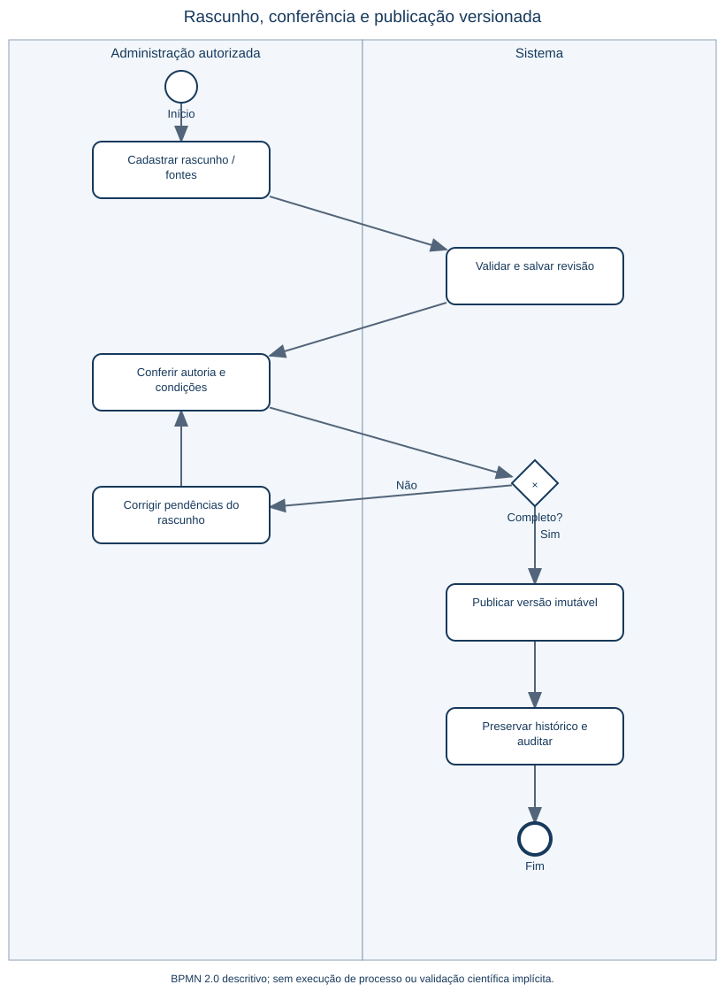

# Processos relevantes em BPMN

Os modelos usam eventos de início/fim, tarefas, gateways exclusivos, fluxos de sequência e raias de responsabilidade. São modelos BPMN 2.0 descritivos, não motores de execução. Os arquivos XML permitem adaptação em ferramenta compatível; as imagens SVG apresentam os mesmos nós e fluxos.

## Aquisição demonstrativa

**Exportação do Eraser:**

[Modelo BPMN 2.0](diagramas/aquisicao-demonstrativa.bpmn). A criação de pedido pendente não concede direito; confirmação exige revalidação e concessão atômica. Cancelamento/expiração não conclui aquisição. O fluxo de biblioteca pressupõe autorização própria, sem pagamento real.

## Publicação editorial

**Exportação do Eraser:**

[Modelo BPMN 2.0](diagramas/publicacao-editorial.bpmn). Publicação exige completude e conferência explícita de autoria, classificações e condições das fontes. Alterações relevantes geram nova versão. Nas evidências automatizadas, o responsável é uma conta de automação identificada e a conferência é estrutural de fixtures originais; não representa revisão científica humana de metodologias reais.

## BPMN conceitual do Sprint 1

Este modelo documenta a proposta inicial; não atesta IA/RAG implementada. [Todas as fontes e links Eraser](diagramas/README.md).
