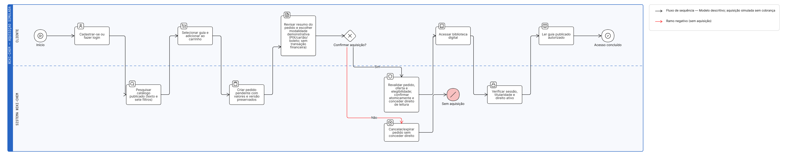
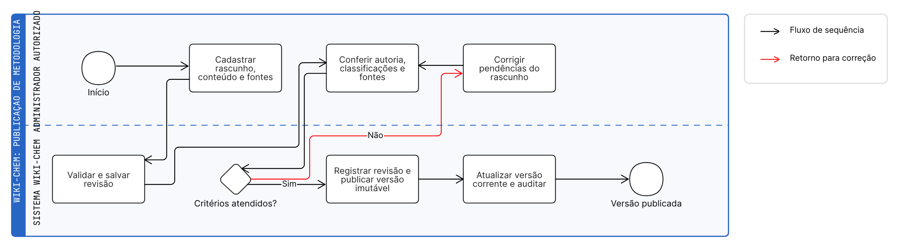
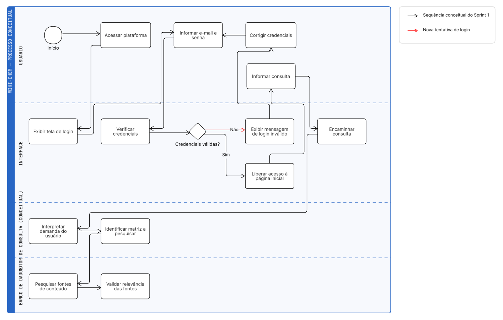
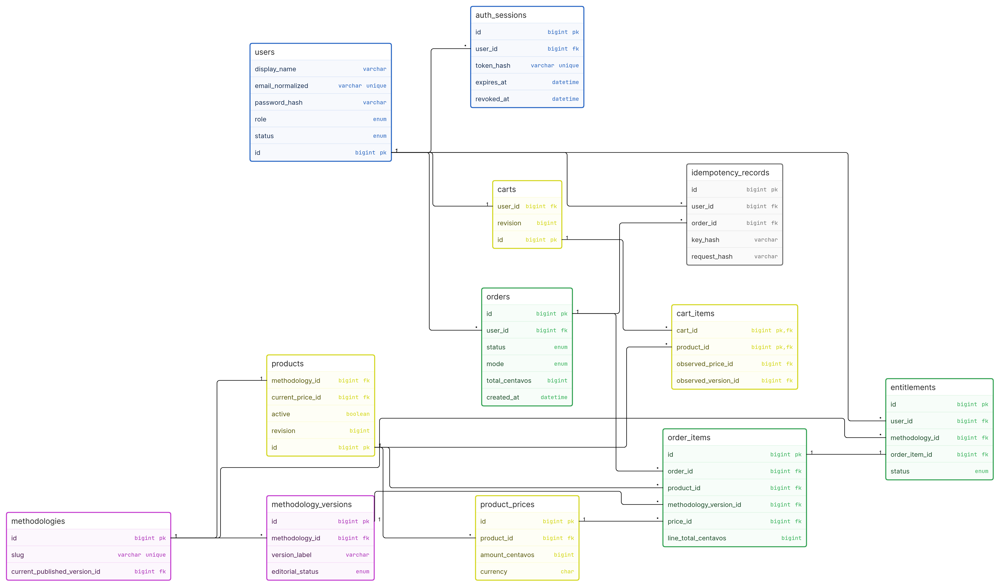
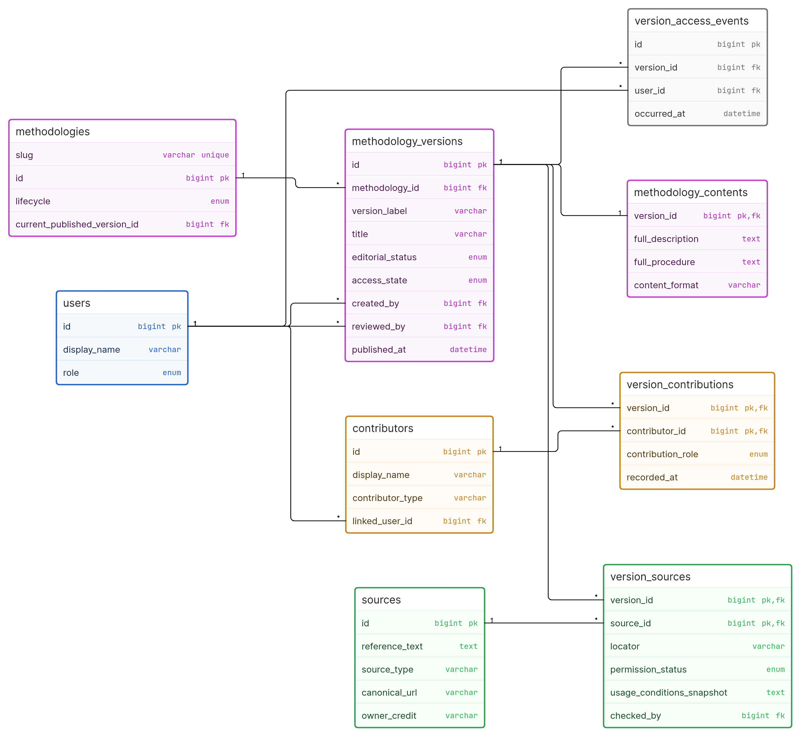
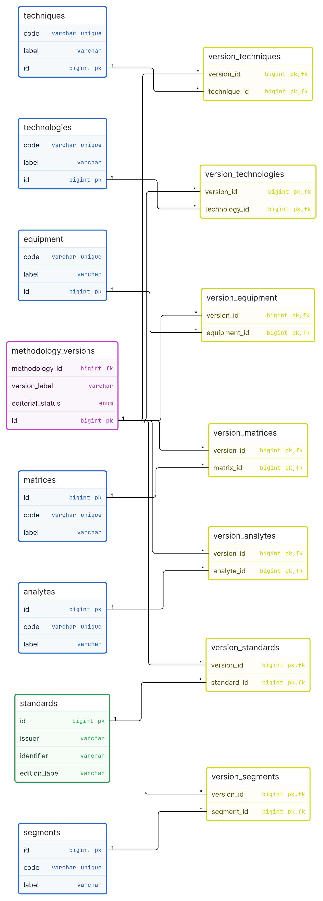

# Diagramas do Wiki-Chem — exportações do Eraser

As imagens abaixo foram exportadas diretamente do workspace do Eraser. As fontes `.eraser` são editáveis. Os arquivos `.bpmn` e `.svg` originais permanecem no repositório, sem substituição.

## Arquitetura

[Diagrama editável no Eraser](https://app.eraser.io/workspace/XzHWqEo8ogZcoPdLxsKl?diagram=4qm0dR5Imeo-I1uG7p_W&layout=canvas) · [PNG](arquitetura-wiki-chem.png) · [Fonte Diagram-as-Code](arquitetura-wiki-chem.eraser)

## BPMN aquisição

[Diagrama editável no Eraser](https://app.eraser.io/workspace/XzHWqEo8ogZcoPdLxsKl?diagram=vrzjvOoSsXbaGfzmZTfb&layout=canvas) · [PNG](aquisicao-demonstrativa-eraser.png) · [Fonte Diagram-as-Code](aquisicao-demonstrativa-eraser.eraser)

## BPMN editorial

[Diagrama editável no Eraser](https://app.eraser.io/workspace/XzHWqEo8ogZcoPdLxsKl?diagram=qxMYQf5tb9nsKeDB--to&layout=canvas) · [PNG](publicacao-editorial-eraser.png) · [Fonte Diagram-as-Code](publicacao-editorial-eraser.eraser)

## BPMN conceitual Sprint 1

[Diagrama editável no Eraser](https://app.eraser.io/workspace/XzHWqEo8ogZcoPdLxsKl?diagram=QNEChmSVtce8KsO2mM6N&layout=canvas) · [PNG](bpmn-conceitual-sprint1-eraser.png) · [Fonte Diagram-as-Code](bpmn-conceitual-sprint1-eraser.eraser)

## DER identidade e comércio

[Diagrama editável no Eraser](https://app.eraser.io/workspace/XzHWqEo8ogZcoPdLxsKl?diagram=Le8R-Gmp2YDzIYuEBvF6&layout=canvas) · [PNG](der-identidade-comercio-biblioteca.png) · [Fonte Diagram-as-Code](der-identidade-comercio-biblioteca.eraser)

## DER editorial

[Diagrama editável no Eraser](https://app.eraser.io/workspace/XzHWqEo8ogZcoPdLxsKl?diagram=OdrL9fdLdA6dAYOWU8mK&layout=canvas) · [PNG](der-conhecimento-editorial.png) · [Fonte Diagram-as-Code](der-conhecimento-editorial.eraser)

## DER sete taxonomias

[Diagrama editável no Eraser](https://app.eraser.io/workspace/XzHWqEo8ogZcoPdLxsKl?diagram=eFtZupHdHs9fpx-ll4NJ&layout=canvas) · [PNG](der-sete-taxonomias.png) · [Fonte Diagram-as-Code](der-sete-taxonomias.eraser)

Os três DERs são visões acadêmicas resumidas, e não o inventário completo de todas as tabelas/colunas. O esquema executável está em `backend/migrations/`. O BPMN conceitual do Sprint 1 registra o planejamento inicial; os BPMNs de aquisição e publicação representam processos do MVP do Sprint 2. IA/RAG e pagamentos reais não estão implementados no MVP.
