# Capturas reais da demonstração

18 imagens produzidas automaticamente em 2026-10-31T11:20:55.075Z por Chromium, consumindo API Fastify e MySQL 8.4 reais em ambiente isolado. Todas foram revisadas; não são mockups e os originais não foram editados. Senhas, e-mails e evidências privadas são mascarados pelo próprio navegador no momento da captura, com a cor azul escura da interface. Os 15 guias técnicos digitais são produtos interpretativos autorais do Wiki-Chem fundamentados em fontes públicas oficiais da U.S. EPA e do USGS (sem reprodução de normas de terceiros e sem revisão científica humana).

O [manifesto](manifest.json) registra descrição, dimensões e hash SHA-256 de cada arquivo para conferência de integridade. A etapa de checkout informa de modo discreto e inequívoco que a transação é isenta de cobrança financeira.

## Figura 1 — home

Página inicial com identidade Wiki-Chem preservada.

## Figura 2 — cadastro

Cadastro real, sem dados pessoais ou credenciais na captura.

## Figura 3 — login

Cadastro concluído e acesso por autenticação real.

## Figura 4 — pesquisa

Pesquisa simplificada inicial com filtros avançados recolhidos, orientação amigável e contador de carrinho vazio.

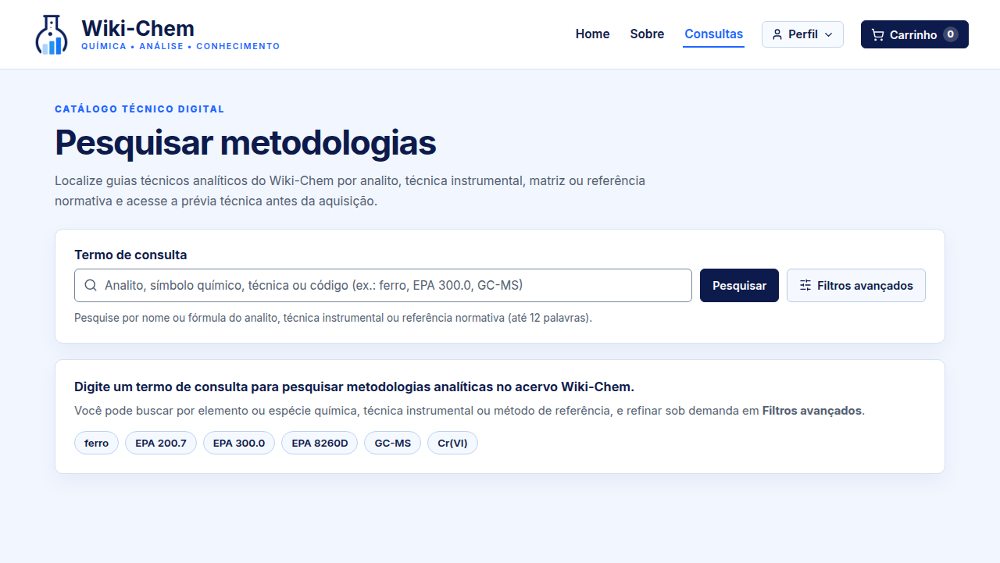

## Figura 5 — sete-filtros

Pesquisa por ferro combinada com espectrofotometria/UV-Vis, sete filtros sob demanda e cartão compacto comercial em BRL.

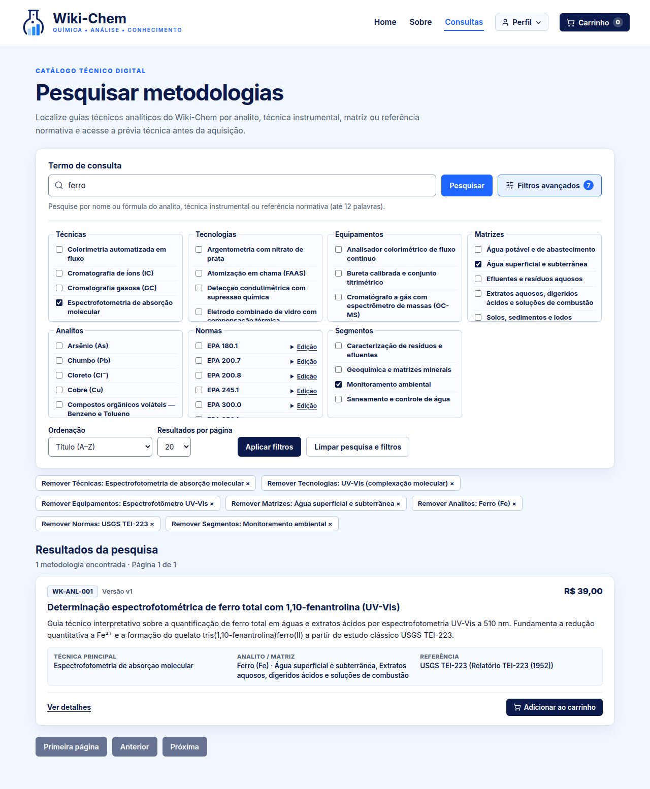

## Figura 6 — previa

Página de metodologia inspirada na organização comercial da ASTM: identificação WK-ANL-001, escopo conciso, referências e caixa lateral de aquisição em BRL.

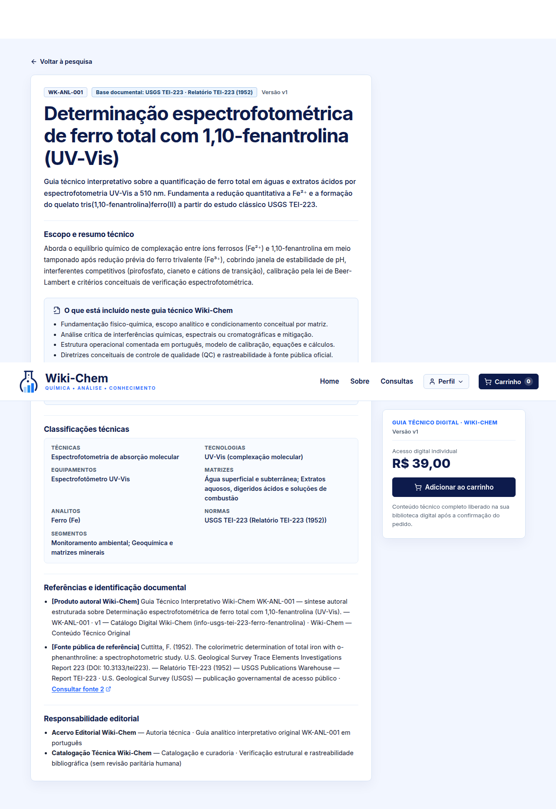

## Figura 7 — carrinho

Carrinho persistente com contador dinâmico no cabeçalho e produto analítico em BRL.

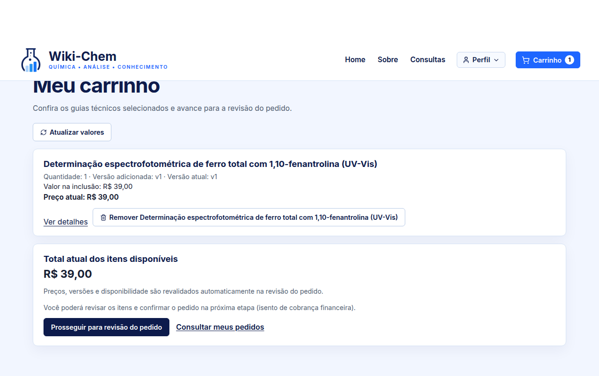

## Figura 8 — revisao-pedido

Checkout com aviso discreto e inequívoco de isenção de cobrança financeira e confirmação explícita.

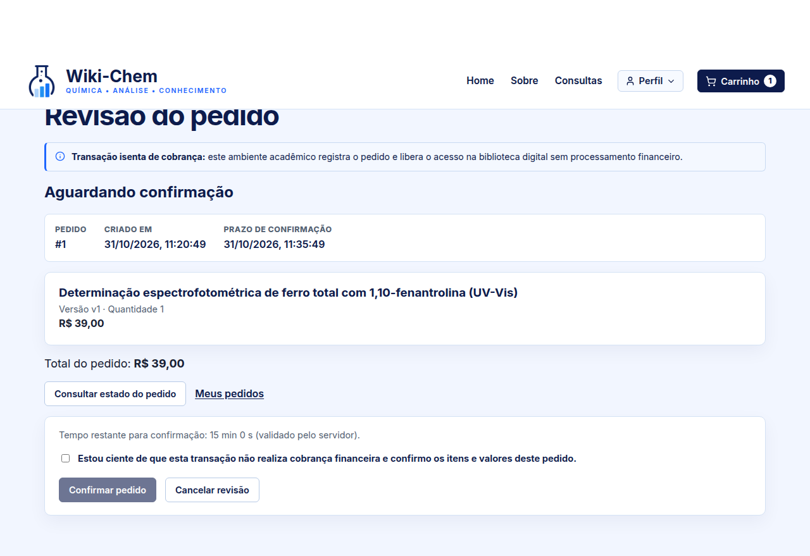

## Figura 9 — confirmacao

Pedido concluído, contador do carrinho zerado e direito de acesso liberado.

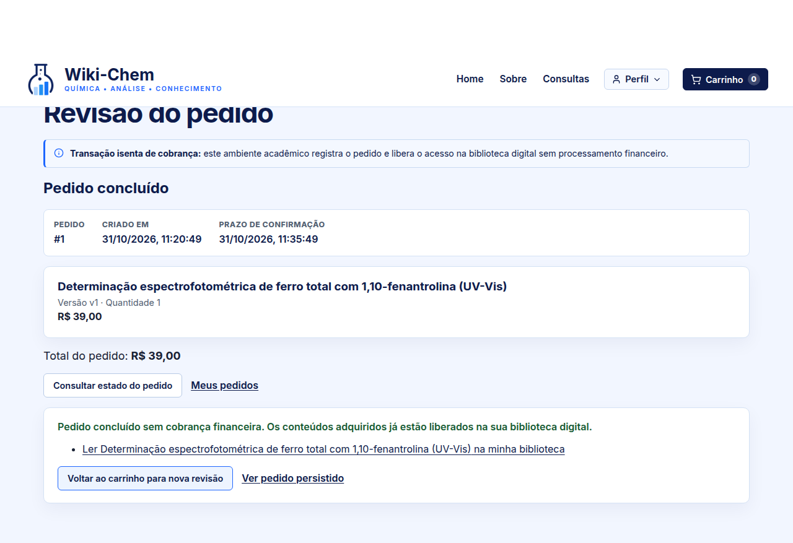

## Figura 10 — pedido

Detalhes do pedido persistido com título, versão e valor consolidado em BRL.

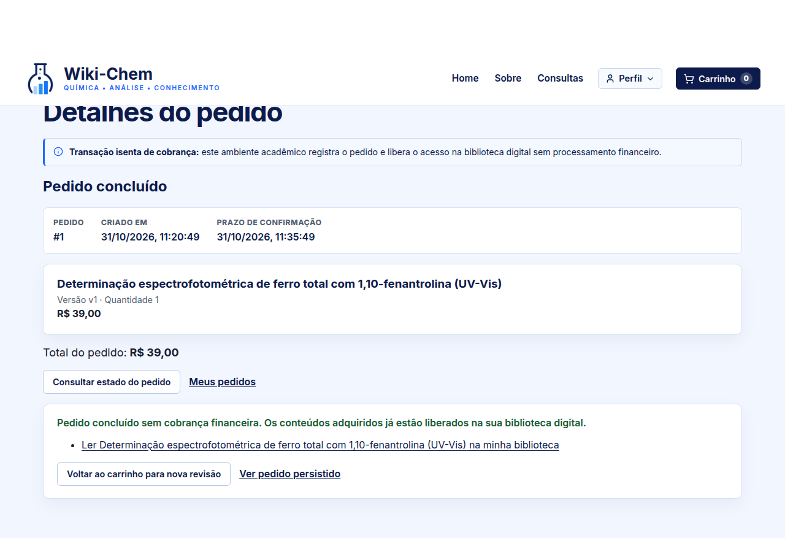

## Figura 11 — biblioteca

Acesso à Minha biblioteca pelo menu Perfil, sem expor o conteúdo integral na listagem.

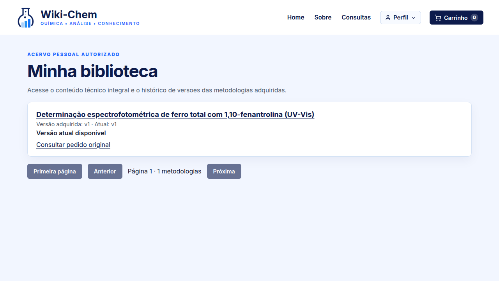

## Figura 12 — leitura-v1

Conteúdo técnico autoral estruturado e referências rastreáveis liberados na biblioteca do titular.

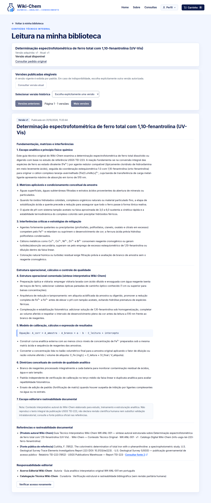

## Figura 13 — admin-rascunho

Administração separada: edição da versão v2 do guia técnico autoral; evidências privadas mascaradas.

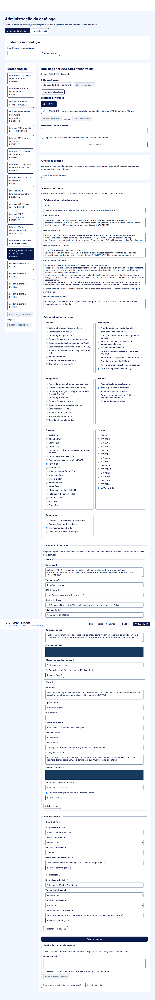

## Figura 14 — revisao-automatizada

Revisão editorial explícita da versão v2 antes da publicação.

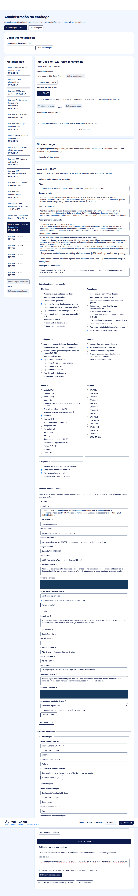

## Figura 15 — historico

Atualização v2 disponível automaticamente ao titular e consulta explícita da v1 adquirida, sem recompra.

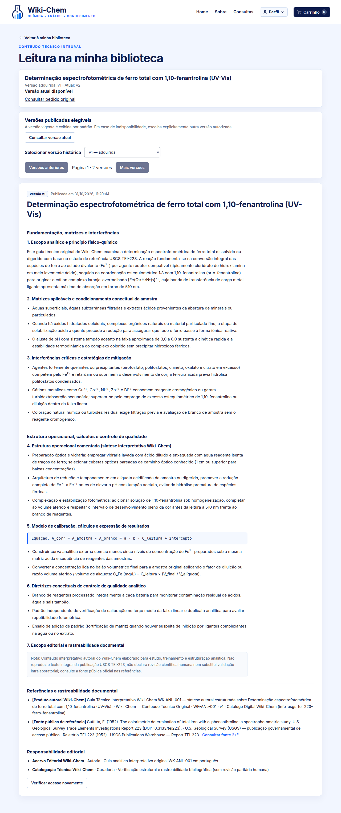

## Figura 16 — leitura-320

Leitura estruturada responsiva em viewport mobile de 320 px.

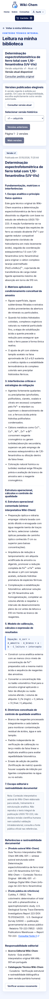

## Figura 17 — pesquisa-320

Pesquisa simplificada, cabeçalho compacto e cartões comerciais em 320 px.

## Figura 18 — classificacoes

Gestão administrativa de taxonomias analíticas e referências normativas.

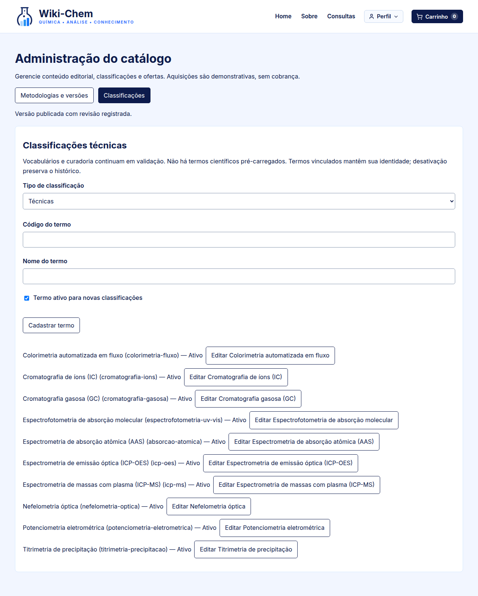
