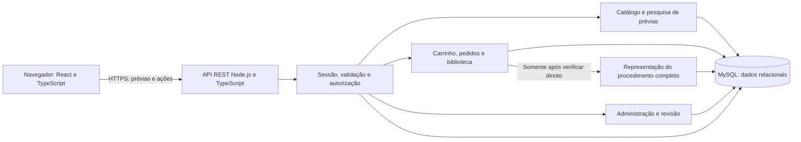

# Arquitetura proposta — MVP Wiki-Chem

**Estado:** proposta, não implementação aprovada. Base `main@6f48aecbca3fce10518e6224731086ec74c48d5c`. As orientações A01–A08, propostas P01–P09 e validações V01–V10 são definidas na [especificação](../especificacoes/MVP-WIKI-CHEM-v1.md). Nenhum serviço é configurado nesta etapa.

## 1. Estrutura e limites de confiança

Propõe-se um **monólito modular Node.js/TypeScript**, API REST `/api/v1` e MySQL transacional. A separação lógica permite implementar incrementos sem microserviços, filas, motores de busca externos ou infraestrutura de IA. Framework HTTP, biblioteca de validação, driver/ORM, migrações e versão MySQL continuam em V07.

O cliente é não confiável: não define preço final, titular de pedido, papel, versão liberada ou direito de acesso. O backend aplica essas decisões independentemente da UI. MySQL não é exposto ao navegador. Conteúdo completo reside em representação/tabela separada, sem cópia em `public/`, bundle React, prévia, cache de CDN ou source map. Não há gateway nem e-mail externo selecionado.

### Módulos propostos

| Módulo | Responsabilidades |
| --- | --- |
| Identidade | Cadastro, credenciais, sessões, perfil e bloqueio de conta |
| Conhecimento | Metodologias, versões, conteúdo protegido, fontes, contribuições e taxonomias |
| Catálogo | Publicação, produto, preço corrente e DTO de prévia; consulta não lê procedimento |
| Comércio | Carrinho, pedido de demonstração, revalidação, idempotência e transação |
| Direitos | Direito por usuário/metodologia, resolução das versões publicadas permitidas, histórico original e estado do conteúdo |
| Administração | Operações privilegiadas, revisão editorial/permissões e auditoria |

Controladores fazem parsing/validação e devolvem DTOs; casos de uso concentram regras e transações; repositórios fazem acesso parametrizado ao MySQL. Nenhum controlador de conteúdo completo depende apenas de um guard frontend. A autorização de dono de pedido/carrinho faz parte do caso de uso, inclusive em replays idempotentes.

## 2. Integração com o frontend preservado

Manter Header, Hero, Home, About, estilos/tokens, Inter, ativos e correções de 320 px da Etapa 01. Ampliar navegação com Pesquisa, Carrinho, Minha biblioteca e Perfil após sessão real. Administração aparece somente para papel autorizado, mantendo validação também no backend. Não reescrever a aplicação ou trocar React/Vite.

Substituir o submit fictício de Login e o painel inerte de Consultas por estados reais de API. Implementar carregamento, falha e ausência de resultados; estado de consulta por URL e cancelamento/descarte de resposta obsoleta. Sessão em contexto React representa estado de UI, não credencial persistida em localStorage. Em 401, limpar dados sensíveis e retornar ao acesso sem repetir operação de compra automaticamente.

P07 propõe mesma origem para frontend/API, com proxy de desenvolvimento definido na futura implementação. Em origens distintas, revisar cookies/CSRF/CORS antes de implantar; não usar origem universal com credenciais. Nenhum ajuste de proxy ou hospedagem é feito neste PR.

## 3. Identidade, autorização e segurança

- Sessão opaca aleatória, somente hash do token no banco, revogável; cookie de produção proposto `__Host-wikichem_session`, `HttpOnly`, `Secure`, `SameSite=Lax`, `Path=/`, sem Domain. Valores de expiração absoluta/inatividade e “manter conectado” exigem V06; sessão é rotacionada no login e revogada no logout/bloqueio.
- Senha com algoritmo adaptativo adequado, parâmetros definidos por V07 e ensaio de custo; não inventar biblioteca/serviço já aprovado. Proposta inicial de política: 12–128 caracteres, sem truncamento silencioso; aprovar em V06. Respostas de login genéricas e limitação de tentativas; sem registrar senha/token.
- Operações autenticadas de escrita exigem token CSRF associado à sessão, entregue no bootstrap de sessão. Cadastro/login exigem JSON, verificação estrita de origem e limites de abuso; ausência de CORS não é tratada como autorização. Cookies não são retornados em JSON nem tokens em URLs.
- DTOs de entrada têm lista de campos permitidos, limites e tipos; consultas SQL parametrizadas; ordenação usa allowlist. Papel/userId/total enviados pelo cliente não substituem os valores obtidos da sessão/banco.
- Conteúdo editorial será renderizado com formato restrito e sanitização apropriada; não executar HTML/script de fonte/administrador. URLs bibliográficas admitem protocolos permitidos e não provocam ingestão/fetch automático pelo servidor.
- Respostas autenticadas e conteúdo protegido usam `Cache-Control: private, no-store`; o cliente remove dados sensíveis no logout. Logs usam requestId e metadados mínimos, nunca procedimento, senha, cookie ou prova privada de permissão.

Essas propostas são alinhadas às referências [OWASP de sessão](https://cheatsheetseries.owasp.org/cheatsheets/Session_Management_Cheat_Sheet.html) e [autorização](https://cheatsheetseries.owasp.org/cheatsheets/Authorization_Cheat_Sheet.html): negar por padrão, conferir permissões por requisição e revogar sessões. Sua adoção específica ainda depende de revisão, não constitui certificação.

### Matriz de autorização

| Recurso/ação | Visitante | Cliente autenticado | Administrador autenticado |
| --- | --- | --- | --- |
| Home/Sobre, cadastro/login | Sim | Sim | Sim |
| Pesquisa, facetas, detalhe gratuito publicado | 401 na API | Sim | Sim |
| Perfil/carrinho/pedidos/biblioteca próprios | 401 | Apenas próprios | Apenas próprios nas rotas de cliente |
| Procedimento pela biblioteca | 401 | Direito próprio ativo à metodologia e versão escolhida publicada/permitida, inclusive atualizações | Mesmo requisito; papel não concede compra |
| Rascunhos/conteúdo integral para edição administrativa | 401 | 403 | Sim, por rota admin, auditada |
| Preços/publicação/taxonomias/permissões | 401 | 403 | Sim, conforme revisão |
| Pedido de outro usuário por rota cliente | 401 | 404 | 404; consulta administrativa de pedidos não faz parte do MVP |

O acesso administrativo para edição é uma permissão editorial distinta do direito comercial de um cliente. Não existe endpoint público de concessão manual de direitos; eventual suporte/revogação comercial exige especificação própria. Suspensão de conteúdo em P06 é uma decisão editorial auditada e não apaga o histórico.

## 4. Contratos REST iniciais (proposta)

Todos os endpoints abaixo usam `/api/v1`, JSON UTF-8 e timestamps ISO 8601 UTC. IDs são strings na API, inclusive se representados por BIGINT no banco; não se presume sigilo dos IDs como defesa. Valores monetários são strings decimais de centavos, `currency: "BRL"`, sem float para cálculo. Exemplos com `<...>` são esquemas documentais, não preços, fontes ou payloads finais.

Listas: `{ "data": [], "page": 1, "pageSize": 20, "total": 0 }`. Objeto: `{ "data": { ... } }`. Proposta de limites: pageSize padrão 20/máximo 100, q até 200 caracteres e até 20 IDs por faceta; confirmar V01/V08. Campos desconhecidos ou tipos inválidos são rejeitados, inclusive tentativas `include=procedure` no catálogo.

Erro: `{ "error": { "code": "CODIGO_ESTAVEL", "message": "Mensagem segura", "details": [], "requestId": "<id>" } }`. `details` só contém campo/motivo seguro, sem SQL, senha, procedimento ou existência de conta na resposta de login.

| HTTP | Uso |
| --- | --- |
| 400 | Payload/query inválidos, faceta/ordenação desconhecida, moeda/quantidade proibida |
| 401 | Sessão ausente, expirada ou revogada; UI volta ao login |
| 403 | Sem papel/direito, CSRF inválido ou conteúdo expressamente suspenso para titular |
| 404 | Recurso inexistente ou fora da propriedade do solicitante; não enumerar pedidos de terceiros |
| 409 | Conflito de revisão, duplicidade, preço/versão/disponibilidade alterados, pedido não confirmável ou chave idempotente incompatível |
| 429 | Limite de tentativas/requisições, com orientação segura para retentativa |
| 500/503 | Falha interna/temporária, sem confirmar compra parcialmente; requestId para suporte |

### 4.1 Identidade

| Método/rota | Entrada | Resultado e regras |
| --- | --- | --- |
| POST `/auth/register` | `displayName`, `email`, `password` | 201 com usuário sem hash/credencial; papel sempre cliente. 409 `ACCOUNT_UNAVAILABLE` em duplicidade, sem revelar dados da conta. P: cadastro não inicia sessão automaticamente |
| POST `/auth/login` | `email`, `password` | 200 com usuário, `csrfToken`, `expiresAt` e Set-Cookie; 401 `INVALID_CREDENTIALS`; rotacionar sessão |
| GET `/auth/session` | Cookie | 200 com usuário, `csrfToken`, `expiresAt`; 401 se inválida, sem credencial em JSON |
| POST `/auth/logout` | Cookie + CSRF | 204, revoga sessão e remove cookie; repetir logout não reativa sessão |
| GET `/me` | Sessão | 200, id/nome/e-mail/papel/estado próprios, sem hash |
| PATCH `/me` | `displayName`, sessão + CSRF | 200 com perfil; e-mail/papel/userId não editáveis neste contrato P08 |

Normalização proposta de e-mail: trim e case-fold definido no serviço, com índice único sobre forma normalizada; não remover pontos/sufixos de provedores. Colação/Unicode e efeitos de enumeração/recuperação exigem V06. Nenhum endpoint de senha esquecida é fingido como implementado; decidir e especificar a solução em V06, substituindo o CTA inerte na futura integração.

### 4.2 Pesquisa e prévia

GET `/taxonomies`: sete coleções de termos ativos com id/código/nome; normas incluem identificador, emissor e edição, quando verificados. Não inclui contagem dinâmica nem conteúdo pago. GET `/methodologies`: sessão obrigatória; parâmetros `q`, `techniqueIds`, `technologyIds`, `equipmentIds`, `matrixIds`, `analyteIds`, `standardIds`, `segmentIds`, `page`, `pageSize`, `sort`. Arrays por parâmetro repetido, sem CSV ambíguo.

P02: OR dentro de uma faceta; AND entre facetas e entre palavras do termo. Cada palavra deve ocorrer em algum campo autorizado da **mesma versão publicada**: título, resumo, descrição gratuita, rótulos técnicos ou referência bibliográfica permitida. Comparação proposta case/acento-insensível, substring literal, preservando demais símbolos e escapando `%`/`_`; V01 deve validar regras para fórmulas e termos curtos. Não pesquisar procedimento completo, nem usar hits do conteúdo pago para alterar resultados/contagens. Índice full-text só pode acelerar sem mudar esse contrato; não ignorar palavras curtas/stopwords silenciosamente.

`sort`: `title_asc` (padrão), `updated_desc`, `price_asc`, `price_desc`; desempate por ID ascendente. IDs desconhecidos/inativos de filtro causam 400. Termo/filtros vazios listam catálogo publicado e disponível; ausência de resultado retorna 200 com lista vazia. Preços comparados no banco como inteiros, nunca lexicalmente.

GET `/methodologies/:id` devolve somente `MethodologyPreview`, mesmo para comprador; rascunho nunca publicado retorna 404. DTO proposto: `id`, `versionId`, `versionLabel`, `title`, `freeSummary`, `publicDescription`, `technicalMetadata` (sete facetas), `contributors`, `references` (referência/edição/localizador autorizado), `offer` (`productId`, `priceId`, `amountCentavos`, `currency`, `available`), `owned`, `purchasable`. Sem procedimento, prova privada de licença ou registro de outro usuário. `owned` considera aquisição prévia inclusive direito revogado; `offer.available` informa disponibilidade geral e `purchasable` também considera o usuário. `purchasable=false` se já adquirido, mesmo após atualização: o CTA abre a biblioteca, sem nova compra. Prévia retirada de venda pode informar indisponibilidade; a pesquisa lista ofertas disponíveis e a biblioteca resolve original/histórico/atualizações conforme P03/P06.

### 4.3 Carrinho, pedidos e direitos

| Método/rota | Entrada/retorno essencial | Regras |
| --- | --- | --- |
| GET `/cart` | `revision`, itens com prévia/preço atual, total atual e problemas por item | Carrinho próprio; total informativo recalculado, sem congelar oferta |
| PUT `/cart/items/:productId` | `expectedRevision`; quantidade implicitamente um | 200 com carrinho; mesma inclusão não duplica; 409 se adquirido/revisão divergente; não aceita preço/total |
| DELETE `/cart/items/:productId` | Query `expectedRevision`, sem body | 200 com carrinho; item ausente sem divergência de revisão é no-op |
| POST `/checkout/simulations` | `cartRevision`; header `Idempotency-Key` | 201 `OrderDetail` pendente, snapshots e `expiresAt`; modo somente `SIMULATED`; contrato transacional em ECOMMERCE |
| POST `/orders/:id/confirm-simulation` | `demoAcknowledged: true`; `Idempotency-Key` | 200 `OrderDetail` concluído simulado; 409 nas revalidações; sem dados financeiros |
| POST `/orders/:id/cancel` | Sessão + CSRF | 200 pedido cancelado se pendente; cancelamento repetido é no-op; concluído não é cancelável por este contrato |
| GET `/orders` e GET `/orders/:id` | Listagem paginada/detalhe próprios | Snapshots de itens/valores e estado de demonstração; nunca filtrar por userId recebido do cliente |
| GET `/library` e GET `/library/:methodologyId` | `methodologyId`, `acquiredVersionId`, `currentPublishedVersionId`, origem do direito, `accessAllowed` e motivo seguro de indisponibilidade | Aquisição é por metodologia; original vem do item do pedido, atual vem do catálogo; não cria nova aquisição ao publicar atualização |
| GET `/library/:methodologyId/versions` | Lista paginada de versões já publicadas da metodologia, rótulo/data, indicadores de original/atual e `accessAllowed` | Exige direito próprio; não lista DRAFT; versões suspensas podem ter metadados seguros com acesso negado |
| GET `/library/:methodologyId/content` | Query opcional `versionId`; resposta inclui `selectedVersionId` e procedimento autorizado | Sem query resolve a atual publicada; com query permite histórico publicado da mesma metodologia; validar sessão, direito metodológico e versão a cada acesso; 403 `PURCHASE_REQUIRED` sem direito |

`OrderDetail`: id, status, mode, currency, createdAt/expiresAt/completedAt, totalCentavos e itens com productId, methodologyId, methodologyVersionId, titleSnapshot, versionLabelSnapshot, unitAmountCentavos, quantity=1 e lineTotalCentavos. `methodologyVersionId` é a versão originalmente adquirida, não o ponteiro corrente; snapshots nunca são atualizados por novas publicações. `OrderDetail` não contém procedimento. Cabeçalho idempotente não substitui sessão/CSRF/autorização; escopo, replay e falhas estão em [ECOMMERCE](ECOMMERCE.md).

A autorização integral usa direito ACTIVE à metodologia e usuário/sessão ativos. A versão resolvida deve pertencer à mesma metodologia, ter published_at e estado PUBLISHED/SUPERSEDED, e access_state ALLOWED. Isso libera a original, histórico e atualizações publicadas, nunca DRAFT. Query malformada retorna 400; versão inexistente, de outra metodologia ou não publicada retorna 404 sem conteúdo; suspensão retorna 403 `CONTENT_SUSPENDED`. Se a atual está suspensa, não há fallback silencioso: informar indisponibilidade e permitir seleção explícita de outra versão histórica elegível. Revogar direito/bloquear usuário impede todas as versões. Desativar venda isoladamente não bloqueia biblioteca. P03 continua sendo proposta pendente de V03.

### 4.4 Administração

Todas as rotas seguintes exigem papel admin, sessão e CSRF em escrita; leitura editorial integral é auditada. Não há endpoint de autoatribuição de papel.

P09 propõe apenas um formulário de rascunho e uma ação de publicação com revisão explícita. Texto, conteúdo, fontes, autoria/curadoria e vínculos técnicos só podem ser editados em DRAFT; publicada/superseded exige novo rascunho. Não existem fila ou estados intermediários de revisão/aprovação. No ato de publicar, conferir expectedRevision e completude/permissões, exigir `reviewAcknowledged=true` e `reviewNote`, e registrar revisor obtido da sessão, data e reviewed_revision na mesma transação. O administrador pode ser também curador/revisor no recorte mínimo, pendente de V09; isso não dispensa revisão nem autoria. Suspensão/restauração e disponibilidade permanecem separadas e auditadas.

| Método/rota | Intenção e contrato inicial |
| --- | --- |
| GET/POST `/admin/methodologies` | Lista paginada/cria identidade de metodologia e produto inativo; sem publicar automaticamente |
| POST `/admin/methodologies/:id/versions` | Cria rascunho novo, opcionalmente baseado em versão existente, sem alterar a publicada |
| GET/PATCH `/admin/versions/:id` | Formulário único: metadados, resumo, facetas, conteúdo protegido, fontes/condições e autoria/curadoria em seções validadas; expectedRevision obrigatório em escrita; somente DRAFT editável; evidências não públicas e HTML/script indevido bloqueado |
| POST `/admin/versions/:id/publish` | `expectedRevision`, `reviewAcknowledged=true`, `reviewNote`; valida condições de uso, registra revisão e publica/atualiza ponteiro atomicamente; edição concorrente causa 409, sem publicar revisão antiga. Atualização é acessível aos titulares de P03, sem reescrever pedidos |
| POST `/admin/products/:id/prices` | `amountCentavos`, currency BRL, `expectedRevision`; cria preço imutável e ativa ponteiro corrente em transação |
| PATCH `/admin/products/:id` | `active`, `expectedRevision`; desativar não apaga histórico/direitos |
| POST `/admin/versions/:id/suspend` e `/restore` | Motivo/evidência e revisão; controla impedimento expresso de uso, sem reescrever pedidos |
| GET/POST/PATCH `/admin/taxonomies/:type` (PATCH em `/:termId`) | `type` em enum das sete facetas; criar/deprecar termo, sem reutilizar identidade/edição histórica |

DTOs finais e validação detalhada deverão ser consolidados em contrato executável no incremento I01, sem alterar silenciosamente estas regras. Publicação, preço e disponibilidade incrementam revisão de oferta; compra concorrente usa os bloqueios descritos no documento comercial.

## 5. Persistência, testes e operação proposta

O [modelo](MODELO-DADOS.md) define chaves/constraints e separação de conteúdo; [ECOMMERCE](ECOMMERCE.md) define limites transacionais. Leituras bloqueantes devem ocorrer dentro de transação; locking reads e unicidade são mecanismos a verificar em MySQL, conforme a [documentação InnoDB](https://dev.mysql.com/doc/refman/8.4/en/innodb-locking-reads.html). Essa referência não escolhe a versão final do banco em V07.

Testar unidade para regras puras, contrato para DTOs/erros, integração com MySQL para relações/rollback/idempotência/concorrência e navegador para fluxo/UX e tentativas de acesso indevido. Não considerar SQLite/mock suficiente para provar as garantias de MySQL. O CI existente continua como base; mudanças futuras de testes/serviços serão propostas no incremento correspondente, não neste PR.

V08 deve aprovar implantação, limites de carga, migração/rollback, backup/restauração, segregação de segredos, logs e alertas. A configuração futura precisa garantir que somente a API acesse MySQL e que arquivos técnicos não escapem por servidor estático. Não há seleção de nuvem, domínio, gateway, provedor de identidade ou IA nesta documentação.

## 6. Matriz consolidada de decisões técnicas pendentes

Esta matriz detalha V06/V07/V09; **nenhuma opção abaixo foi instalada, selecionada definitivamente ou considerada aprovada**. O frontend e a versão de Node de referência da Etapa 01 permanecem preservados. V10 aprova a baseline antes das tarefas dependentes.

| Tema | Proposta/opções para decisão | Aprovação e evidência necessárias |
| --- | --- | --- |
| Framework backend — V07 | Framework HTTP TS com validação, erros e middleware centralizados; Express ou Fastify são opções, não escolhas realizadas | Mantenedor registra escolha/compatibilidade com runtime, contratos e testes; não adicionar camadas sem caso de uso |
| MySQL e acesso — V07 | Definir versão MySQL, driver SQL parametrizado versus query builder/ORM e estratégia transacional única | Demonstrar BIGINT monetário, FKs/UNICIDADE, isolamento, locks e rollback em MySQL; escolher uma abordagem compatível, sem misturar implementações |
| Migrações — V07/V08 | Uma ferramenta alinhada ao acesso escolhido, scripts versionados e execução controlada; sem sincronização destrutiva automática em produção | Aprovar fluxo de aplicação/reversão/backup, testar banco vazio e atualização; distinguir fixtures de desenvolvimento de dados reais |
| Autenticação — V06/V07 | P01 mantém proposta de contas locais e sessão opaca revogável no MySQL; definir biblioteca de sessão, hashing/custo, TTL absoluto/inatividade e CSRF | Testar rotação, logout, expiração, abuso e isolamento; aprovar política de senha/recuperação/e-mail; sem credencial no frontend ou provedor externo escolhido |
| Primeiro administrador — V07/V09 | Futuro comando operacional local protegido, fora de cadastro/HTTP público, executado por responsável autorizado | Sem senha padrão/seed de admin; segredo por entrada segura, nunca argumentos/logs/repositório; hash no serviço; repetição não cria conta duplicada nem promove outro usuário silenciosamente; registrar responsável/ação e desabilitar execução não autorizada |
| Administração editorial — V09 | P09: admin único, DRAFT → PUBLISHED e SUPERSEDED ao substituir; revisão no publish com autoria/fontes/condições | Aprovar que a mesma pessoa pode curar/revisar/publicar, campos mínimos e suspensão/restauração; papéis, filas e dupla aprovação não são dependências do MVP |
| Conteúdo e atualização — V02/V03 | Direito metodológico com original/histórico/atualizações e validação da versão por requisição | Confirmar duração/limites/condições e candidatas; não inferir autorização de uso a partir de link público nem de fixture |

IA/RAG, fornecedores, SDKs, embeddings e bancos vetoriais estão integralmente fora do MVP, de sua autenticação/pesquisa e da lista de dependências técnicas a escolher. Eventual estudo só ocorrerá após a plataforma funcional, em escopo próprio.
