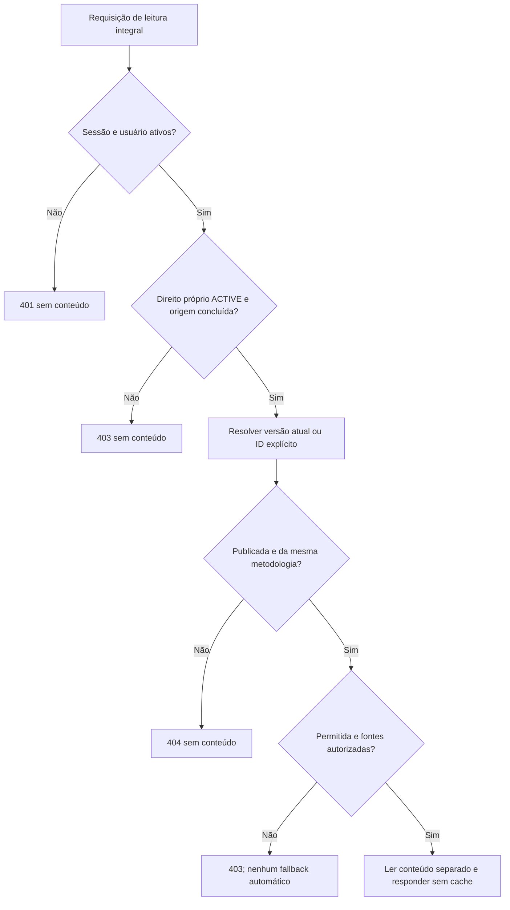
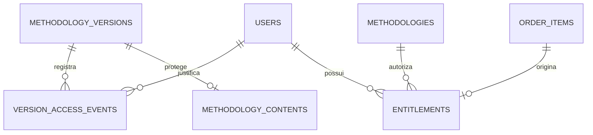

# Biblioteca digital e leitura autorizada

## Objetivo e escopo implementado

O recorte A15 conclui a leitura das metodologias adquiridas por confirmação demonstrativa. A biblioteca integra o fluxo login → pesquisa → carrinho → revisão → confirmação → pedido → biblioteca → procedimento. Todas as aquisições continuam identificadas como **DEMONSTRAÇÃO — SEM COBRANÇA**. Não existem pagamentos, downloads, assinaturas, hospedagem pública ou dependências de IA/RAG neste incremento.

O direito é por usuário e metodologia. Permite a versão originalmente adquirida, o histórico publicado elegível e atualizações publicadas da mesma identidade metodológica, sem novo pedido ou cobrança. Esse comportamento foi autorizado para a demonstração; P03 continua pendente como política comercial definitiva, incluindo duração, condições das fontes e tratamento de restrições. Não se presume corpus técnico autorizado nem permissão comercial por existir uma referência pública.

## Entidades e regras de autorização

O módulo library reutiliza entitlements, order_items, orders, methodologies, methodology_versions, methodology_contents e vínculos de fontes/autoria existentes. Não duplica conteúdo nem cria novos direitos. O pedido original mantém preço, título e versão adquiridos, mesmo após atualizações do catálogo. A listagem contém metadados do titular, inclusive indicação de direito revogado, sem procedimento ou prova privada. A mera presença no carrinho ou em pedido pendente não autoriza leitura.

Toda leitura integral revalida no backend:

1. Sessão ativa, prazos, usuário não bloqueado e titularidade do direito.
2. Direito ACTIVE originado de item pertencente ao mesmo usuário/metodologia e pedido COMPLETED_SIMULATED.
3. Metodologia não excluída e versão pertencente à mesma metodologia, não excluída, com publicação registrada e estado PUBLISHED ou SUPERSEDED.
4. Estado de acesso ALLOWED e todas as fontes verificadas como APPROVED, com ao menos uma origem.
5. Existência da representação integral PLAIN_TEXT, lida somente após as verificações anteriores.

O papel ADMIN não ignora essas regras nas rotas de cliente. Acesso editorial privilegiado continua em /admin, com autenticação, autorização e auditoria próprias. Não há concessão de direitos por papel. Metodologia arquivada ou produto retirado de venda preserva o acesso adquirido às versões permitidas; suspensão da versão e revogação do direito são conceitos distintos.

Sem versionId, a API resolve exclusivamente o ponteiro de versão publicada atual. Se estiver suspensa, retorna CONTENT_SUSPENDED e não busca uma versão anterior automaticamente. O usuário pode selecionar explicitamente outra versão publicada e autorizada no histórico. Rascunhos e versões de outra metodologia retornam 404, sem corpo integral. Direito revogado, fonte pendente/recusada ou versão suspensa retorna 403; não há fallback silencioso nem promessa de solução comercial.

## Contratos REST

Prefixo /api/v1; todas as operações exigem sessão. IDs são strings decimais, parâmetros desconhecidos/duplicados são rejeitados por Zod e SQL usa parâmetros. Paginação padrão page=1/pageSize=20, máximo 100, ordenação por ID decrescente e desempate único.

| Rota | Resposta e limites |
| --- | --- |
| GET /library | `{data: LibraryEntry[], total, page, pageSize}` próprio, sem conteúdo integral |
| GET /library/:methodologyId | `{data: LibraryEntry}` do titular; ausência de direito retorna 403 PURCHASE_REQUIRED |
| GET /library/:methodologyId/versions | Lista paginada de versões publicadas elegíveis, com id, rótulo, título, data e flags original/current; direito deve estar ACTIVE |
| GET /library/:methodologyId/content | `{data: LibraryContent}`; query opcional versionId seleciona histórico explicitamente |

LibraryEntry informa metodologia, estado do direito, data, pedido original, versão/título/preço históricos, versão atual e estado de acesso AVAILABLE, CONTENT_SUSPENDED, CONTENT_UNAVAILABLE ou ENTITLEMENT_REVOKED. Não contém procedimento. LibraryContent informa metodologia, selectedVersionId, rótulo/título/data publicados, fullDescription, fullProcedure, contentFormat=PLAIN_TEXT, referências permitidas e autoria/curadoria. Exclui justificativas privadas, evidências de permissões, dados de outros compradores e credenciais.

Erros seguros: 400 entrada inválida, 401 sessão/conta, 403 PURCHASE_REQUIRED/ENTITLEMENT_REVOKED/CONTENT_SUSPENDED/CONTENT_UNAVAILABLE, 404 versão inexistente/não publicada/de outra metodologia e 503 LIBRARY_UNAVAILABLE. Incluem requestId e não revelam SQL, procedimento ou provas de autorização.

## Consistência e proteção do conteúdo

Leituras integrais usam transação com locking reads de usuário, direito/origem, metodologia, versão e fontes antes da tabela de conteúdo. A ordem relativa metodologia → versão coordena com suspensão/publicação. Bloqueio compartilhado de usuário exclui confirmação concorrente e bloqueio de conta durante a decisão de acesso; suspensão e permissão não podem ser validadas a partir de um snapshot antigo após espera por lock. Autorização é avaliada a cada nova requisição; conteúdo já recebido por um usuário autorizado não pode ser apagado remotamente, e o sistema não promete DRM.

Respostas de biblioteca, inclusive erros autenticados, usam Cache-Control: private, no-store, max-age=0, Pragma: no-cache, Expires: 0 e Vary: Cookie. Não há armazenamento de procedimento em localStorage/sessionStorage, ativos públicos, bundle ou cache compartilhado. O cliente renderiza texto simples, sem executar HTML. Trocar versão, atualizar autorização ou receber erro remove o conteúdo anterior; respostas obsoletas são descartadas. A página oculta a leitura ao entrar em segundo plano e verifica novamente ao voltar/receber foco ou restauração de página. Logout e sessão inválida desmontam o leitor protegido. Essas medidas não impedem que um usuário autorizado copie o texto recebido.

## Suspensão e restauração editorial mínima

PATCH /admin/versions/:id/access aceita exclusivamente expectedRevision, accessState=ALLOWED/SUSPENDED e reason não vazia. Exige ADMIN ativo, origem/CSRF e versão já publicada. Revisão divergente retorna 409; rascunho, mesma situação ou payload de conteúdo são recusados. A ação não altera procedimento, fontes, autoria ou revisão editorial originalmente publicada. A restauração não aprova uma fonte pendente/recusada.

A nova entidade version_access_events registra versão, administrador, estado anterior/novo, justificativa, revisão resultante, requestId e data. Alterar estado, incrementar revisão de versão/oferta, inserir justificativa e evento auditável é uma transação única. A identidade do conteúdo publicado permanece imutável. A justificativa não integra respostas de biblioteca ou prévia. Não há endpoint de edição/exclusão desses eventos.

## Verificação e pendências

Testes exercitam pedido pendente/concluído, titularidade, ADMIN sem direito, v1/v2/histórico, rascunho e versão alheia, suspensão/restauração, expiração absoluta/inatividade, logout, conta bloqueada, revogação, retirada de venda, fontes pendentes e não exposição. Integração utiliza MySQL real e origens sintéticas próprias. Jornadas de navegador percorrem o fluxo de aquisição até leitura, seleção de histórico, suspensão administrativa, falha de rede, retorno seguro e responsividade. Ativos de produção são verificados separadamente de mocks de interface.

A verificação integral aprovou 396 testes: 98 de backend (unitários e contratos), 98 de frontend, 159 de integração MySQL, 14 de navegador de apresentação/ativos de produção e 27 de navegador com API/MySQL reais. As 48 migrações foram aplicadas e repetidas sem reaplicação; instalação limpa, build e análise estática foram aprovados. Auditorias completas e de produção não detectaram vulnerabilidades. Os 15 cenários adicionais de MySQL cobrem autorização e disponibilidade, e quatro novas jornadas integradas percorrem a biblioteca. A execução corrigida concluiu sem testes ignorados ou instáveis. Esses resultados utilizam conteúdo sintético próprio e não validam qualidade científica, licenças de corpus real ou desempenho em produção. Permanecem pendentes validação de corpus/taxonomias e fontes reais, condições comerciais definitivas, retenção/anonimização, requisitos de implantação e avaliação de carga. O próximo incremento deve focar consolidação do MVP demonstrativo e evidências acadêmicas, com escopo aprovado antes de novas funcionalidades; pagamentos, downloads, assinaturas e IA/RAG continuam fora do escopo.
