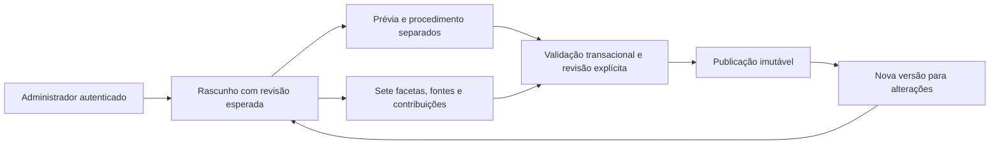

# Catálogo editorial e administração

## Objetivo e funcionalidades

Implementar o gerenciamento de metodologias de química analítica com sete taxonomias, versões, conteúdo protegido, fontes, autoria, curadoria e revisão. /admin utiliza a interface React e exige ADMIN tanto na navegação quanto no backend. O cliente CUSTOMER pode consultar taxonomias ativas e a prévia de uma metodologia publicada conhecida; a [pesquisa autenticada](PESQUISA-METODOLOGIAS.md) lista prévias por texto/sete filtros. Ofertas/preços opcionais e carrinho estão descritos em [Ofertas e carrinho](OFERTAS-CARRINHO.md).

A implementação não carrega corpus científico, as candidatas da EPA ou permissões de reprodução. Vocabulário, aplicabilidade das candidatas e condições reais de uso continuam sujeitos à curadoria. Isso não impede o cadastro funcional de rascunhos e a construção da estrutura.

## Modelo e integridade

Cada um dos sete eixos possui tabela de termos e associação N:N por versão: techniques, technologies, equipment, matrices, analytes, standards e segments. PKs compostas impedem vínculos duplicados; FKs restritivas e índices por termo/versão garantem pertencimento e navegação. Identificação, emissor e edição são obrigatórios para normas. VERIFIED confirma identificação declarada pelo administrador, sem afirmar vigência regulatória.

Metodologia tem identidade estável, lifecycle e ponteiro corrente. FK composta garante que o ponteiro pertence à própria metodologia. Versões guardam prévia, revisão esperada e estados DRAFT/PUBLISHED/SUPERSEDED. O procedimento e a descrição integral ficam em methodology_contents, separados das consultas de prévia. A versão guarda múltiplas fontes e contribuições AUTHOR/CURATOR; registros de origem e atribuição são imutáveis e reutilizados por identidade, preservando as ligações de cada versão.

version_classification_notes registra justificativa quando uma faceta não se aplica. Fonte desconhecida ou norma sem identificação não é substituída por termo fictício. Deprecar um termo preserva vínculos; termo já vinculado não muda de significado. Fontes e contribuições são editadas no formulário do rascunho, sem alteração global de conteúdo publicado.

version_reviews registra uma revisão explícita por versão publicada. audit_events registra ator, ação, destino, requestId e data, sem procedimento, evidência privada, senha ou token. Leituras administrativas de conteúdo completo também são auditadas.

## Fluxo editorial adotado

Salvar rascunho admite campos incompletos. Publicar exige título, resumo gratuito, descrição pública, descrição integral, procedimento, descrição das alterações, autoria e curadoria. Cada faceta deve ter termos ativos ou justificativa explícita de não aplicabilidade; normas selecionadas devem ter identificação verificada.

Cada fonte precisa de referência, crédito, localizador, condições, evidência e conferência explícita atribuída ao administrador. PENDING/REJECTED bloqueiam publicação. Um link público não é tratado como autorização. A plataforma registra a declaração e a revisão humana; não autentica juridicamente documentos ou direitos por conta própria.

Publicação exige expectedRevision, reviewAcknowledged=true e reviewNote. Revisor e timestamps vêm do servidor/sessão. Bloqueios InnoDB serializam a metodologia; revisão desatualizada resulta em 409. Alterações de conteúdo, vínculos, ponteiro, revisão e auditoria são atômicas. Nova publicação torna a anterior SUPERSEDED sem sobrescrever texto, evidências ou revisão anterior.

Copiar versão da mesma metodologia cria outro DRAFT; confirmações de condições de uso voltam a PENDING e a evidência é esvaziada para nova conferência. Publicação é desabilitada na interface enquanto há mudanças locais não salvas.

## Remoção, arquivamento e limites

DELETE de rascunho usa expectedRevision e marca deleted_at. Metodologia sem histórico publicado pode ser removida logicamente; identidade/slug/rótulo da versão não são reutilizados. Metodologia com histórico é arquivada/restaurada por PATCH, preservando versões. Arquivamento retira a prévia e impede novas publicações até restauração.

Não há exclusão física por API, edição de versão publicada ou sobrescrita global de fonte atribuída ao histórico. Retenção/limpeza de registros desativados e órfãos é uma decisão operacional posterior. Arquivamento editorial não define política de direitos de compra; ofertas/carrinho estão implementados, e pedidos, direitos e biblioteca estão implementados em A14/A15.

## Contratos REST implementados

Prefixo /api/v1; IDs textuais, campos permitidos por Zod, timestamps de revisão/publicação ISO 8601 UTC, respostas sem cache. Escritas exigem sessão, ADMIN, origem exata e X-CSRF-Token. Paginação padrão 20, máximo 100; listas usam data/page/pageSize/total.

| Método e recurso | Finalidade |
| --- | --- |
| GET /taxonomies | Sete coleções ativas para usuário autenticado |
| GET /methodologies/:id | Prévia da versão corrente publicada; sem procedimento, evidência privada, nota de revisão, preço ou direito comercial |
| GET /admin/taxonomies | Inclui termos inativos para gestão/histórico |
| POST /admin/taxonomies/:type | Cria termo; type limitado aos sete eixos |
| PATCH /admin/taxonomies/:type/:id | Revisão esperada; edita termo ainda não vinculado ou ativa/desativa mantendo identidade |
| GET/POST /admin/methodologies | Lista paginada/cria identidade, sem produto |
| GET/PATCH/DELETE /admin/methodologies/:id | Consulta, edita identidade ainda não publicada, arquiva/restaura ou remove sem histórico publicado |
| GET/POST /admin/methodologies/:id/versions | Lista/cria versão; basedOnVersionId opcional da própria metodologia |
| GET/PATCH/DELETE /admin/versions/:id | Lê conteúdo editorial auditado, salva formulário completo do DRAFT ou remove rascunho |
| POST /admin/versions/:id/publish | Publica com revisão e condições verificadas |

PATCH do rascunho substitui o formulário inteiro: title, freeSummary, publicDescription, fullDescription, fullProcedure, changelog, classifications (sete arrays), notApplicable (sete justificativas), sources e contributors, além de expectedRevision. O formulário administra fontes e autoria de forma integrada; nenhuma etapa de aprovação editorial intermediária foi adicionada. DELETE administrativo usa JSON com expectedRevision.

Sources inclui referenceText, sourceType ORIGINAL/REFERENCE, canonicalUrl HTTP(S) sem credenciais, ownerCredit, editionLabel, locator, usageConditions, permissionStatus, permissionEvidence e permissionAcknowledged. Contributors inclui displayName, contributorType PERSON/ORGANIZATION, reference e role AUTHOR/CURATOR. Ator, data e revisão não são aceitos como afirmações do cliente.

Rascunhos aceitam título até 200, resumo até 4000, descrição pública até 8000, descrição integral até 16000, procedimento até 64000 e descrição de alterações até 2000 caracteres. Há até 20 termos por faceta, 20 fontes e 20 contribuições. Somente o PATCH editorial aceita corpo de até 512 KiB; autenticação mantém seu limite anterior. Conteúdo é texto simples, exibido por React sem executar HTML. URLs não são buscadas pelo servidor.

401 cobre sessão inválida, 403 papel/origem/CSRF, 404 registro indisponível, 400 contrato inválido e 409 revisão/imutabilidade/publicação incompleta. Detalhes de validação indicam campos e motivos, sem reproduzir conteúdo protegido. CUSTOMER não recebe resposta editorial mesmo enviando CSRF válido ou IDs conhecidos.

## Verificação e pendências

Os testes verificam CRUD lógico, classificação múltipla nos sete eixos, FKs/índices, propriedade do ponteiro e da versão de origem, concorrência, revisão, imutabilidade, retirada da prévia e limites de autorização. Marcadores sintéticos no procedimento/evidência comprovam ausência desses dados nas prévias e respostas negadas. As fixtures contêm texto original DEMO, sem procedimento laboratorial real ou autorização fictícia de terceiro.

Há testes de formulário, carregamento, conflito, campos acessíveis, publicação somente do conteúdo salvo, teclado e responsividade. A integração usa MySQL real e navegador, preservando os testes anteriores. Resultados executados devem ser distinguidos da validação científica das metodologias.

Continuam pendentes: vocabulários oficiais e critérios de aplicabilidade, inclusão das candidatas reais, corpus revisado e permissões demonstráveis, volumes/otimização das coleções de termos, retenção e política de suspensão. A busca gratuita está implementada em recorte próprio; ofertas/preços/carrinho estão implementados e direitos, pedidos e biblioteca estão implementados em A14/A15; pagamentos permanecem fora do escopo; IA/RAG permanece integralmente fora do MVP.

### Resultados experimentais

A validação automatizada executada aprovou 65 testes de unidade/contrato do backend, 36 testes de componentes e rotas React, 13 regressões de navegador e 12 jornadas com API e MySQL reais. As jornadas verificaram criação, edição, publicação, leitura imutável, autorização, navegação por teclado e formulário em largura de 320 px.

A integração com MySQL 8.4 aprovou CRUD, os sete relacionamentos múltiplos, restrições referenciais, conflitos de revisão, publicação incompleta, imutabilidade e isolamento do procedimento. As 28 migrações de estrutura foram aplicadas e executadas novamente sem reaplicação. Instalação limpa, builds, análise estática e auditorias completas/de produção foram aprovados, com zero vulnerabilidades reportadas. Esses resultados demonstram comportamento do software com fixtures sintéticas; não constituem validação científica de métodos nem comprovação de direitos sobre fontes reais.

## Disponibilidade de versões publicadas

[Biblioteca digital](BIBLIOTECA-DIGITAL.md) acrescenta PATCH /admin/versions/:id/access, com ADMIN, CSRF, expectedRevision, estado e justificativa obrigatória. Suspensão/restauração e evento são atômicos; conteúdo, fontes e revisão editorial original não são alterados. Restauração não aprova condições de fontes pendentes. O controle está disponível em /admin para versões publicadas e históricas.
