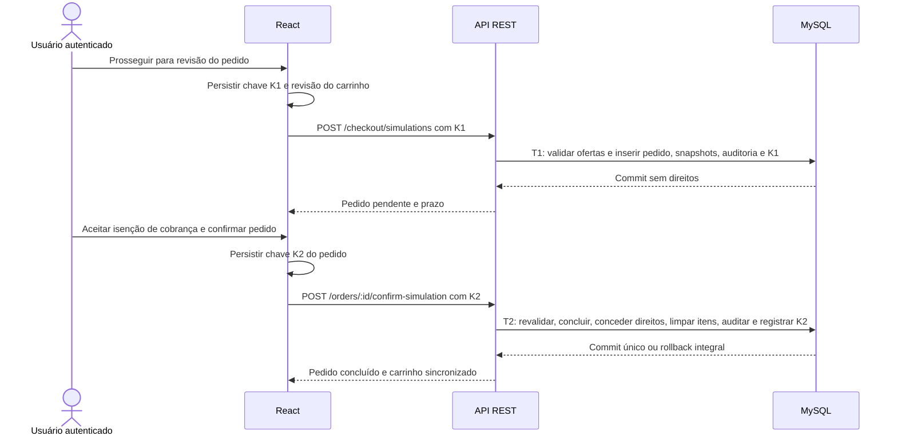
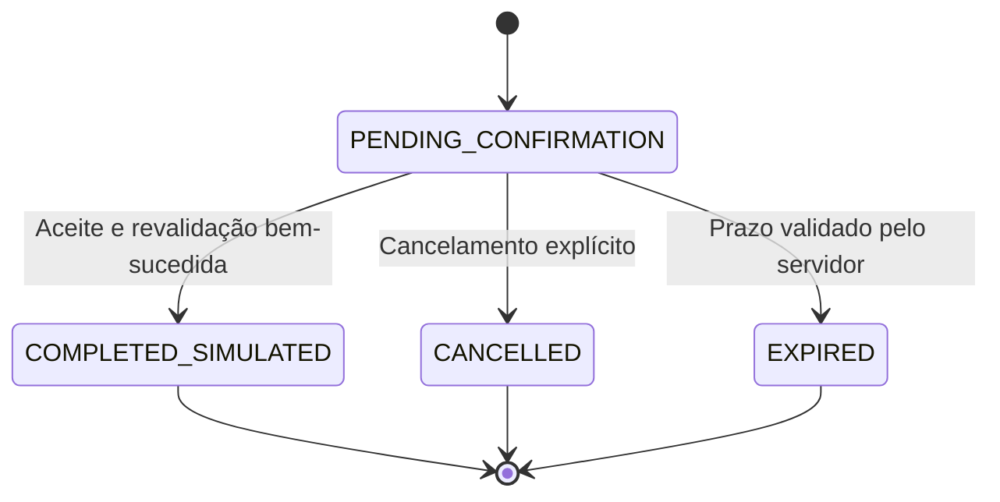

# Checkout sem cobrança financeira e pedidos persistidos

## Objetivo, estado e limites

O módulo de checkout implementa a aquisição em duas transações (`PENDING_CONFIRMATION` → `COMPLETED_SIMULATED`), sem processamento financeiro, gateway ou coleta de dados de cartão, PIX ou faturamento. O fluxo autenticado percorre `/carrinho` → revisão persistida em `/checkout/:id` → confirmação explícita → conclusão e liberação imediata na biblioteca digital → histórico em `/pedidos` (acessível pelo menu `Perfil → Pedidos`).

Na etapa de checkout (`/checkout/:id`), a interface informa de modo discreto, claro e inequívoco que **a transação é isenta de cobrança financeira** no ambiente acadêmico, exigindo ciência explícita antes de confirmar o pedido. Após a confirmação, o contador dinâmico do carrinho no cabeçalho é atualizado e os direitos (`entitlements`) ficam persistidos por usuário e metodologia, liberando a leitura integral estruturada em `/biblioteca/:methodologyId` conforme [Biblioteca digital](BIBLIOTECA-DIGITAL.md). O conteúdo técnico completo nunca integra as respostas de checkout ou pedidos.

## Transações e estados

`T1` exige carrinho não vazio, revisão atual e todos os produtos elegíveis, sem reservar preços nem conceder direitos antecipados. `T2` revalida produto, metodologia, versão, preço, valor e revisão da oferta contra os snapshots; qualquer divergência bloqueia a conclusão sem substituição silenciosa. O prazo é determinado pelo servidor (`CHECKOUT_TTL_SECONDS`, padrão 900 s).

## Integridade, concorrência e modelagem

As quatro tabelas implementadas complementam o [modelo relacional](MODELO-DADOS.md):

| Entidade | Dados e garantias |
| --- | --- |
| `orders` | Proprietário, estados (`PENDING_CONFIRMATION`, `COMPLETED_SIMULATED`, `CANCELLED`, `EXPIRED`), modo `SIMULATED`, `BRL`, total e datas UTC |
| `order_items` | Produto/metodologia/versão/preço originais, snapshots imutáveis de título e rótulo de versão, valor unitário e total de linha |
| `entitlements` | Um registro por `(user_id, methodology_id)`, origem no item original, `ACTIVE`/`REVOKED`, sem fixar apenas uma versão |
| `idempotency_records` | Escopo usuário/operação/hash SHA-256 da chave UUID, hash canônico do payload, `order_id` e código HTTP |

Triggers de banco impedem alteração ou exclusão de snapshots de itens e direitos históricos, razão pela qual o arquivamento de metodologias legadas (`RETIRED`) preserva integralmente todos os pedidos e direitos anteriores. `UNIQUE(user_id, methodology_id)` impede dupla aquisição inclusive concorrente.

## Contratos e autorização

Prefixo `/api/v1`; todas as rotas exigem sessão ativa, e mutações exigem origem permitida, CSRF e JSON (`CHECKOUT_RATE_LIMIT_MAX`, padrão 60/minuto por usuário). Pedido de terceiro retorna `404`.

| Operação | Entrada | Saída |
| --- | --- | --- |
| `POST /checkout/simulations` | `Idempotency-Key` UUID; `{cartRevision: inteiro positivo}` | `201 {data: OrderDetail}` |
| `POST /orders/:id/confirm-simulation` | `Idempotency-Key` UUID; `{demoAcknowledged: true}` | `200 {data: OrderDetail}` |
| `POST /orders/:id/cancel` | `{}` | `200 {data: OrderDetail}` |
| `GET /orders` | `page`/`pageSize` validados (padrão 1/20, máx. 100) | `200 {data: OrderSummary[], total, page, pageSize}` |
| `GET /orders/:id` | ID decimal válido | `200 {data: OrderDetail}` |

## Idempotência e recuperação

UUIDs são armazenados como SHA-256 no backend e associados ao hash canônico da intenção. No navegador, apenas metadados de intenção não autenticadores (UUID, revisão do carrinho, ID do pedido) são mantidos por usuário antes do `POST`, permitindo consultar o estado do pedido ou repetir a mesma chave em caso de queda de rede sem duplicar pedidos ou direitos.
