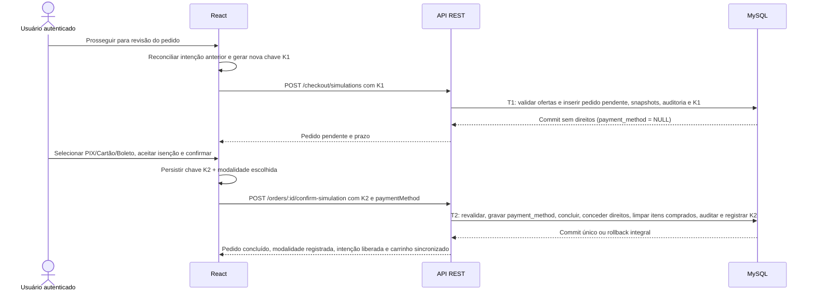
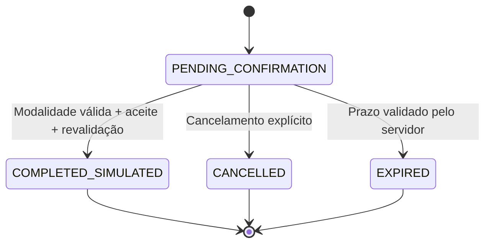

# Checkout com simulação de pagamento e pedidos persistidos

## Objetivo, estado e limites

O módulo de checkout implementa a aquisição em duas transações (`PENDING_CONFIRMATION` → `COMPLETED_SIMULATED`), com **simulação profissional de forma de pagamento** (`PIX`, `Cartão de crédito` e `Boleto bancário`), sem processamento financeiro real, gateway bancário, emissão de PIX/boleto pagável ou solicitação de números de cartão, CVV, CPF ou dados bancários. O fluxo autenticado percorre `/carrinho` → revisão persistida em `/checkout/:id` → escolha obrigatória de modalidade simulada + confirmação explícita → conclusão com quitação/aprovação simulada e liberação imediata na biblioteca digital → histórico em `/pedidos` (acessível pelo menu `Perfil → Pedidos`).

Na etapa de checkout (`/checkout/:id`), a interface informa de modo discreto, claro e inequívoco que **a transação é isenta de cobrança financeira** no ambiente acadêmico, exigindo seleção de modalidade (`PIX`, `CREDIT_CARD` ou `BOLETO`) e ciência explícita antes de confirmar o pedido. Após a confirmação:
- Somente os itens comprados no pedido são removidos de `cart_items`, preservando itens adicionados posteriormente.
- A intenção local do pedido concluído é liberada automaticamente no navegador, garantindo **compras consecutivas na mesma sessão** com novas chaves de idempotência.
- O contador dinâmico do carrinho no cabeçalho é atualizado imediatamente e os direitos (`entitlements`) ficam persistidos por usuário e metodologia, liberando a leitura integral estruturada em `/biblioteca/:methodologyId` conforme [Biblioteca digital](BIBLIOTECA-DIGITAL.md).
- Em pedidos já concluídos, o cabeçalho documental exibe `Concluído em` e `Forma de pagamento` (sem exibir `Prazo de confirmação` como metadado principal), além de ligação direta para cada metodologia adquirida.

## Transações e estados

`T1` exige carrinho não vazio, revisão atual e todos os produtos elegíveis, sem reservar preços nem conceder direitos antecipados. `T2` exige `paymentMethod` válido (`PIX | CREDIT_CARD | BOLETO`), revalida produto, metodologia, versão, preço, valor e revisão da oferta contra os snapshots; qualquer divergência bloqueia a conclusão sem substituição silenciosa. O prazo é determinado pelo servidor (`CHECKOUT_TTL_SECONDS`, padrão 900 s).

## Integridade, concorrência e modelagem

As quatro tabelas implementadas complementam o [modelo relacional](MODELO-DADOS.md):

| Entidade | Dados e garantias |
| --- | --- |
| `orders` | Proprietário, estados (`PENDING_CONFIRMATION`, `COMPLETED_SIMULATED`, `CANCELLED`, `EXPIRED`), modo `SIMULATED`, `BRL`, `payment_method` (`ENUM('PIX','CREDIT_CARD','BOLETO') NULL`, compatível com pedidos históricos anteriores e restrito a pedidos concluídos), total e datas UTC |
| `order_items` | Produto/metodologia/versão/preço originais, snapshots imutáveis de título e rótulo de versão, valor unitário e total de linha |
| `entitlements` | Um registro por `(user_id, methodology_id)`, origem no item original, `ACTIVE`/`REVOKED`, sem fixar apenas uma versão |
| `idempotency_records` | Escopo usuário/operação/hash SHA-256 da chave UUID, hash canônico do payload (incluindo `paymentMethod` na confirmação), `order_id` e código HTTP |

Triggers de banco (`immutable_order_update`, `immutable_order_item_update`, `immutable_entitlement_delete`) impedem alteração de valores, modalidade de pagamento ou snapshots após a conclusão, bem como exclusão de pedidos, itens e direitos históricos. `UNIQUE(user_id, methodology_id)` impede dupla aquisição inclusive concorrente.

## Contratos e autorização

Prefixo `/api/v1`; todas as rotas exigem sessão ativa, e mutações exigem origem permitida, CSRF e JSON (`CHECKOUT_RATE_LIMIT_MAX`, padrão 60/minuto por usuário). Pedido de terceiro retorna `404`.

| Operação | Entrada | Saída |
| --- | --- | --- |
| `POST /checkout/simulations` | `Idempotency-Key` UUID; `{cartRevision: inteiro positivo}` | `201 {data: OrderDetail}` |
| `POST /orders/:id/confirm-simulation` | `Idempotency-Key` UUID; `{demoAcknowledged: true, paymentMethod: 'PIX' \| 'CREDIT_CARD' \| 'BOLETO'}` | `200 {data: OrderDetail}` |
| `POST /orders/:id/cancel` | `{}` | `200 {data: OrderDetail}` |
| `GET /orders` | `page`/`pageSize` validados (padrão 1/20, máx. 100) | `200 {data: OrderSummary[], total, page, pageSize}` |
| `GET /orders/:id` | ID decimal válido | `200 {data: OrderDetail}` |

## Idempotência, preservação de modalidade e compras consecutivas

UUIDs são armazenados como SHA-256 no backend e associados ao hash canônico da intenção:
- **Preservação da modalidade na confirmação:** a chave `Idempotency-Key` de `POST /orders/:id/confirm-simulation` incorpora `paymentMethod` ao `request_hash`. Repetir a mesma chave com a mesma modalidade retorna `200` idempotente; tentar reutilizar a chave (ou confirmar pedido já concluído) alterando a forma de pagamento retorna `409 IDEMPOTENCY_CONFLICT`.
- **Ciclo de vida limpo para compras consecutivas:** assim que o servidor confirma um estado terminal (`COMPLETED_SIMULATED`, `CANCELLED` ou `EXPIRED`), o frontend libera automaticamente a intenção local (`wikichem-demo-create:<userId>` e `wikichem-demo-confirm:<userId>:<orderId>`). Ao abrir `/carrinho` com uma intenção residual, `CartCheckout` reconcilia o estado junto à API antes de reutilizá-la, preservando a recuperação apenas para revisões realmente pendentes da revisão atual ou respostas de rede incertas.
