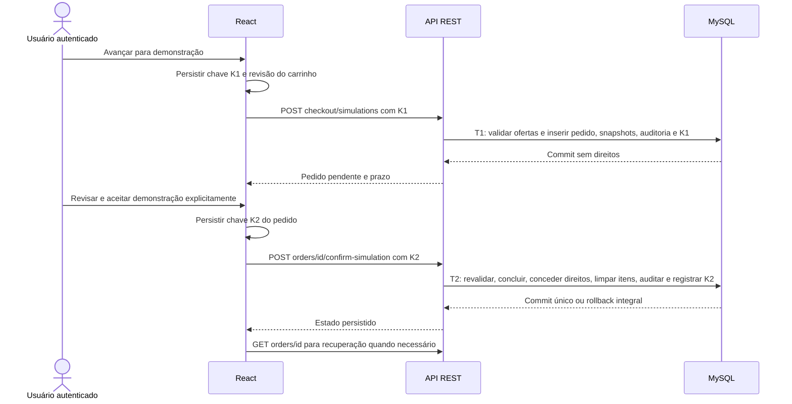
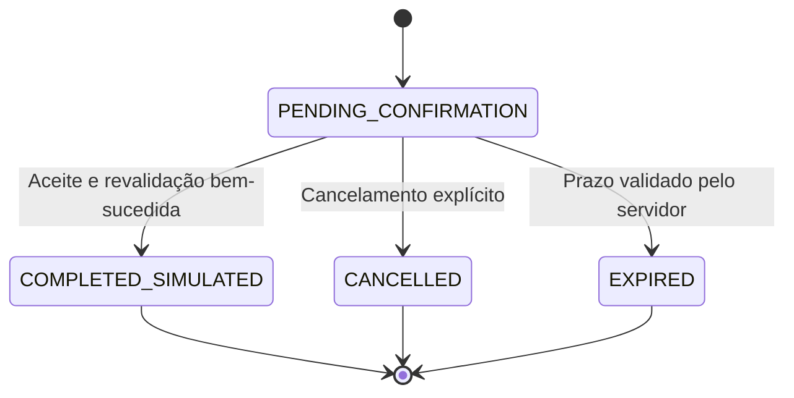

# Checkout demonstrativo e pedidos persistidos

## Objetivo, estado e limites

O incremento A14 implementa aquisição **SIMULATED**, em duas transações, sem cobrança ou integração financeira. O fluxo autenticado é carrinho → revisão persistida → confirmação explícita → resultado → histórico. Todas essas telas exibem **“DEMONSTRAÇÃO — SEM COBRANÇA”**. Não são coletados dados de cartão, PIX, documento fiscal ou faturamento. Não existe gateway, pagamento, estorno nem geração de documento fiscal.

Os direitos ficam registrados por usuário/metodologia, conforme o recorte demonstrativo autorizado. A política P03 de acesso ao original e às atualizações permanece proposta comercial pendente de V03. Não há ainda página ou endpoint de leitura integral da biblioteca; o direito registrado não expõe o procedimento em qualquer resposta deste módulo. IA/RAG permanece fora do MVP e de suas dependências.

## Transações e estados

T1 exige carrinho não vazio, revisão atual e todos os produtos elegíveis. Não reserva preço, não remove itens, não concede direitos e não mantém transação aberta durante a revisão humana. T2 compara produto, metodologia, versão, preço, valor e revisão da oferta com os snapshots. Qualquer alteração, inclusive redução de preço ou desativação seguida de reativação, bloqueia a conclusão; exige cancelamento/expiração e outra revisão explícita. Não substitui valores silenciosamente nem conclui um subconjunto.

O servidor estabelece o prazo com `CHECKOUT_TTL_SECONDS` (900 segundos por padrão, configurável entre 5 e 3600). O cliente recebe `serverTime` e `expiresAt`; sua contagem é informativa. GET apresenta EXPIRED efetivo sem escrita; confirmar ou cancelar pode materializar a expiração e auditoria, sem direitos. O prazo é conferido após aquisição dos bloqueios e novamente depois da revalidação. Pedidos terminais são imutáveis. O cancelamento é idempotente; um pedido concluído não pode ser cancelado por este contrato.

## Integridade, concorrência e modelagem

As quatro tabelas implementadas complementam o [modelo relacional](MODELO-DADOS.md):

| Entidade | Dados e garantias |
| --- | --- |
| orders | Proprietário, quatro estados, modo SIMULATED, BRL, total, revisão original do carrinho, datas de criação/expiração/conclusão/cancelamento; índice por proprietário/data/ID |
| order_items | Produto/metodologia/versão/preço originais; título e rótulo de versão históricos, valor unitário e total de linha, quantidade um; unicidade por pedido/produto e pedido/metodologia |
| entitlements | Um registro por usuário/metodologia, origem no item original, ACTIVE/REVOKED e datas/motivo; não fixa a versão corrente no direito |
| idempotency_records | Escopo usuário/operação/hash da chave, hash canônico do pedido HTTP, order_id, código de resposta e criação; unicidade composta |

FKs compostas garantem que item pertença ao dono do pedido, versão à metodologia, produto à metodologia, preço ao produto e direito ao proprietário/metodologia do item. Triggers impedem alteração/exclusão de snapshots e exclusão/alteração de origem de direitos; concessão exige pedido concluído e mesmo proprietário. Inserção de item exige pedido pendente e preço/valor compatíveis. Quantidade, moeda, valores positivos e coerência de datas/estados possuem constraints; soma e pedido não vazio são invariantes do caso de uso e dos testes. Uma migração contém um único statement SQL; os corpos BEGIN/END de CREATE TRIGGER não habilitam múltiplos statements independentes no driver.

Moeda é calculada no servidor com BigInt e serializada como string decimal. O total do pedido deve caber em BIGINT positivo com sinal (máximo técnico 9223372036854775807 centavos); excedê-lo rejeita integralmente a criação. Não se trata de preço ou limite comercial aprovado. Os valores FX01–FX05 existem exclusivamente em testes/dev protegidos; não há seed comercial nem publicação automática de candidatas EPA.

Mutações serializam pelo usuário, depois carrinho/pedido, produtos em ID crescente, metodologias/versões e vínculos de permissões. As leituras críticas são locking reads, evitando validar um snapshot antigo após esperar outra transação. Administração mantém a mesma ordem relativa produto → metodologia → versão. A leitura dos itens já serializados pelo carrinho não reserva intervalos vazios de índices, evitando interferência entre carrinhos novos de compradores distintos. Há até três tentativas somente para deadlock/timeout de lock; nenhuma ação externa integra a transação. UNIQUE(user_id, methodology_id) impede dupla aquisição inclusive concorrente; REVOKED também bloqueia recompra automática. Repetir confirmação de pedido concluído não restaura direito revogado.

Concluir, conceder todos os direitos, remover somente produtos adquiridos do carrinho atual, incrementar sua revisão quando houver remoção, auditar e registrar idempotência compartilham o mesmo commit. Falha em qualquer escrita faz rollback de todos esses efeitos. Itens adicionados após T1 são preservados. Pedidos pendentes distintos podem coexistir; depois que um conclui, outro com metodologia já adquirida recebe ALREADY_OWNED, sem aquisição parcial.

## Contratos e autorização

Prefixo `/api/v1`; todas as rotas exigem sessão ativa. Escritas exigem origem, CSRF e JSON. Não há parâmetro de proprietário escolhido pelo cliente. Pedido alheio retorna 404. Mutação é limitada por usuário (`CHECKOUT_RATE_LIMIT_MAX`, padrão 60/minuto).

| Operação | Entrada | Saída |
| --- | --- | --- |
| POST /checkout/simulations | Idempotency-Key UUID; `{cartRevision: inteiro positivo}` | 201 `{data: OrderDetail}` |
| POST /orders/:id/confirm-simulation | Idempotency-Key UUID; `{demoAcknowledged: true}` | 200 `{data: OrderDetail}` |
| POST /orders/:id/cancel | `{}` | 200 `{data: OrderDetail}` |
| GET /orders | page/pageSize validados, padrões 1/20, tamanho máximo 100 | 200 `{data: OrderSummary[], total, page, pageSize}`, ordem ID decrescente |
| GET /orders/:id | ID decimal válido | 200 `{data: OrderDetail}` |

OrderSummary contém id/status/mode/currency/totalCentavos/cartRevisionSnapshot, createdAt/expiresAt/completedAt/cancelledAt, itemCount e serverTime. OrderDetail acrescenta itens com id/productId/methodologyId/methodologyVersionId/priceId, titleSnapshot/versionLabelSnapshot, unitAmountCentavos/lineTotalCentavos e quantity=1. Não contém usuário arbitrário, hashes, procedimento, credenciais ou evidências privadas de permissão.

Erros: 400 para entrada/chave inválida ou EMPTY_CART; 401 sessão ausente/expirada; 403 CSRF/origem/conta; 404 proprietário/ID não encontrado; 409 CART_CHANGED, OFFER_CHANGED, PRODUCT_UNAVAILABLE, ALREADY_OWNED, ORDER_EXPIRED, ORDER_STATE, IDEMPOTENCY_CONFLICT, ORDER_TOTAL_LIMIT ou conflito transacional; 429 limite; 503 CHECKOUT_RETRYABLE para falha técnica sem confirmação confiável ao cliente. O formato seguro existente inclui código, mensagem e requestId.

## Idempotência e interrupções

UUIDs são normalizados e armazenados somente como SHA-256 no backend. O hash da intenção usa operação, alvo e payload permitido em representação canônica; mesma chave com payload/alvo diferente retorna 409. Replay de T1 retorna o mesmo ID e código 201 mesmo depois de esvaziar o carrinho; T2 retorna 200 e estado atual, sem nova concessão. Não se promete resposta byte a byte idêntica. Chaves só são gravadas com operação bem-sucedida; erros revertidos permitem repetição da mesma chave. Não há expurgo automático; retenção/anonimização definitiva requer V06.

O navegador persiste somente identificadores de intenção (UUID, revisão do carrinho, ID do pedido) por usuário, antes do POST. São metadados não autenticadores; sessão e CSRF continuam fora do armazenamento local. Web Locks coordena abas quando disponível, e o backend preserva a integridade independentemente desse recurso. Armazenamento indisponível/corrompido bloqueia nova intenção. Perda de resposta não gera chave substituta: oferece consultar estado/histórico ou repetir a mesma intenção. A confirmação exige checkbox e ação explícita; retornar após login ou recarregar só consulta o pedido. Nova revisão é iniciada explicitamente após resultado terminal ou rejeição de criação conhecida.

## Verificação e pendências

A suíte MySQL cobre T1 sem direitos, T2 atômica, falhas injetadas antes/depois de escritas parciais, concorrência, replay, payload divergente, expiração, cancelamento, mudança de preço/versão/disponibilidade/permissão, snapshots imutáveis, FKs, recompra e isolamento. Injeção de relógio/falha existe somente na composição dos testes, sem rota ou variável pública de falha. Os testes React verificam contrato e estados; navegador integrado utiliza API e MySQL reais, incluindo respostas perdidas após efetivação e duas abas. Fixtures são originais/sintéticas de software, sem representar autorização de fonte técnica externa.

Resultado da verificação integral: 361 testes aprovados — 95 unitários/contratos de backend, 86 de frontend, 144 de integração MySQL, 13 de navegador de apresentação e 23 de navegador com API/MySQL reais. As 47 migrações foram aplicadas e sua repetição não criou reaplicações; build, análise estática e auditorias completas/de produção passaram, sem vulnerabilidades detectadas. Os 30 cenários de integração de checkout incluem rollback injetado em três pontos de criação e cinco de confirmação, com direitos, carrinho, auditoria e idempotência preservados atomicamente. Quatro jornadas novas de navegador verificam aquisição, respostas perdidas, preço alterado e duas abas/sessão expirada. Revisão e resultado mantêm responsividade entre 320 e 1280 px. Esses resultados usam dados sintéticos e não demonstram qualidade científica de corpus, autorização comercial de fontes ou desempenho sob carga de produção. Próximo incremento: biblioteca autenticada com autorização ACTIVE por metodologia e validação de cada versão/condição de uso no backend. Permanecem pendentes condições comerciais definitivas, retenção, curadoria real e aprovação P03/V03; nenhum resultado automatizado substitui essas decisões.
