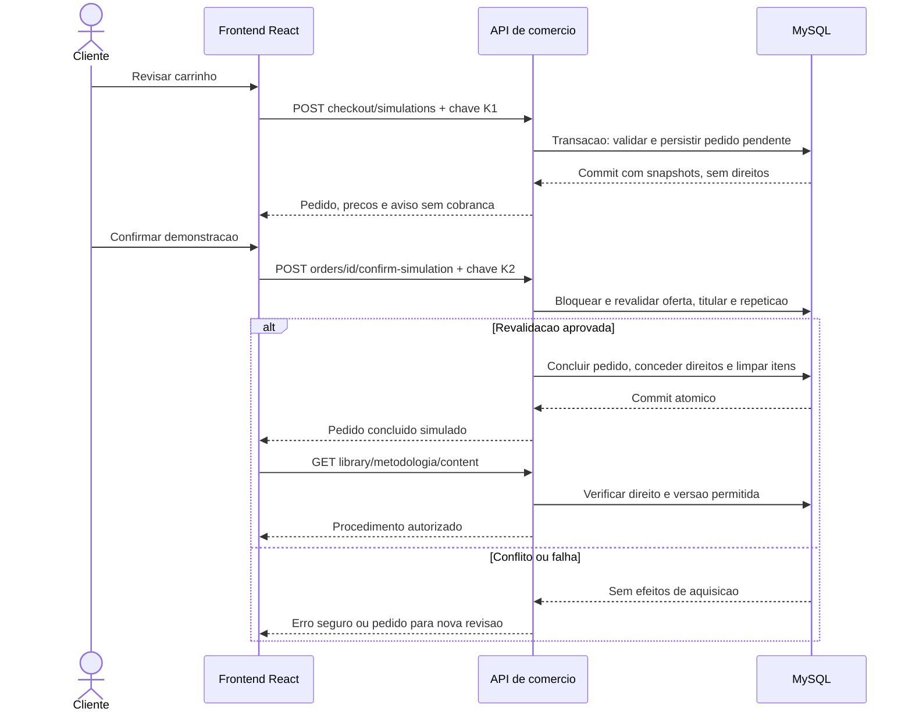
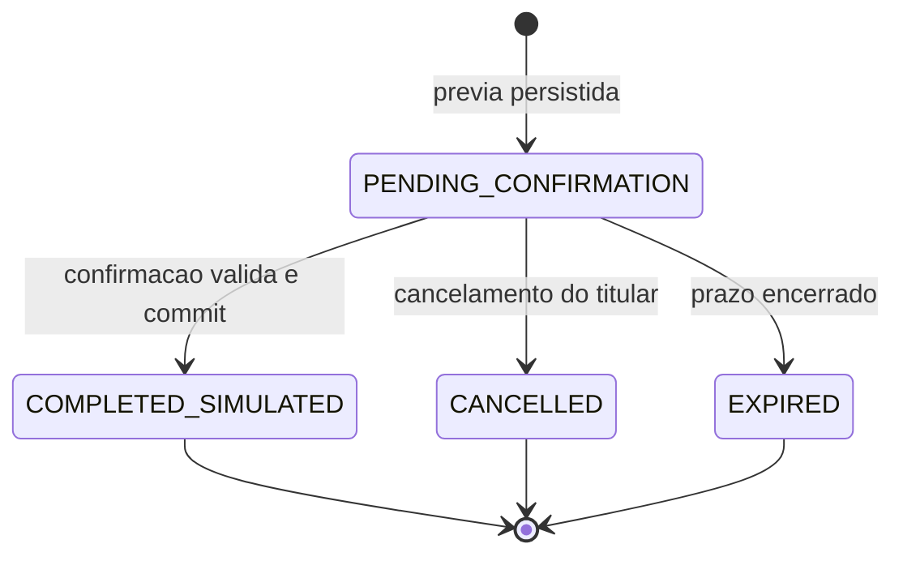

# E-commerce de conteúdo digital — proposta para o MVP

**Estado:** ofertas, preços e carrinho implementados em A13; checkout demonstrativo, pedidos e registro de direitos implementados em A14. Biblioteca e condições comerciais definitivas continuam propostas, sem integração financeira. Regras A/P/V: [especificação](../especificacoes/MVP-WIKI-CHEM-v1.md). Complementos: [modelo](MODELO-DADOS.md), [API](ARQUITETURA-MVP.md) e [roadmap](../planejamento/ROADMAP-MVP.md).

## 1. Unidade comercial e significado da demonstração

A metodologia individual é a unidade comercial principal. Produto único por metodologia e quantidade um foram adotados em A13; a regra de aquisição por usuário/metodologia permanece proposta em P04 para pedidos/direitos. Pacotes, assinaturas, upgrade pago e pagamento real não são alternativas já implementadas.

O checkout deve exibir **“DEMONSTRAÇÃO — SEM COBRANÇA”** na revisão, confirmação, resultado e histórico. O botão implementado é “Confirmar aquisição de demonstração”. O pedido usa mode SIMULATED e conclusão COMPLETED_SIMULATED, nunca PAID. Não coletar cartão, documento financeiro, endereço de faturamento ou chave de pagamento, nem escolher/chamar gateway. O acesso concedido é real dentro da demonstração; a cobrança não existe.

BRL e preços individuais são orientações A03/A05. Valores comerciais, faixas e condições só poderão ser cadastrados após V05; números de fixtures não são oferta real. Total do MVP é a soma de itens de quantidade um, sem frete, cupom ou parcelamento. Questões tributárias/contratuais para eventual operação comercial real exigem validação específica e não estão aprovadas aqui.

### 1.1 Valores fictícios para fixtures de desenvolvimento

**DEMONSTRAÇÃO — DADOS FICTÍCIOS DE DESENVOLVIMENTO, SEM COBRANÇA OU VALIDADE COMERCIAL.** As identidades abaixo são produtos sintéticos de software, não preços das candidatas C01–C05 nem política de precificação. A tabela fornece valores para testes isolados de ofertas/carrinho; não cria seed, oferta, procedimento, referência, autor ou autorização.

| Fixture | Nome sintético | amountCentavos (string) | currency | Exibição de demonstração |
| --- | --- | --- | --- | --- |
| FX01 | Produto DEMO 01 | `"1000"` | BRL | R$ 10,00 |
| FX02 | Produto DEMO 02 | `"1750"` | BRL | R$ 17,50 |
| FX03 | Produto DEMO 03 | `"2250"` | BRL | R$ 22,50 |
| FX04 | Produto DEMO 04 | `"3000"` | BRL | R$ 30,00 |
| FX05 | Produto DEMO 05 | `"4000"` | BRL | R$ 40,00 |

Casos monetários verificáveis: FX01 + FX02 totalizam `"2750"` (R$ 27,50); as cinco totalizam `"12000"` (R$ 120,00). Em cenário isolado de alteração de preço, FX01 muda de `"1000"` para `"1250"` (R$ 12,50): antes da confirmação, nova prévia é exigida; depois de uma aquisição já concluída a `"1000"`, o item histórico permanece nesse valor. Publicar atualização não cria nova cobrança.

As fixtures implementadas em testes recusam produção; qualquer carregador futuro deve exigir ativação explícita apenas em dev/test, com marcador visível DEMO e bloqueio de carregamento em produção; não serão migrações de dados comerciais. Não atribuir estes preços às metodologias reais por correspondência de numeração. A tabela monetária não define campos de licença/revisão como aprovados: testes unitários podem isolar dependências com doubles identificados, mas publicação e integração completas precisam de conteúdo original/autorizado e condições de uso efetivamente validadas em V02. Nunca aprovar fonte fictícia ou pular a proteção editorial apenas para fazer checkout passar em testes. Não existe carregador ou seed comercial da aplicação.

O comportamento executável de oferta/carrinho, sem compra, está em [Ofertas e carrinho](OFERTAS-CARRINHO.md). As seções de pedidos e direitos abaixo permanecem propostas. Preços reais e autorização de corpus não são presumidos por testes.

## 2. Oferta, versão e direitos

| Regra proposta | Consequência |
| --- | --- |
| Venda depende de produto ativo, preço corrente, metodologia publicada e versão revisada/permitida | Rascunho, produto sem preço e versão suspensa não são compráveis |
| Pedido fixa produto, versão, referência de preço e snapshots | Histórico não muda com preço, título ou versão novos |
| Direito ACTIVE é por usuário/metodologia (P03, pendente de V03) | Permite original, histórico publicado e atualizações publicadas da mesma metodologia sem nova compra; nova publicação não modifica direito, pedido ou preço histórico |
| Item adquirido não entra novamente no carrinho | UI mostra “Na minha biblioteca”; backend rejeita tentativa direta, inclusive versão nova da mesma metodologia |
| Direitos revogados não autorizam recompra automática | Exibir estado e orientação; tratamento/possível restauração precisa de V03/V09, não contornar por nova compra |
| Retirada de venda difere de suspensão de acesso (P06) | Retirada não apaga direito/versão; suspensão expressa por impedimento de uso bloqueia procedimento e é auditada |

Referências e condições de uso são revisadas antes de publicar. Não inferir que citar uma fonte permite reproduzir seu procedimento comercialmente. Mudança conhecida de permissão exige revisão/suspensão das versões afetadas, sem apagar a história de compra. O alcance/duração do acesso e textos correspondentes dependem de V02/V03/V06; esta proposta não promete licença perpétua nem transfere direitos sobre obras de terceiros.

Na biblioteca, a leitura padrão resolve a versão corrente publicada; selecionar `versionId` permite versão já publicada da mesma metodologia. O pedido sempre preserva a versão originalmente adquirida, inclusive seu rótulo, data e valor de compra. A proposta abrange também o histórico publicado; rascunhos e versões de outra metodologia não são atualizações elegíveis. Atualização suspensa continua bloqueada, e o backend não troca silenciosamente para outra versão. Seleção explícita de uma histórica ALLOWED continua possível com direito ativo. Revogação do direito/bloqueio da conta impede todas as versões. O recorte demonstrativo está autorizado em A15; duração e exceções comerciais definitivas continuam pendentes em V03.

## 3. Fluxo de compra em duas etapas (P05 adotado em A14)

1. Cliente autenticado edita carrinho próprio; cada alteração efetiva incrementa revision. Exibir preço atual e problemas de disponibilidade; valores ainda não estão reservados.
2. POST `/checkout/simulations` recebe cartRevision e chave idempotente. O servidor valida todos os itens e cria, na mesma transação, um pedido PENDING_CONFIRMATION e seus snapshots. Não há direito de acesso nesta etapa.
3. Revisão mostra exatamente os itens do pedido, suas versões, valores, prazo e indicação de demonstração. A14 adota prazo técnico padrão de 15 minutos, configurável; política comercial definitiva continua sujeita a V04. O relógio do servidor é a referência; usuário não define expiresAt.
4. Confirmação envia demoAcknowledged=true e outra chave idempotente. O servidor revalida e conclui de forma atômica. Nenhum reconhecimento no navegador concede direitos sozinho.
5. UI consulta o pedido persistido e a biblioteca; conteúdo completo é obtido por endpoint próprio autorizado, não vem na resposta da compra.

O pedido pendente é um snapshot independente da edição posterior do carrinho. Confirmá-lo exige mostrar novamente seus itens; editar o carrinho não altera silenciosamente esse pedido. Após conclusão, remover do carrinho apenas os produtos adquiridos, preservando outros itens adicionados nesse intervalo. Se oferta mudar, cancelar/abandonar a prévia antiga e criar outra com revisão explícita; não sobrescrever seu snapshot.

## 4. Máquina de estados

Pedido concluído não volta a pendente/cancelado por este contrato; não existe reembolso financeiro no MVP. Falha de validação/infraestrutura na confirmação não cria um estado de “pago” nem direito parcial. Conflito de preço deixa a prévia não confirmável até ser cancelada/expirar; a UI oferece nova revisão, sem substituir valores.

`expires_at` é a autoridade para impedir confirmação mesmo se o estado EXPIRED ainda não tiver sido materializado. Leitura apresenta estado efetivo e prazo encerrado; a próxima operação de escrita pode registrar EXPIRED e evento, sem direito. GET não concede acesso nem executa compra. Não é necessário configurar scheduler externo para que um prazo vencido seja respeitado. A suíte testa essa diferença temporal e a materialização idempotente.

## 5. Limites transacionais e ordem de bloqueios

Estratégia implementada no recorte A14: todas as mutações do carrinho/compra do mesmo usuário passam pelo bloqueio de sua linha em `users`, serializando sua aquisição. Após isso, ordem consistente: carrinho, pedido existente, produtos em ID crescente, metodologias em ID crescente e versões em ID crescente. Operações administrativas que afetem oferta/publicação usam a mesma ordem relativa produto → metodologia → versão. Preços publicados e itens históricos são imutáveis.

Bloqueios não substituem UNIQUE/FKs nem a revisão de deadlocks. A implementação deve demonstrar a estratégia em MySQL e usar retry limitado de transação quando apropriado. Não manter transação aberta enquanto o usuário lê/decide; as duas etapas acima são transações separadas.

### T1 — criar prévia persistida

1. Validar sessão ativa, CSRF, formato da chave e payload. BEGIN; bloquear usuário e confirmar estado da conta.
2. Consultar chave existente no escopo da operação. Replay válido devolve o mesmo pedido, sem criar outro; hash incompatível retorna 409.
3. Bloquear carrinho e conferir cartRevision, propriedade e não vazio; bloquear ofertas/conhecimento na ordem definida.
4. Exigir todos os itens vendáveis, sem metodologia já adquirida. Rejeitar integralmente se algum item falhar; não omitir itens nem recalcular um subconjunto em silêncio.
5. Ler preço/versionamento do servidor e validar limites/soma inteira BRL. Inserir pedido, itens/snapshots, evento e registro idempotente associado, tudo na transação.
6. COMMIT e retornar 201 com pedido pendente. Qualquer falha antes do commit faz rollback desses registros; nenhum direito é inserido em T1.

### T2 — confirmar demonstração

1. Validar sessão/CSRF/payload e BEGIN; bloquear usuário/carrinho/pedido e verificar propriedade antes de retornar replay/resultado.
2. Chave já persistida com mesmo hash devolve o mesmo recurso, sem efeitos novos. Pedido próprio já COMPLETED_SIMULATED também devolve sua conclusão, ainda que seja outra chave, sem nova concessão.
3. Para PENDING_CONFIRMATION, conferir prazo, acknowledgement e integridade dos itens. Cancelado/expirado não pode concluir. Expiração pode ser materializada como EXPIRED em transação sem efeitos de aquisição e resposta 409.
4. Bloquear produtos/metodologias/versões e revalidar disponibilidade, permissões, versão corrente e priceId contra snapshots. Qualquer mudança de preço/versão, mesmo redução de valor, exige nova prévia. Não confiar no valor que o cliente enviou ou exibiu.
5. Conferir ausência de aquisição anterior para **todos** os itens, incluindo outra confirmação concorrente. Em conflito, retornar 409 sem compra parcial. UNIQUE(user_id, methodology_id) é a última defesa contra duplicidade.
6. Atualizar pedido para COMPLETED_SIMULATED, inserir direito por metodologia de cada item com vínculo ao item original (sem fixar versão no direito), remover somente produtos concluídos do carrinho e incrementar sua revision quando necessário; gravar evento e registro idempotente. O item mantém o snapshot da versão inicialmente adquirida.
7. COMMIT único. Falha injetada em qualquer escrita da conclusão reverte pedido/direitos/carrinho/idempotência/evento de conclusão conjuntamente.

Invariantes: item do direito pertence ao pedido do usuário; versão pertence à metodologia do produto; preço pertence ao produto e é o snapshot aceito; total é soma íntegra. Não há estoque físico nem baixa em gateway. Escrever somente `status` do pedido e conceder direitos em uma requisição posterior não atende à consistência exigida.

## 6. Idempotência, concorrência e repetição

`Idempotency-Key` é obrigatório em T1/T2, com escopo `(user_id, operation, key_hash)`; UUID normalizado no recorte A14. `request_hash` deriva de representação canônica da rota/alvo/payload permitido; corpo com preço/userId arbitrário é inválido, não parte de uma compra autorizada.

| Caso | Comportamento proposto |
| --- | --- |
| Mesma operação/chave/hash já confirmada no banco | Mesmo orderId e código da operação; DTO pode refletir estado atual do pedido, não promete replay byte a byte de estado antigo; nenhuma nova escrita comercial |
| Mesma operação/chave com payload/alvo diferente de registro existente | 409 `IDEMPOTENCY_CONFLICT`, sem executar novamente |
| Falha com rollback antes de persistir resultado | Não fica chave órfã; cliente pode repetir a mesma intenção/chave; efeito não é presumido pelo navegador |
| Duas chaves confirmam o mesmo pedido | Uma conclusão; segunda devolve o mesmo pedido concluído, não concede direitos novamente |
| Dois pedidos pendentes distintos contêm a mesma metodologia | Podem existir sem direito; após o primeiro concluir, o segundo recebe 409 `ALREADY_OWNED`, sem concluir seus demais itens |
| Duas abas/chaves compram simultaneamente | Bloqueio por usuário e unicidade serializam e impedem duplicidade; teste real com concorrência é obrigatório |
| Produto/preço/versão muda durante confirmação | Ordem de locks coordena com admin; confirmar snapshot validado ou retornar conflito, nunca misturar versão/preço de momentos diferentes |

Registro idempotente só fica persistido com resultado transacional bem-sucedido da operação. Em erro de negócio com rollback, não se promete memória permanente de uma chave rejeitada. Proposta inicial: não expurgar registros de operações concluídas no MVP até aprovação da retenção em V06; unicidade de direitos e estado do pedido continuam protegendo compras mesmo após eventual política futura de expurgo.

## 7. Interrupções e mensagens

| Situação | Código/estado | Recuperação |
| --- | --- | --- |
| Carrinho vazio/entrada inválida | 400 `EMPTY_CART`/`VALIDATION_ERROR` | Retornar ao carrinho, sem pedido vazio |
| Carrinho alterado antes de criar pedido | 409 `CART_CHANGED` | Recarregar e revisar; não enviar revisão antiga automaticamente |
| Já adquirido, inclusive após atualização | 409 `ALREADY_OWNED` | Oferecer biblioteca e atualizações publicadas sem recompra; remover conflito do carrinho só por ação explícita |
| Oferta ou versão alterada/suspensa | 409 `OFFER_CHANGED`/`PRODUCT_UNAVAILABLE` | Nova prévia após revisão; sem compra parcial |
| Prazo encerrado | 409 `ORDER_EXPIRED` | Criar outra prévia com valores atuais; sem direito antigo |
| Cancelamento voluntário | CANCELLED | Preservar itens no carrinho; não conceder direito |
| Sessão expirada | 401 | Login; consultar pedido/carrinho próprios e exigir nova ação; nenhum auto-confirm |
| Resposta perdida após commit | Resultado desconhecido no cliente | Consultar orderId conhecido ou repetir mesma chave; não usar chave nova para “tentar de novo” sem verificar |
| Falha temporária/deadlock após retries internos limitados | 503 `CHECKOUT_RETRYABLE` | Orientar retentativa da mesma intenção/chave; sem afirmar sucesso sem commit |
| Sem direito ao conteúdo | 403 `PURCHASE_REQUIRED` | Mostrar prévia/compra ou biblioteca conforme estado, sem procedimento no erro |
| Conteúdo adquirido suspenso | 403 `CONTENT_SUSPENDED` | Informar indisponibilidade, preservar histórico e indicar tratamento administrativo; sem prometer reembolso/prazo legal |

## 8. Critérios de aceitação comercial e evidências futuras

Testes transacionais mínimos: T1 válido sem direito; confirmação concedendo todos os direitos; preço/versão alterados; indisponibilidade antes/durante a transação; rollback entre escritas; repetição com mesma/diferente chave; dois pedidos concorrentes; mesmo produto duas vezes; aquisição já existente; expirado/cancelado; resposta perdida depois do commit; isolamento de pedidos/biblioteca entre dois usuários; suspensão versus mera retirada de venda; preservação do preço e versão após edição do catálogo.

Testes de não exposição usam marcador de teste exclusivo em conteúdo de origem permitida e verificam que busca/prévia/pedido/erros/bundle não o contêm. Acesso integral falha sem aquisição, sessão ou direito ativo. Alterar versionId para outra versão publicada e permitida da mesma metodologia é operação legítima; trocar para rascunho ou outra metodologia deve falhar. Logout/expiração/revogação bloqueiam a requisição, sem expor conteúdo no erro.

### 8.1 Testes da política metodológica proposta

Em ambiente isolado, com conteúdo original/autorizado de V02 e valores apenas de fixture: adquirir metodologia na versão v1 e guardar orderId/item, preço e rótulo originais; publicar v2 com revisão; verificar biblioteca/current e leitura padrão v2, seleção explícita de v1 e outras históricas publicadas permitidas, sem novo pedido, direito ou cobrança. Alterar preço de catálogo não modifica snapshot. Nova tentativa de compra da metodologia recebe ALREADY_OWNED, não uma oferta de upgrade pago.

Testar ainda: v3 DRAFT ausente da lista/retorno integral; versão publicada de outra metodologia negada; versão atual SUSPENDED negada por padrão sem fallback silencioso; seleção explícita de v1 ALLOWED permitida; direito REVOKED ou usuário bloqueado negando todas as versões. Esses cenários têm implementação e testes no recorte demonstrativo A15. P09 está adotada no fluxo editorial; P03 continua pendente como política comercial definitiva.

Conjunto editorial, preços reais, duração/escopo do direito, atualizações, suspensão, limites e textos de demonstração ainda precisam de V02–V06/V09. Os valores fictícios da seção 1.1 são exclusivamente fixtures; não são política comercial. Este documento não cria referências ou autorizações fictícias nem aprova regras legais; o [roadmap](../planejamento/ROADMAP-MVP.md) transforma os cenários aprovados em tarefas pequenas.

## Aquisição implementada e fronteira da biblioteca

[Checkout demonstrativo](CHECKOUT-DEMONSTRATIVO.md) consolida contratos e comportamento executável deste recorte. As rotas e regras de leitura da biblioteca estão implementadas em A15, conforme [Biblioteca digital](BIBLIOTECA-DIGITAL.md). A política de direito por metodologia é usada exclusivamente para a demonstração autorizada; P03/V03 continuam pendentes quanto a condições comerciais. Nas prévias, aquisição já registrada mostra “Na minha biblioteca” e impede nova adição ao carrinho.
