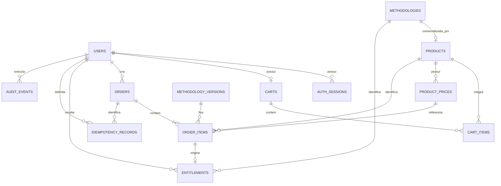
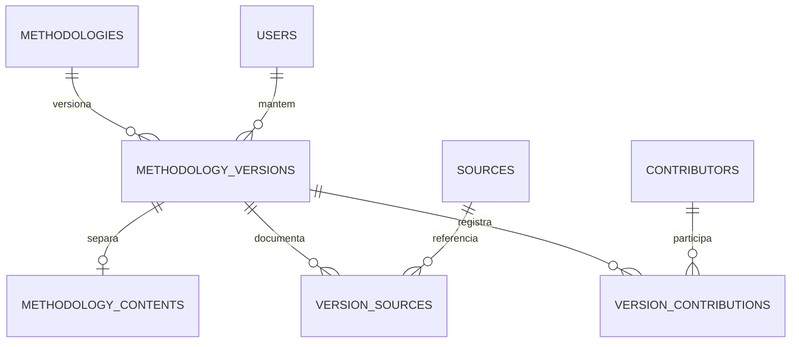
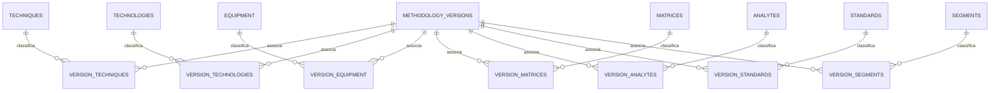

# Modelo de dados proposto — Wiki-Chem

**Estado:** modelo de negócio planejado. O esquema implementado contém infraestrutura, identidade e conhecimento editorial, incluindo sete taxonomias e associações N:N por versão. Entidades comerciais continuam planejadas. Referências: [especificação e decisões](../especificacoes/MVP-WIKI-CHEM-v1.md), [API](ARQUITETURA-MVP.md) e [transações](ECOMMERCE.md). A01–A12 orientam o escopo; P03 e condições comerciais continuam pendentes; identidade mínima e fluxo editorial estão adotados em A10/A11.

## 1. Convenções e limites

MySQL relacional, mecanismo transacional com FKs, datas UTC e migrações versionadas na implementação futura. Proposta: PKs BIGINT UNSIGNED, serializadas como strings na API; nomes abaixo são lógicos. MySQL 8.4, mysql2/promise e migrações SQL controladas são decisões adotadas. Colações, tipos e constraints dos futuros agregados serão detalhados nas migrações correspondentes.

Valores monetários em BIGINT de centavos e currency fixa BRL, serializados como strings decimais para evitar perda de precisão em JavaScript. Soma/cálculo no servidor com aritmética inteira e validação de overflow. Proposta de ofertas MVP: valor positivo, sem descontos/quantidade variável; gratuidade/faixa e preços reais dependem de V05. Os valores FX01–FX05 em [ECOMMERCE](ECOMMERCE.md) são apenas fixtures monetárias de desenvolvimento, sem vincular preços às candidatas reais. A fundação não carrega dados de catálogo.

As relações de conhecimento são normalizadas. Snapshots de título, versão e valor nos itens de pedido são **redundância intencional de fatos da aquisição**, imutáveis, não uma cópia do catálogo atual nem do procedimento. Identidade de produto/metodologia/versão não pode ser reaproveitada.

## 2. Entidades e relacionamentos — comércio e identidade

Cada item pendente pode originar zero direitos; item concluído simulado deve originar exatamente um, por invariantes transacionais. Um usuário pode não ter carrinho ainda. Pedido persistido é criado com um ou mais itens na mesma transação; não se permite pedido vazio.

| Entidade | Campos essenciais propostos | Chaves/regras |
| --- | --- | --- |
| `users` | id, display_name, email_normalized, password_hash, role, status, provisioned_by nullable, created_at, updated_at | UNIQUE(email_normalized); role CUSTOMER/ADMIN; status ACTIVE/BLOCKED; cliente não edita papel |
| `auth_sessions` | id, user_id, token_hash, issued_at, last_seen_at, expires_at, revoked_at | UNIQUE(token_hash); FK user; token de autenticação original não armazenado; CSRF derivado por HMAC do segredo da sessão, sem persistência em claro; prazos em [Identidade](IDENTIDADE.md) |
| `carts` | id, user_id, revision, created_at, updated_at | UNIQUE(user_id); um carrinho reutilizável por usuário; revision incrementa em alteração efetiva |
| `cart_items` | cart_id, product_id, added_at | PK(cart_id, product_id); quantidade implicitamente um; sem preço confiado ao cliente |
| `products` | id, methodology_id, active, current_price_id nullable, revision, created_at, updated_at | UNIQUE(methodology_id); ponteiro de preço deve pertencer ao próprio produto; inativo até oferta válida |
| `product_prices` | id, product_id, amount_centavos, currency, created_by, created_at | Preço imutável; currency BRL; histórico append-only; ativação do ponteiro é transacional |
| `orders` | id, user_id, status, mode, currency, total_centavos, cart_revision_snapshot, created_at, expires_at, completed_at nullable, cancelled_at nullable | mode SIMULATED; status PENDING_CONFIRMATION/COMPLETED_SIMULATED/CANCELLED/EXPIRED; total igual à soma dos itens |
| `order_items` | id, order_id, product_id, methodology_version_id, price_id, title_snapshot, version_label_snapshot, unit_amount_centavos, quantity, line_total_centavos | UNIQUE(order_id, product_id); quantity=1; line_total=unit_amount; preço/versão pertencem ao produto/metodologia; campos comerciais imutáveis |
| `entitlements` | id, user_id, methodology_id, order_item_id, status, granted_at, revoked_at nullable, reason nullable | UNIQUE(user_id, methodology_id); UNIQUE(order_item_id); direito metodológico, sem FK que o fixe a uma versão; origem/versão original derivadas do item imutável; ACTIVE/REVOKED; P03/V03 ainda pendentes |
| `idempotency_records` | id, user_id, operation, key_hash, request_hash, order_id, response_status, created_at | UNIQUE(user_id, operation, key_hash); somente efeitos concluídos da operação ficam persistidos; rollback remove reserva nova; não guardar conteúdo pago ou credencial na resposta |
| `audit_events` | id, actor_user_id, action, target_type, target_id, request_id, safe_metadata, occurred_at | Trilha de escrita relevante e acesso editorial integral; sem senha/token/procedimento; retenção em V06/V09 |

Índices compostos/FKs devem garantir o pertencimento de preço ao produto e versão à metodologia quando possível. Demais invariantes entre pedido/item/usuário/direito exigem checagem e escrita no caso de uso transacional: **uma FK isolada não prova que o dono do pedido é o dono do direito**. V07 deve traduzir essas invariantes para constraints compostas e testes de integração.

## 3. Entidades e relacionamentos — conhecimento editorial

| Entidade | Campos essenciais propostos | Regras |
| --- | --- | --- |
| `methodologies` | id, slug, lifecycle, current_published_version_id nullable, created_by, created_at | UNIQUE(slug); DRAFT/PUBLISHED/RETIRED; ponteiro só aceita versão própria publicada com revisão registrada; aposentadoria bloqueia venda, não apaga versões/direitos |
| `methodology_versions` | id, methodology_id, version_label, title, free_summary, public_description, changelog, editorial_status, access_state, revision, created_by, reviewed_by, reviewed_at, reviewed_revision, review_note, published_at | UNIQUE(methodology_id, version_label); somente DRAFT/PUBLISHED/SUPERSEDED no fluxo editorial mínimo; revisão e publicação registradas juntas; access_state ALLOWED/SUSPENDED independente; publicada é imutável |
| `methodology_contents` | version_id, full_description, full_procedure, content_format | PK/FK version_id; representação integral separada; rascunho pode ainda não tê-la, publicação exige conteúdo; acesso só por caso de uso autorizado |
| `sources` | id, reference_text, source_type, canonical_url nullable, owner_credit, edition_label nullable | Origem verificável, sem inventar referência; fonte pode ser registro de autoria original comprovada; nova edição/origem cria identidade distinta |
| `version_sources` | version_id, source_id, locator, usage_conditions_snapshot, permission_status, permission_evidence_ref nullable, checked_by, checked_at | PK(version_id, source_id); PENDING/APPROVED/REJECTED; ligação registra condições da versão; evidência administrativa não entra no DTO de prévia |
| `contributors` | id, display_name, contributor_type, reference nullable, linked_user_id nullable | Pessoa/organização identificada; vínculo opcional com usuário de administração, sem inventar autores |
| `version_contributions` | version_id, contributor_id, contribution_role, recorded_at | PK(version_id, contributor_id, contribution_role); AUTHOR/CURATOR para atribuição; revisão obrigatória identificada em reviewed_by/at/note, sem cadastro duplicado obrigatório de revisor/contribuidor; independência de pessoas depende de V09 |

`sources` guarda referências e atribuição, não cópia integral automática do material. Corrigir conteúdo publicado, referência, contribuição ou vínculo técnico com impacto exige nova versão; versões antigas e suas condições permanecem rastreáveis. Suspensão administrativa de acesso é um estado separado e auditável, não alteração silenciosa do texto publicado. Mudança da condição de uso de uma origem exige avaliar versões afetadas antes de mantê-las disponíveis.

Produto e metodologia são entidades distintas: disponibilidade/preço comercial não pertence ao texto técnico, e conteúdo pode existir como rascunho sem produto ativo. P03 propõe direito por metodologia: publicar atualização muda o ponteiro corrente, sem alterar direito, pedido ou preço histórico e sem emitir nova aquisição. O item de pedido mantém `methodology_version_id`, título e rótulo originais; o direito não armazena uma versão corrente mutável.

A versão original é obtida de `entitlements.order_item_id` → `order_items.methodology_version_id`. A versão de leitura padrão vem de `methodologies.current_published_version_id`. Uma versão selecionada só é elegível se pertence à mesma metodologia, já foi publicada (PUBLISHED/SUPERSEDED e published_at registrado) e está ALLOWED; exige também usuário/sessão e direito ACTIVE. A proposta inclui histórico publicado e atualizações futuras da mesma identidade metodológica; nunca rascunho ou versão de outra metodologia. Suspensão da versão atual não autoriza fallback silencioso; o cliente pode selecionar explicitamente outra versão publicada permitida.

P09 simplifica revisão para o ato de publicação: conferir expectedRevision e completude, registrar responsável da sessão/nota/revisão de conteúdo aceita e publicar atomicamente. Não há estado IN_REVIEW nem APPROVED de versão; o enum APPROVED em `version_sources.permission_status` continua sendo evidência de condição de uso, não fase editorial nem autorização criada por fixtures. Fonte pendente bloqueia publicar. O mesmo admin pode curar/revisar/publicar no recorte A11 adotado; demais responsabilidades de governança permanecem em V09. Alteração de texto publicado cria rascunho novo.

Os campos de revisão são nulos enquanto DRAFT e obrigatórios ao publicar; `reviewed_by` referencia `users` e vem da sessão, não do payload. `reviewed_revision` identifica a revisão de conteúdo aceita pelo publish. Mudanças administrativas posteriores de suspensão não reescrevem esse registro de revisão nem os snapshots de compra.

## 4. Sete taxonomias e relações N:N por versão

Não usar coluna com CSV/array de IDs ou um único valor por metodologia. Cada faceta tem tabela própria e tabela associativa; uma metodologia é filtrada pelos vínculos de sua **versão publicada corrente**, sem combinar termos de versões diferentes.

| Faceta e tabela | Significado a validar em V01 | Associação (PK composta + duas FKs) |
| --- | --- | --- |
| Técnica — `techniques` | Classe de abordagem analítica, com vocabulário curado | `version_techniques(version_id, technique_id)` |
| Tecnologia — `technologies` | Princípio/variante tecnológica aplicada, distinto da técnica e do equipamento | `version_technologies(version_id, technology_id)` |
| Equipamento — `equipment` | Tipo/modelo de instrumento aplicável, sem catálogo de fabricante inventado | `version_equipment(version_id, equipment_id)` |
| Matriz — `matrices` | Material/contexto da amostra | `version_matrices(version_id, matrix_id)` |
| Analito — `analytes` | Alvo da determinação e identificadores aprovados pela curadoria | `version_analytes(version_id, analyte_id)` |
| Norma — `standards` | Documento normativo identificado e edição específica; não declarar vigente sem verificação | `version_standards(version_id, standard_id)` |
| Segmento — `segments` | Setor/contexto de aplicação | `version_segments(version_id, segment_id)` |

Tabelas de termos: id, code único, label, normalized_label, active e timestamps. Normas também têm issuer, identifier, edition_label e verified_status; issuer/identifier/edition_label são obrigatórios no termo curado, com UNIQUE(issuer, identifier, edition_label) e nenhum “vigente” inferido automaticamente. Edição desconhecida permanece pendência editorial, não um termo com edição fictícia ou NULL que contorne a unicidade. Casos sem norma aplicável têm zero vínculos e justificativa editorial; ausência de informação não deve ser convertida em norma fictícia. Outros campos não aplicáveis também exigem distinção de desconhecido na revisão.

Deprecar termo impede novas seleções, mas preserva vínculos históricos. Alterar significado/edição exige novo termo; correção meramente editorial é auditada e não pode mudar a interpretação da versão adquirida. Synonyms/aliases e hierarquias não são uma oitava faceta; só serão detalhados se V01 os aprovar.

## 5. Invariantes de integridade

| ID | Invariante e evidência futura necessária |
| --- | --- |
| MD01 | E-mail normalizado único e papel de registro sempre cliente; concorrência de dois cadastros não duplica conta |
| MD02 | Somente versão própria, completa e com origens autorizadas pode ser publicada com revisão explícita registrada na mesma transação; rascunho incompleto ou revisão concorrente divergente falha; versão/sources/taxonomias históricas não são sobrescritas |
| MD03 | Um produto por metodologia; preço corrente pertence ao produto e é imutável; atualização de preço cria registro e incrementa revision da oferta |
| MD04 | Um produto por carrinho e por pedido; quantidade um; nenhum pedido persistido vazio; total de snapshot igual à soma dos itens, currency BRL |
| MD05 | Direito associa usuário do pedido e metodologia do produto; item de origem preserva versão/valor originais. Pedido deve estar COMPLETED_SIMULATED e concessão ser atômica; leitura pode resolver outra versão publicada da mesma metodologia sem alterar o item |
| MD06 | UNIQUE(user_id, methodology_id) impede recompra; atualização publicada não cria pedido/direito novo nem nova cobrança. REVOKED não autoriza recompra automática. P03/V03 seguem pendentes de aprovação |
| MD07 | Reservas idempotentes, pedido confirmado, direitos, limpeza seletiva de carrinho e evento de conclusão têm destino atômico; nenhuma falha intermediária concede acesso parcial |
| MD08 | Conteúdo completo não aparece nos DTOs de prévia/itens/pedidos, nem no índice de busca textual; teste de não exposição deve procurar marcadores exclusivos do procedimento |
| MD09 | FKs históricas usam restrição de exclusão; desativação lógica não destrói compra. Retenção/anonimização de usuários depende de V06, sem presumir deleção em cascata como regra legal |

Os estados e controles comerciais estão detalhados em [ECOMMERCE](ECOMMERCE.md). Regras entre agregados que não couberem em CHECK/FK são responsabilidade explícita do caso de uso e de seus testes; não presumir que “normalizado” sozinho garanta autorização ou atomicidade.

## 6. Índices e consistência de pesquisa

As sete associações já possuem PKs compostas e índices inversos (term_id, version_id), usados por EXISTS na pesquisa. A consulta reutiliza o esquema editorial e não exige nova migração. Índices por usuário/data/ID em pedidos/direitos e chave idempotente composta continuam propostos para comércio. Para paginação/ordenação, medir plano de execução com o conjunto V01/V08. Não prometer performance ou selecionar mecanismo de busca antes dos volumes aprovados.

[Pesquisa implementada](PESQUISA-METODOLOGIAS.md) considera apenas campos gratuitos autorizados da versão corrente. LIKE literal parametrizado trata acentos/caixa e termos curtos, sem índice no conteúdo integral. As colações e a normalização devem ser verificadas com termos curtos, acentos e símbolos do conjunto aprovado. FULLTEXT, se usado, não pode suprimir silenciosamente esses casos; LIKE parametrizado com escape literal pode ser necessário no recorte inicial. Não há embedding, vetor ou índice de procedimento pago.

## 7. Questões de modelagem que precisam de aprovação

P03/V03: direito metodológico com histórico/atualizações e duração; P04/V04: repetição/carrinho; V02: candidatas, condições de fontes e revisão; V05: preços reais/gratuidade, separados das fixtures; V06: retenção e anonimização; V07: tipos físicos/colação/constraints/migrações e autenticação; A11: admin único e revisão na publicação adotados; demais decisões de governança permanecem em V09. Matriz técnica consolidada em [ARQUITETURA-MVP](ARQUITETURA-MVP.md). Não há seeds científicos, permissões fictícias ou ofertas comerciais reais nestes diagramas/tabelas.

## 8. Esquema físico implementado

A tabela schema_migrations registra version (PK textual), checksum SHA-256, status APPLYING/APPLIED, started_at e applied_at UTC. É infraestrutura, não dado comercial. A colação geral é utf8mb4_0900_ai_ci, com version/checksum ascii_bin. users, auth_sessions e as entidades editoriais da seção 9 estão migradas. As entidades comerciais permanecem como modelo de destino, sem tabelas instaladas.

Migrações de identidade: e-mail ASCII normalizado único, papéis CUSTOMER/ADMIN, estado ACTIVE/BLOCKED, token_hash único, FK restritiva e timestamps UTC. provisioned_by registra o responsável pelo bootstrap. Hash Argon2id contém salt/parâmetros, sem senha em claro; token original e CSRF não são persistidos. Detalhes em [Identidade](IDENTIDADE.md).

## 9. Persistência editorial implementada

[Catálogo editorial](CATALOGO-EDITORIAL.md) descreve as entidades executáveis: methodologies, methodology_versions, methodology_contents, sources, version_sources, contributors, version_contributions, version_reviews, audit_events, sete tabelas de termos e sete associações. version_classification_notes guarda justificativas sem misturar desconhecido e não aplicável. Fontes e contribuições usam fingerprint único para identidade imutável; revisão esperada controla edição. FK composta garante pertencimento do ponteiro corrente. deleted_at permite remoção lógica de rascunhos sem reutilizar identidade. Não há tabela de produto, preço, carrinho, pedido ou direito instalada por este recorte.
