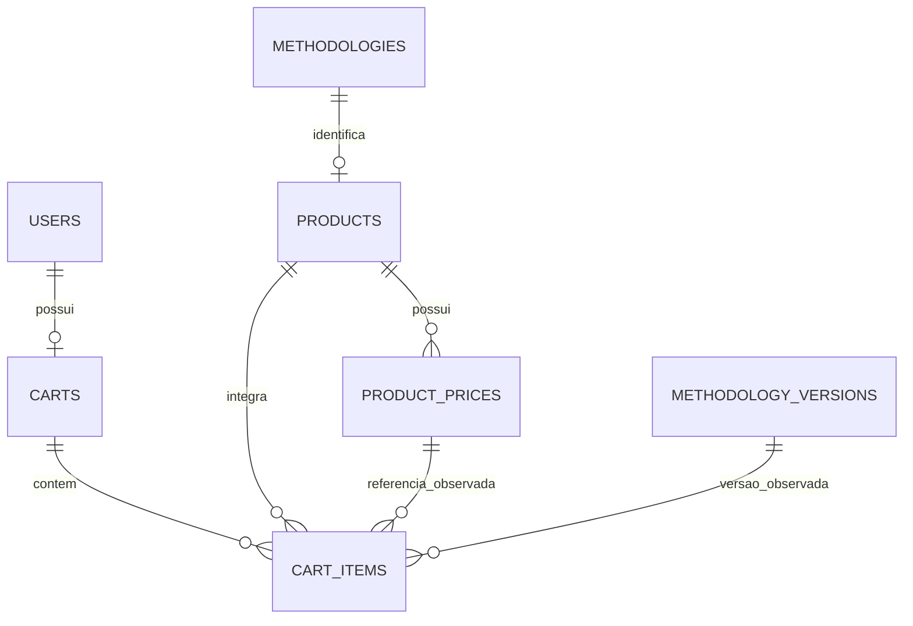
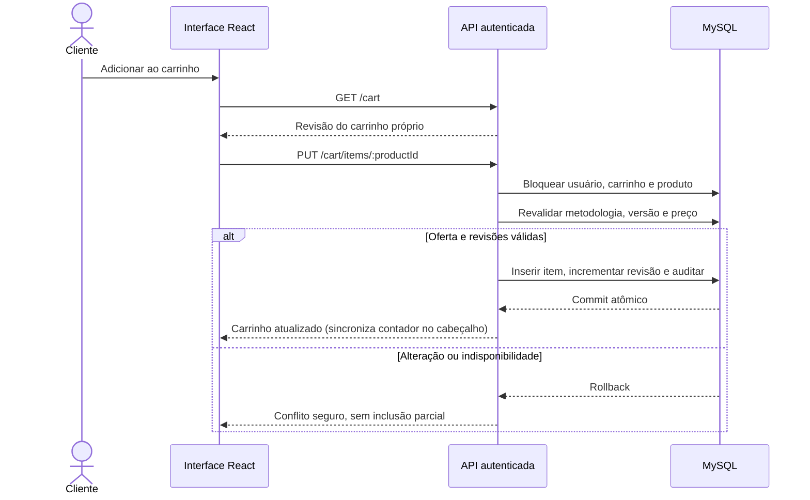

# Ofertas, preços e carrinho persistente

## Objetivo e recorte funcional

O sistema associa um produto digital original a cada metodologia elegível e apresenta preço BRL e ação de compra nos cartões compactos de pesquisa e na página de metodologia inspirada na ASTM (`/metodologias/:id`). O cabeçalho autenticado exibe o botão `Carrinho` com ícone e contador dinâmico de itens (`0`, `1`, `2`...), sincronizado por `CartSummaryProvider` em tempo real nas operações de inclusão, remoção e conclusão de pedido. Somente ofertas ativas com preço vigente e versão publicada corrente, revisada e permitida podem ser adicionadas ao carrinho.

A administração comercial permanece integrada à metodologia em `/admin` (acessível pelo menu `Perfil → Administração` exclusivamente para `ADMIN`). O cliente utiliza `/carrinho` para revisar valores atuais, identificar eventuais alterações e remover itens antes de prosseguir à revisão do pedido. Adicionar ao carrinho não realiza cobrança nem libera o conteúdo protegido antes da confirmação em `/checkout/:id`.

## Modelo físico e invariantes

`products` tem metodologia única, `active`, `current_price_id`, `revision` e datas UTC. O produto nasce inativo. `product_prices` registra centavos inteiros positivos, `BRL`, autor e data. O preço corrente pertence ao próprio produto por FK composta; triggers rejeitam `UPDATE` e `DELETE` de preços históricos. Arquivar uma metodologia (`RETIRED`) desativa automaticamente sua oferta (`active = FALSE`), retirando-a da vitrine sem apagar histórico de preços, pedidos ou direitos.

`carts` tem `user_id` único e `revision`. `cart_items` possui `PK(cart_id, product_id)`, quantidade unitária implícita, referência à metodologia, preço/versão/revisão observados e snapshots gratuitos. Revisão divergente resulta em `409`, preservando o estado anterior.

## Valores, configuração acadêmica e disponibilidade

Centavos trafegam como strings decimais (`1` a `9223372036854775807`), somados com `BigInt` no servidor e formatados sem ponto flutuante no frontend. No ambiente acadêmico demonstrativo (`NODE_ENV=test`, `DEMO_ALLOW=true`), os 15 guias técnicos autorais do Wiki-Chem (`WK-ANL-001` a `WK-ANL-015`) recebem valores padrão em BRL entre `R$ 29,00` e `R$ 68,00`, configuráveis pelas variáveis de ambiente `WIKICHEM_DEMO_DEFAULT_PRICE_CENTAVOS` (inteiro positivo em centavos) ou `WIKICHEM_DEMO_PRICES` (JSON por slug, aceitando centavos positivos ou `null` para manter uma ficha apenas como referência informativa pendente de produto autoral). A reconciliação demonstrativa bloqueia a criação de oferta comercial caso o conteúdo integral autoral esteja vazio, curto ou composto apenas por avisos genéricos.

O total informado no carrinho considera apenas itens disponíveis, preservando itens alterados ou indisponíveis com sinalização explícita (`PRICE_CHANGED`, `VERSION_CHANGED`, `OFFER_CHANGED`, `UNAVAILABLE`) e identificando metodologias já adquiridas (`owned: true`) com link direto para `/biblioteca/:methodologyId`, impedindo recompra duplicada.

## Contratos REST implementados

Prefixo `/api/v1`. Todos exigem sessão válida; escritas exigem origem permitida e CSRF.

| Método e recurso | Contrato |
| --- | --- |
| `GET /admin/products` | `ADMIN`; paginação padrão 20/máximo 100; filtro opcional `methodologyId` |
| `POST /admin/products` | `ADMIN`; `methodologyId`; cria produto inativo (`201`) |
| `GET /admin/products/:id` | `ADMIN`; produto, revisão, oferta e identificação gratuita da metodologia |
| `PATCH /admin/products/:id` | `ADMIN`; `active` e `expectedRevision`; valida elegibilidade antes de ativar |
| `POST /admin/products/:id/prices` | `ADMIN`; `amountCentavos`, `currency=BRL` e `expectedRevision` (`201`) |
| `GET /admin/products/:id/prices` | `ADMIN`; histórico paginado imutável com responsável e data |
| `GET /cart` | Carrinho próprio, revisão, itens, total atual em centavos e contagem de indisponíveis |
| `PUT /cart/items/:productId` | `expectedRevision`, `offerRevision`, `priceId` e `versionId` observados; retorna carrinho atualizado |
| `DELETE /cart/items/:productId` | Query `expectedRevision`, sem corpo; retorna carrinho atualizado |

## Transações e confidencialidade

Pesquisa, prévia e carrinho nunca consultam nem serializam `methodology_contents`, evidências privadas ou notas editoriais. O acesso ao texto técnico integral ocorre exclusivamente via [Biblioteca digital](BIBLIOTECA-DIGITAL.md) após conclusão do pedido em [Checkout demonstrativo](CHECKOUT-DEMONSTRATIVO.md).
