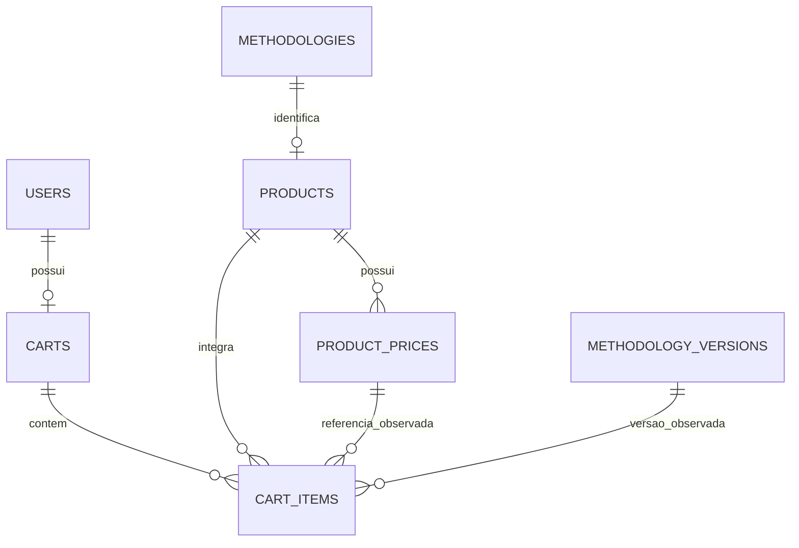
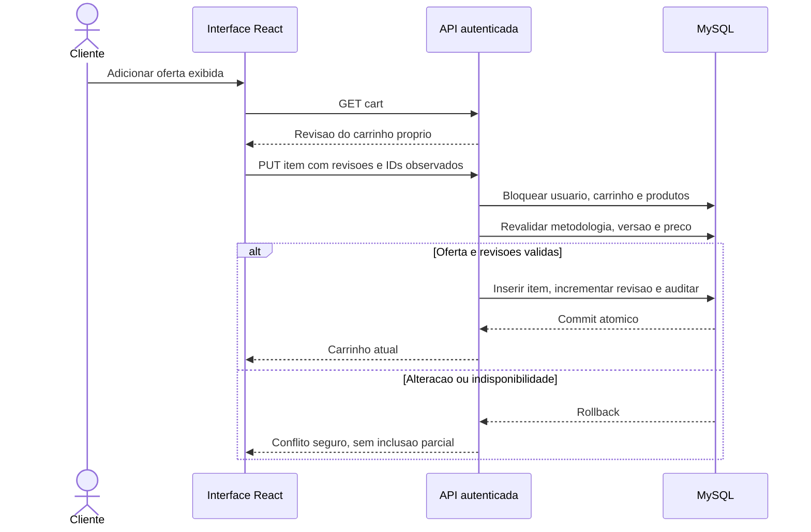

# Ofertas, preços e carrinho persistente

## Objetivo e recorte funcional

O sistema associa um produto digital a cada metodologia e apresenta preço BRL e disponibilidade nas prévias de pesquisa e detalhe. A metodologia continua pesquisável sem produto, preço ou oferta ativa; a elegibilidade editorial continua sendo a condição de recuperação da prévia. Somente ofertas com preço e versão publicada corrente, revisada e permitida podem ser adicionadas ao carrinho.

A administração comercial está integrada à metodologia em /admin. ADMIN cria produto inativo, cadastra novo preço, consulta histórico e ativa/desativa oferta. O cliente usa /carrinho para consultar valores atuais, identificar alterações e remover itens. Cabeçalho, retorno após login, carregamento, erros, revisão concorrente e navegação por teclado preservam os padrões de identidade e apresentação existentes.

Este recorte implementa a apresentação comercial de RF07, a estrutura de ofertas de RF09 e o carrinho de RF10. Não há checkout, confirmação, pedido, direito de leitura ou pagamento. Adicionar ao carrinho não reserva valores nem libera o procedimento. Preços reais, condições comerciais e direitos propostos continuam sujeitos a validação; a existência da estrutura não aprova conteúdo ou permissões reais das fontes.

## Modelo físico e invariantes

products tem metodologia única, active, current_price_id, revision e datas UTC. O produto nasce inativo. product_prices registra centavos inteiros positivos, BRL, autor e data. O preço corrente deve pertencer ao próprio produto por FK composta; cada sucessor é um novo registro. Triggers rejeitam UPDATE e DELETE de preços históricos, além da ausência dessas operações na API. O histórico não é reescrito ao alterar oferta ou publicar versão.

carts tem user_id único e revision. É criado na primeira mutação; uma leitura sem carrinho retorna uma representação vazia com revisão inicial 1. cart_items possui PK(cart_id, product_id), quantidade implicitamente um, referência à metodologia, preço/versão/revisão observados e snapshots de título/rótulo gratuitos. FKs compostas garantem que produto, preço e versão pertencem à mesma metodologia/produto. Esses registros de observação servem à revalidação; não são pedido nem aquisição.

A revisão do produto muda com novo preço, ativação/desativação e publicação/arquivamento/restauração editorial. Arquivar desativa a oferta; restaurar ou publicar não reativa uma oferta inativa. A revisão do carrinho muda somente com inclusão/remoção efetiva. Inclusão já existente e remoção ausente são idempotentes quando a revisão esperada é válida. Revisão divergente resulta em 409, preservando o estado anterior.

## Valores e disponibilidade

Centavos trafegam como strings decimais. O contrato aceita de 1 a 9223372036854775807, limite técnico de armazenamento, sem ponto flutuante, expoente, separadores ou zeros à esquerda. BRL é a única moeda. Esse limite não define faixa comercial aprovada; gratuidade e política de precificação real permanecem pendentes.

O servidor soma com BigInt. Há até 100 produtos por carrinho; a soma informativa pode alcançar 100 vezes o limite individual e permanece uma string exata, sem ser persistida em uma coluna monetária de pedido. A futura criação de pedidos deve validar seu próprio limite de armazenamento antes de confirmar qualquer aquisição. O frontend formata inteiros e centavos sem convertê-los para Number.

O total informado considera somente itens atualmente disponíveis. O carrinho também devolve unavailableCount e mantém todos os itens. Cada linha mostra valor observado, preço atual, versão adicionada, versão corrente quando permitida e problemas PRICE_CHANGED, VERSION_CHANGED, OFFER_CHANGED ou UNAVAILABLE. Preço/revisão observados não são atualizados por GET nem pela repetição de uma inclusão. A interface identifica os itens excluídos do total; nada é removido silenciosamente.

A prévia inclui offer nullable com productId, revision, active, priceId/amountCentavos nullable, currency, available e reason; purchasable indica elegibilidade atual de inclusão. Sem produto, offer é null. Produto sem preço, inativo ou conteúdo indisponível não autoriza inclusão. Não existe owned nem validação de compra anterior, pois ainda não há direitos/pedidos; isso deve ser implementado antes da confirmação demonstrativa.

## Contratos REST implementados

Prefixo /api/v1. Todos exigem sessão válida. Escritas exigem origem permitida e CSRF; JSON é obrigatório nos corpos de inclusão/administração. Remoção usa query e não tem corpo. IDs são strings decimais e Zod rejeita campos desconhecidos, inclusive userId, quantity, preço ou total no carrinho.

| Método e recurso | Contrato |
| --- | --- |
| GET /admin/products | ADMIN; paginação padrão 20/máximo 100; filtro opcional methodologyId |
| POST /admin/products | ADMIN; methodologyId; cria um único produto inativo e retorna 201 |
| GET /admin/products/:id | ADMIN; produto, revisão, oferta e identificação gratuita da metodologia |
| PATCH /admin/products/:id | ADMIN; active e expectedRevision; valida elegibilidade antes de ativar |
| POST /admin/products/:id/prices | ADMIN; amountCentavos, currency=BRL e expectedRevision; insere histórico e atualiza ponteiro atomicamente; retorna produto atualizado com 201 |
| GET /admin/products/:id/prices | ADMIN; histórico paginado, somente leitura, com responsável e data |
| GET /cart | Carrinho próprio, revisão, itens, total atual em centavos e contagem de indisponíveis |
| PUT /cart/items/:productId | expectedRevision do carrinho, offerRevision, priceId e versionId observados na prévia; quantidade um; retorna carrinho atualizado |
| DELETE /cart/items/:productId | Query expectedRevision, sem corpo; retorna carrinho atualizado |

A inclusão compara a oferta e versão da prévia com os registros correntes bloqueados. Alteração entre exibição e inclusão causa 409 OFFER_CHANGED; indisponibilidade causa OFFER_UNAVAILABLE. Os identificadores são precondições de comparação, não preços confiados ao cliente. Em nova leitura do carrinho, alterações posteriores aparecem como avisos por item com valores recalculados. Erros 401/403/400/404/409/503 seguem o formato seguro da API com requestId.

## Transações e proteção

Mutações do mesmo usuário bloqueiam users antes de carts e dos produtos em ID crescente. Operações comerciais/editoriais compartilham a ordem produto → metodologia → versão; publicação não disputa o produto depois de bloquear a metodologia. Restrições únicas/FKs complementam o bloqueio e as revisões. Deadlocks e espera excedida causam 409 EDIT_CONFLICT, com rollback e orientação para nova leitura; não há repetição ilimitada nem confirmação automática.

Leituras de carrinho e ofertas usam snapshot REPEATABLE READ; as respostas de mutação são montadas com leituras correntes sob os bloqueios da transação. Autor e proprietário vêm da sessão, nunca de userId recebido. O papel ADMIN é conferido também dentro da transação de escrita. Auditoria registra criação de produto/preço, ativação/desativação e mudanças efetivas no carrinho, sem procedimento, condições privadas, senha, token ou corpo da requisição. Publicação e arquivamento preservam a auditoria editorial correspondente.

Pesquisa, prévia e carrinho não consultam nem serializam methodology_contents, evidência privada ou notas editoriais. O histórico de preços é restrito a ADMIN; o cliente recebe apenas valores necessários à sua prévia/carrinho. Nenhum caminho desta implementação concede acesso ao conteúdo integral.

A criação dos triggers usa a conta operacional de migração, com privilégio TRIGGER e os requisitos de binary logging da instalação. O proprietário do trigger deve manter os privilégios necessários; a conta da API continua sem DDL. Referência: [MySQL 8.4 — CREATE TRIGGER](https://dev.mysql.com/doc/refman/8.4/en/create-trigger.html).

## Verificação e pendências

Testes de contrato e interface verificam centavos exatos, limites, moeda, campos privilegiados, produto sem preço, histórico, ativação e carrinho. A integração real cobre FKs, triggers imutáveis, revisões concorrentes, duplicidades, isolamento, persistência após nova sessão/recriação da API, preço/versão/disponibilidade alterados e ausência de conteúdo privado. Jornadas de navegador exercitam ofertas pelo administrador e carrinho pelo cliente, incluindo soma FX, rede, expiração, teclado e tela de 320 px.

FX01–FX05 são textos e valores originais sintéticos de teste, claramente DEMO, sem associação às candidatas EPA ou fontes de terceiros. A função de fixtures é exclusiva dos testes/desenvolvimento e recusa produção; não há seed comercial ou importação pelo código da aplicação. Publicação das fixtures passa pela revisão editorial real, com declaração de origem do próprio material de teste, sem forjar autorização científica externa.

Permanecem pendentes: corpus autorizado, vocabulário/curadoria científicos, preços reais e condições comerciais, política de aquisição/atualizações, tratamento de direitos revogados, limites de pedido e implantação/backup. O próximo incremento é a confirmação demonstrativa com pedidos e direitos transacionais, mediante validação das decisões correspondentes. Checkout, pagamentos, gateway, biblioteca e IA/RAG estão fora desta implementação.

### Resultados observados

A validação local aprovou 92 testes de unidade/contrato do backend e 67 testes de componentes/rotas do frontend. Build e análise estática passaram. Integração MySQL e navegador têm cobertura separada, sem presumir aprovação científica, comercial ou jurídica do corpus.
