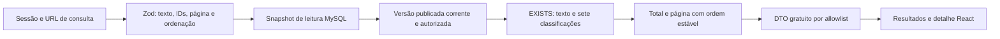

# Pesquisa autenticada de metodologias

## Objetivo e alcance funcional

A pesquisa permite recuperar prévias técnicas do catálogo MySQL sem depender de produtos, preços ou direitos de compra. A interface React em /consultas combina texto, sete classificações, ordenação e paginação. A página /metodologias/:id apresenta a prévia gratuita, fontes permitidas e autoria/curadoria. Ambas exigem sessão válida; a autorização é verificada novamente na API.

RF04–RF06 são implementados no recorte de recuperação editorial. RF07 agora inclui preço/disponibilidade da oferta cadastrada, conforme [Ofertas e carrinho](OFERTAS-CARRINHO.md), além dos metadados gratuitos. Sem oferta elegível, a interface informa “Oferta comercial ainda não disponível”. Não se presume compra ou direito adquirido. A pesquisa não depende de oferta ativa; não há dados científicos pré-carregados nem IA/RAG.

## Contrato e regras de seleção

GET /api/v1/methodologies aceita q, techniqueIds, technologyIds, equipmentIds, matrixIds, analyteIds, standardIds, segmentIds, page, pageSize e sort. IDs são strings decimais; cada valor de um filtro ocupa uma ocorrência do parâmetro. Exemplo exclusivamente estrutural: `?q=agua&analyteIds=1&analyteIds=2&matrixIds=3&page=1&pageSize=20&sort=title_asc`. Os IDs devem existir e estar ativos no banco; o exemplo não representa termos científicos ou dados instalados.

- OR entre valores de uma mesma categoria; AND entre as categorias e entre as palavras do texto.
- Cada palavra deve ocorrer em algum campo gratuito da mesma versão corrente: título, resumo, descrição pública, rótulo/código técnico ou identificação de norma, referência bibliográfica, crédito, edição ou localizador permitido. URL da fonte e contribuições não são campos de busca textual neste recorte.
- Texto de até 200 caracteres e 12 palavras, normalizado em NFC e com espaços consolidados. Comparação case/acento-insensível pela colação utf8mb4_0900_ai_ci. Não há stopwords nem comprimento mínimo de palavra. %, _ e ! são literais, com escape explícito; os demais símbolos são enviados sem interpretação química ou transliteração de fórmulas.
- Até 20 IDs distintos por categoria. CSV, IDs malformados, desconhecidos/inativos, parâmetros desconhecidos, duplicação de campos escalares e ordenações não previstas são rejeitados com 400.
- page começa em 1 e vai até 1000000; pageSize padrão 20, máximo 100. A resposta tem data, total, page e pageSize. Página além do total retorna lista vazia com total preservado e opção de voltar à primeira página.
- title_asc é o padrão; updated_desc ordena pela publicação da versão corrente. Ambos desempatam por ID da metodologia crescente. Não há ordenação por preço.

A elegibilidade exige metodologia não excluída e publicada, ponteiro para versão própria corrente, versão PUBLISHED/ALLOWED não excluída e fontes com condições aprovadas. Rascunhos, histórico substituído, suspensão, arquivamento ou condição de uso não aprovada não produzem resultados. GET /methodologies/:id aplica a mesma regra e retorna 404 para conteúdo indisponível. GET /taxonomies mantém as sete coleções ativas sem contagens dinâmicas.

## Arquitetura da consulta e proteção

O módulo de catálogo reutiliza a mesma montagem de DTO gratuito para listagem e detalhe. Não consulta methodology_contents, evidências privadas, condições internas ou notas de revisão para compor a pesquisa. Um marcador existente apenas no procedimento não afeta resultados nem total. Os filtros usam EXISTS e não multiplicam linhas quando há múltiplos analitos, matrizes ou fontes correspondentes.

SQL parametrizado trata texto, IDs e paginação como dados; somente nomes de tabela/coluna e ordenação de allowlists entram na estrutura SQL. Campos ASCII são convertidos para utf8mb4 na comparação, sem alterar seu armazenamento. Total, página e metadados são lidos em uma transação REPEATABLE READ explicitamente definida para aquela operação. Isso impede resultados de instantes diferentes dentro de uma resposta; requisições de páginas distintas ainda podem refletir novas publicações entre si.

As sete coleções de metadados, referências e contribuições são carregadas em lote por página; não há um conjunto adicional de consultas para cada resultado. São reutilizados os índices referenciais existentes. Não há migração de esquema adicional nem índice full-text neste recorte: LIKE literal evita descartar termos curtos, mas exige avaliação de desempenho com corpus e volume representativos. Não se declara capacidade de produção sem essa medição.

Referências de implementação: [MySQL 8.4 — conversão de caracteres](https://dev.mysql.com/doc/refman/8.4/en/cast-functions.html), [comparação de strings](https://dev.mysql.com/doc/refman/8.4/en/string-comparison-functions.html) e [isolamento InnoDB](https://dev.mysql.com/doc/refman/8.4/en/innodb-transaction-isolation-levels.html).

## Experiência, erros e rastreabilidade

A URL registra somente critérios gratuitos, repetindo os parâmetros multivalorados. O formulário aplica as seleções por botão; remover uma seleção aplicada ou limpar a consulta redefine a página. A navegação do detalhe devolve ao estado anterior da consulta. Atualizar a página e voltar/avançar no navegador restauram os parâmetros. Retorno após login e link de volta aceitam destinos internos conhecidos, impedindo redirecionamento externo.

Mudanças de consulta desmontam o estado anterior; respostas obsoletas são descartadas. Carregamento, lista vazia, página vazia, erro de parâmetros, falha de rede e prévia indisponível têm mensagens e recuperação explícitas. Em 401 o contexto de autenticação remove a sessão da interface e encaminha ao acesso, preservando o retorno seguro. Nenhum erro gera metodologia, fonte, preço ou confirmação substituta.

Formulários usam rótulos nativos, fieldsets/legendas para as sete categorias, checkboxes múltiplos, status de carregamento/resultados, mensagens de erro e foco visível. Layout e detalhes permitem quebra de textos longos em telas de 320 px. Conteúdo é texto simples renderizado pelo React; links de referências aceitam somente HTTP(S) sem credenciais.

## Verificação e limites de conteúdo

Os testes verificam cada filtro, combinações OR/AND, múltiplos analitos/matrizes, correspondência entre campos gratuitos, caixa/acentos/NFC, palavras curtas, símbolos e curingas literais. Cobrem paginação/desempate, ausência de duplicação, histórico substituído, rascunhos, suspensão, arquivamento, exclusão e condição de fonte, acesso sem sessão e marcadores privados ausentes dos resultados e do total. A interface tem testes de URL, retorno de detalhes, descarte de resposta obsoleta, rede, expiração, teclado e responsividade; as jornadas integradas usam API e MySQL reais.

As fixtures são originais, sintéticas, identificadas como DEMO e limitadas ao banco descartável de testes. A publicação de suas prévias passa pela API editorial e pela revisão explícita existente. Nenhuma candidata EPA, fonte real ou autorização de terceiro é criada por esses testes. Correspondências demonstradas com fixtures não validam cientificamente terminologias ou procedimentos. Vocabulários, corpus autorizado, avaliação de relevância e capacidade de carga continuam dependentes de curadoria e avaliação próprias.

### Resultados observados

A validação executada aprovou **254 testes**, preservando as verificações de identidade e administração:

| Categoria | Testes aprovados | Evidência funcional |
| --- | ---: | --- |
| Unidade e contrato do backend | 80 | Validação, identidade, regras editoriais e construção parametrizada da pesquisa |
| Componentes, rotas e estado React | 54 | URL, filtros múltiplos, paginação, detalhes, rede, expiração e descarte de resposta obsoleta |
| Integração com MySQL 8.4 e processos reais | 92 | Inclui 25 casos de pesquisa, sete facetas, acentos/símbolos, autorização, isolamento e snapshot durante publicação concorrente |
| Regressões de navegador | 13 | Navegação, larguras de tela, foco e contraste |
| Jornadas com API e MySQL reais | 15 | Identidade, administração e três jornadas de pesquisa por CUSTOMER, incluindo detalhes, URL, teclado, rede e sessão expirada |

Instalação limpa, build, análise estática e auditorias completas/de produção foram executados com sucesso; as auditorias reportaram zero vulnerabilidades. As 28 migrações existentes foram aplicadas e repetidas sem reaplicação; a pesquisa não exigiu alteração do esquema. A execução integrada utilizou ambiente Linux com MySQL isolado e Chromium, sem depender de testes manuais. Esses resultados comprovam o comportamento do software com fixtures e não constituem validação científica do corpus, autorização real de uso de fontes ou medição de capacidade de produção.

## Integração com aquisição demonstrativa

O recorte A14 acrescenta checkout demonstrativo, histórico próprio e direitos registrados, conforme [Checkout demonstrativo](CHECKOUT-DEMONSTRATIVO.md). Ofertas e carrinho identificam metodologia já adquirida, impedem recompra e não expõem procedimento. A biblioteca integral ainda não existe; condições comerciais definitivas continuam pendentes.
