# Pesquisa autenticada de metodologias

## Objetivo e alcance funcional

A pesquisa permite recuperar prévias técnicas de metodologias analíticas publicadas no catálogo MySQL, combinando busca textual com equivalências químicas controladas, sete classificações analíticas recolhidas sob demanda, ordenação e paginação. A página `/metodologias/:id` apresenta o layout de produto inspirado na organização comercial da ASTM: código de identificação (`WK-ANL-*`), base documental, versão, escopo resumido, quadro descritivo do conteúdo entregue na biblioteca, classificações essenciais, referências rastreáveis e caixa lateral de aquisição em BRL. Ambas as rotas exigem sessão válida; a autorização é verificada novamente na API.

RF04–RF06 são implementados no recorte de recuperação editorial, e RF07 apresenta metadados gratuitos, resumo conciso e preço/disponibilidade em BRL quando há produto elegível, conforme [Ofertas e carrinho](OFERTAS-CARRINHO.md). Caso uma ficha possua apenas referência pública externa sem produto autoral elegível (`sourceType: 'REFERENCE'` único e `offer: null`), a interface indica `Referência catalogada — produto autoral pendente`, sem simular comercialização; para produtos com oferta inativa, informa indisponibilidade comercial. Não há seed de produção nem IA/RAG.

## Contrato e regras de seleção

`GET /api/v1/methodologies` aceita `q`, `techniqueIds`, `technologyIds`, `equipmentIds`, `matrixIds`, `analyteIds`, `standardIds`, `segmentIds`, `page`, `pageSize` e `sort`. IDs são strings decimais; cada valor de um filtro ocupa uma ocorrência do parâmetro. Exemplo estrutural: `?q=ferro&techniqueIds=1&technologyIds=2&page=1&pageSize=20&sort=title_asc`. Os IDs devem existir e estar ativos no banco.

- **Termo obrigatório na experiência de pesquisa (`/consultas`):** a interface exibe inicialmente apenas o campo `Termo de consulta`, o botão `Pesquisar` e o controle `Filtros avançados` recolhido. Sem termo não vazio (`q.trim().length > 0`), inclusive quando há filtros marcados, a página apresenta orientação amigável e não consulta `GET /api/v1/methodologies` nem lista o catálogo completo.
- OR entre valores de uma mesma categoria; AND entre categorias distintas e entre as palavras do texto.
- Cada palavra (ou uma de suas equivalências controladas de domínio) deve ocorrer em algum campo gratuito da mesma versão corrente: título, resumo, descrição pública, rótulo/código técnico de termo ativo (`t.active = TRUE`), identificação normativa (`issuer`, `identifier`, `edition_label`), referência bibliográfica, crédito, edição ou localizador permitido. URL da fonte e contribuições não são campos de busca textual.
- Texto de até 200 caracteres e 12 palavras, normalizado em NFC e com espaços consolidados. Comparação case/acento-insensível pela colação `utf8mb4_0900_ai_ci`. `%`, `_` e `!` são tratados literalmente com `ESCAPE '!'`.
- **Aliases químicos e siglas controladas sem perda de precisão:**
  - Símbolos químicos curtos (`Fe`, `Cu`, `Pb`, `Zn`, `Hg`, `Mn`, `Cr`) combinam nomes/espécies canônicos (`ferro`, `Fe²⁺`, `Fe(II)`, `Fe(III)` etc.) com verificação de símbolo delimitado por fronteira não alfanumérica sensível à caixa (`REGEXP_LIKE` sob `utf8mb4_0900_as_ci`), evitando falsos positivos em palavras comuns (`"referência"`, `"efluentes"`, `"interferências"`). Palavras ambíguas (`"as"`) e letras isoladas (`"p"`, `"f"`, `"n"`) não são expandidas.
  - Siglas e grafias equivalentes (`UV-Vis`/`UV/Vis`, `GC-MS`/`GC/MS`, `ICP-OES`/`ICP-AES`, `ICP-MS`/`ICP/MS`, `fenantrolina`/`phenanthroline`, `Cl-`/`cloreto`, `F-`/`fluoreto`, `NO3-`/`nitrato`, `NO2-`/`nitrito`, `SO4`/`sulfato`, `PO4`/`fosfato`, `NH3-N`/`amoniacal`, `Cr(VI)`, `VOC`/`COV`, `PAH`/`HPA`, `DQO`/`COD`) são resolvidas de modo determinístico e parametrizado.
- Até 20 IDs distintos por categoria. CSV, IDs malformados, desconhecidos/inativos, parâmetros desconhecidos, duplicação de campos escalares e ordenações não previstas são rejeitados com 400.
- `page` vai de 1 a 1000000; `pageSize` padrão 20, máximo 100. `title_asc` é o padrão; `updated_desc` ordena pela publicação da versão corrente, desempatando por ID crescente da metodologia.

A elegibilidade exige metodologia não excluída e com ciclo `PUBLISHED` (registros `RETIRED` não aparecem na pesquisa nem na vitrine), ponteiro para versão corrente `PUBLISHED`/`ALLOWED` e fontes com condições aprovadas. `GET /methodologies/:id` aplica a mesma regra e retorna 404 para conteúdo indisponível ou arquivado. `GET /taxonomies` retorna apenas termos ativos das sete coleções.

## Arquitetura da consulta e proteção

```mermaid
flowchart LR
  U["Sessão e URL com termo válido"] --> V["Zod: texto, IDs, página e ordenação"]
  V --> A["Normalização e aliases controlados"]
  A --> S["Snapshot REPEATABLE READ MySQL"]
  S --> E["Versão publicada corrente e autorizada"]
  E --> F["EXISTS parametrizado: texto + 7 facetas"]
  F --> P["Total e página com ordem estável"]
  P --> D["DTO gratuito por allowlist"]
  D --> R["Cartões compactos e página de produto React"]
```

O módulo de catálogo reutiliza a mesma montagem de DTO gratuito para listagem e detalhe. Não consulta `methodology_contents`, evidências privadas, condições internas ou notas de revisão para compor a pesquisa. SQL parametrizado trata texto, padrões `LIKE`/`REGEXP_LIKE`, IDs e paginação exclusivamente como parâmetros, sob transação `REPEATABLE READ` somente leitura e carregamento em lote sem N+1.

## Experiência de consulta, cartões compactos e página de metodologia

- **Filtros avançados recolhidos por padrão:** abrem sob demanda em grade responsiva (4 colunas em desktop, 2 em tablet e 1 até 480 px), exibindo contador de seleções no botão `Filtros avançados` e preservando `Aplicar filtros`, ordenação, tamanho de página e `Limpar pesquisa e filtros`. Na faceta `Normas`, emissor, identificador oficial e edição ficam acessíveis sob demanda em `Edição`.
- **Cartões de resultado compactos:** exibem apenas após pesquisa válida código documental (`WK-ANL-001`..`WK-ANL-015`), versão, preço em BRL, título clicável, resumo limitado a 2–3 frases, técnica principal, analito/matriz, referência normativa e ações `Ver detalhes` / `Adicionar ao carrinho` (ou `Na minha biblioteca` quando já adquirido).
- **Página de metodologia inspirada na ASTM (`/metodologias/:id`):** apresenta cabeçalho documental, resumo curto de um parágrafo, quadro transparente do que compõe o guia digital autoral do Wiki-Chem, classificações essenciais, referências rastreáveis com link externo seguro (`rel="noopener noreferrer"`) e painel lateral de compra em BRL, mantendo o conteúdo técnico completo exclusivo de `/biblioteca/:methodologyId`.

## Catálogo demonstrativo e limites

No ambiente demonstrativo isolado (`NODE_ENV=test`, `DEMO_ALLOW=true`, `wikichem_test_*`), o catálogo concilia **15 produtos digitais autorais originais do Wiki-Chem** (`WK-ANL-001` a `WK-ANL-015`) fundamentados em referências oficiais públicas verificadas da U.S. EPA e do USGS (USGS TEI-223, EPA 180.1, 200.7, 200.8, 245.1, 300.0, 350.1, 353.2, 365.1, 410.4, 7000B, 7196A, 8260D, 9040C e 9253), com preços configuráveis em BRL e conteúdo interpretativo próprio protegido por aquisição, sem reproduzir normas de terceiros como documentos licenciados e sem presumir revisão científica humana. Os cinco registros sintéticos legados (`academic-demo-1`..`5`) permanecem conciliados como `RETIRED` (fora da vitrine e da pesquisa), preservando pedidos e direitos históricos.
