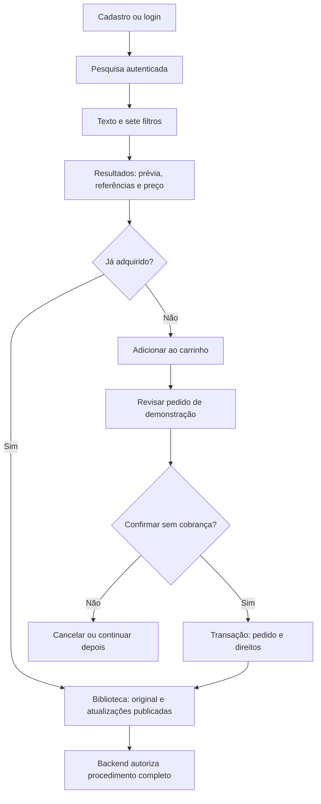

# Wiki-Chem — Especificação do MVP v1 com e-commerce

**Estado:** requisitos do MVP e propostas de produto em validação. Infraestrutura, identidade, administração editorial e pesquisa autenticada estão implementadas; ofertas, preços e carrinho persistente estão implementados. Checkout, pedidos e direitos permanecem planejados.

## 1. Contexto e metodologia

O Wiki-Chem é um projeto acadêmico da FATEC, curso DSM, disciplina de Engenharia de Software II. O problema abordado é a organização e recuperação de metodologias de química analítica com metadados rastreáveis e acesso controlado ao conteúdo integral. O objetivo é construir uma plataforma funcional de pesquisa e aquisição demonstrativa, mantendo a interface React existente.

A metodologia é incremental e orientada por especificações verificáveis, tomando as [diretrizes SDD v1.0](https://github.com/dernivaljr/sdd-methodology/blob/main/SDD-GUIDELINES.md) como referência. Requisitos, arquitetura, modelagem e tarefas são distintos; testes verificam critérios de aceitação. A constituição própria e a adoção formal permanecem em V10, sem impedir incrementos expressamente autorizados.

A aplicação dispõe de frontend e backend modular com MySQL configurável. O backend implementa infraestrutura e identidade persistente: cadastro, login, sessão, logout e perfil. /consultas, /metodologias/:id e /perfil exigem sessão. Texto e sete filtros consultam o catálogo publicado corrente, com prévia gratuita e referências permitidas; ofertas/preços cadastrados são apresentados com disponibilidade, sem bloquear a pesquisa quando ausentes. /carrinho mantém itens e revalida valores. O checkout demonstrativo cria revisão persistida, confirma atomicamente com direitos por metodologia e oferece histórico próprio. A biblioteca integral permanece futura.

Documentos associados: [arquitetura e API](../arquitetura/ARQUITETURA-MVP.md), [modelo](../arquitetura/MODELO-DADOS.md), [comércio](../arquitetura/ECOMMERCE.md) e [planejamento](../planejamento/ROADMAP-MVP.md). Esta especificação não é o relatório acadêmico final.

## 2. Estados das decisões

**A = orientação expressamente confirmada pelo solicitante para este trabalho.** Não significa aprovação das propostas de implementação. **P = proposta técnica ou de comportamento**, dependente de validação de produto. **V = ponto que exige validação identificada na seção 9.** Nenhum preço, fonte, contrato de uso ou parecer jurídico foi aprovado por estes documentos.

| ID | Orientação confirmada (A) |
| --- | --- |
| A01 | Preservar React + TypeScript, identidade visual e frontend existente |
| A02 | Cadastro/login/sessão/logout/perfil reais; pesquisa autenticada com os sete filtros |
| A03 | Metodologia individual como produto, prévia gratuita, preço BRL e conteúdos completos autorizados pelo backend |
| A04 | Carrinho, checkout explicitamente simulado, pedidos e histórico persistidos, biblioteca e administração básica |
| A05 | Planejar Node.js + TypeScript/REST e MySQL relacional com relações N:N; valores históricos e consistência transacional |
| A06 | Rastrear autoria/curadoria, revisão, fontes, versões e permissões; não comercializar reprodução protegida sem autorização |
| A07 | IA/RAG, provedores, pacotes, assinaturas e pagamentos reais fora do MVP |
| A08 | Implementação incremental: a fundação não antecipa identidade, catálogo ou comércio; distinguir requisitos e propostas |
| A09 | Fundação adotada: Node.js 24, TypeScript strict, Fastify, Zod, MySQL 8.4, mysql2/promise, SQL parametrizado, migrações SQL controladas e Vitest |
| A10 | Identidade real autorizada: Argon2id, sessão opaca revogável, CSRF, perfil próprio e bootstrap operacional seguro; recuperação, e-mail verificado e publicação comercial fora do incremento |
| A11 | Catálogo editorial e /admin autorizados: sete taxonomias N:N por versão, fontes, autoria/curadoria, revisão explícita e publicação imutável; sem pesquisa, preços ou comércio |

| A12 | Pesquisa autenticada autorizada: texto, sete filtros com OR interno/AND entre categorias, paginação, ordenação e detalhes gratuitos; independente de produtos. Oferta comercial completa de RF07 na Etapa 07; sem preços fictícios |

| A13 | Produtos/preços BRL/carrinho autorizados: um produto por metodologia, histórico imutável, quantidade um, revisão, revalidação e isolamento |
| A14 | Checkout demonstrativo em duas transações, snapshots, idempotência, pedidos/histórico e direitos registrados por metodologia; sem cobrança e sem leitura integral da biblioteca. Recorte demonstrativo de P03; condições comerciais definitivas seguem pendentes |

### Propostas transversais e adoções identificadas

| ID | Proposta (P), com adoção explicitada quando aplicável |
| --- | --- |
| P01 | Adotada no recorte de A10: CUSTOMER/ADMIN, sessão opaca revogável, cookie seguro e CSRF; políticas em [Identidade](../arquitetura/IDENTIDADE.md) |
| P02 | Adotada no recorte A12: AND entre facetas/palavras e OR entre valores da mesma faceta; busca somente em informações de prévia. Semântica científica do vocabulário permanece em V01 |
| P03 | Aquisição por metodologia: direito ativo permite a versão original, o histórico publicado e novas atualizações publicadas da mesma metodologia, sem recompra; versão/preço originais permanecem no pedido. Política proposta, pendente de V03 |
| P04 | Estrutura de produto único/quantidade um e carrinho adotada em A13. Recompra, direitos e confirmação idempotente permanecem propostos para incremento de pedidos |
| P05 | Pedido em duas etapas adotado no recorte A14: prévia persistida e confirmação explícita, prazo configurável, revalidação e cancelamento; condições comerciais definitivas continuam pendentes |
| P06 | Desativar venda não remove a biblioteca; suspensão expressa por impedimento de uso bloqueia conteúdo e requer tratamento administrativo |
| P07 | Monólito modular adotado e mesma origem preparada no desenvolvimento; tecnologias em A09, hospedagem em produção pendente |
| P08 | Perfil edita nome de exibição; mudança de e-mail, recuperação de senha e verificação de e-mail exigem definição própria em V06 |
| P09 | Fluxo editorial mínimo adotado no recorte A11: rascunho e publicação com revisão explícita; autoria, condições verificadas e histórico preservados. Demais decisões de governança em V09 |

As propostas são usadas de forma consistente nos contratos/modelos seguintes para permitir revisão concreta. P01 e o recorte de perfil de P08 foram adotados em A10, o fluxo editorial mínimo P09 em A11 e a busca P02 no recorte A12; propostas comerciais não são aprovadas por essa adoção. Não devem ser implementadas como decisões já aprovadas sem resolver suas validações.

## 3. Objetivo, usuários e limite do MVP

Permitir que um usuário autenticado encontre uma metodologia adequada ao contexto analítico, avalie uma prévia e adquira acesso em uma demonstração transacional persistida. “Adquirida” no MVP significa **aquisição simulada sem cobrança**, não pagamento ou documento fiscal emitido.

Visitantes acessam Home, Sobre e acesso. Clientes pesquisam, consultam prévias, usam seu carrinho, pedidos, perfil e biblioteca. Administradores mantêm conteúdos/ofertas e revisão de permissões; não escolhem direitos de terceiros arbitrariamente pelo navegador. O mesmo administrador pode usar as funções de cliente, mas papel administrativo não gera aquisição comercial.

Não se incluem: dados de cartão, gateway, liquidação, reembolso financeiro, assinaturas, pacotes, emissão fiscal, DRM, download/exportação, marketplace de autores, avaliações, geração de procedimentos ou IA. Conteúdo completo será exibido em área protegida; impedir captura de tela por usuário autorizado não é uma promessa do MVP.

## 4. Requisitos e critérios de aceitação

Os critérios abaixo são metas verificáveis da implementação posterior, não testes aprovados nesta etapa.

| ID | Requisito | Critérios de aceitação |
| --- | --- | --- |
| RF01 | Cadastro persistente | Nome, e-mail e senha válidos criam conta cliente única; senha não é armazenada/retornada em claro; duplicidade normalizada não cria segunda conta; payload não pode promover papel; erros não expõem detalhes internos |
| RF02 | Login, sessão e logout | Credencial válida inicia sessão real; inválida não inicia; sessão é rotacionada após login, expira e pode ser revogada; logout invalida no servidor; cookie antigo não autoriza requisição; bloquear conta invalida acesso |
| RF03 | Perfil e propriedade | Usuário lê seu perfil e altera apenas os campos permitidos; não consegue consultar/alterar perfil, carrinho ou pedidos de outro usuário por troca de ID; P08/V06 delimitam e-mail/recuperação |
| RF04 | Pesquisa autenticada | Sem sessão válida, API responde 401 e UI encaminha ao login com retorno interno seguro; após login há consulta real; termo e filtros sobrevivem à navegação por URL; resposta antiga não sobrescreve consulta mais recente |
| RF05 | Sete filtros N:N | Técnica, tecnologia, equipamento, matriz, analito, norma e segmento aceitam múltiplos termos; testes exercitam cada faceta, OR interno e AND entre facetas na mesma versão publicada; limpar restaura a consulta; filtros desconhecidos são rejeitados |
| RF06 | Busca textual e listagem | Regra P02 da arquitetura atende termos curtos, acentos e caracteres literais aprovados em V01; termo vazio permite navegação do catálogo; ordenação é estável e paginação limitada; nenhuma correspondência retorna lista vazia com feedback, sem conteúdo inventado |
| RF07 | Prévia informativa | Resultado e detalhe mostram título, resumo gratuito, metadados essenciais das sete facetas aplicáveis, referências/localizadores permitidos, versão, preço BRL e disponibilidade; prévia não contém etapas completas do procedimento; curadoria avalia suficiência informativa e limite de exposição |
| RF08 | Catálogo versionado | Rascunho não aparece na pesquisa nem é liberado a compradores; publicação exige prévia, procedimento separado, taxonomias e origem/permissões/revisão registradas; nova versão não sobrescreve a original e fica acessível aos titulares da metodologia após publicação, conforme P03; referências normativas distinguem edição/situação verificada |
| RF09 | Produto e oferta | Cada metodologia tem no máximo um produto individual; preço vigente é definido pelo administrador autorizado e não pelo cliente; preço/versionamento/disponibilidade são revalidados no servidor; nenhum preço definitivo é estabelecido nesta especificação |
| RF10 | Carrinho persistente | Carrinho pertence à sessão/usuário no banco, sobrevive a recarga/logout-login; um produto aparece uma única vez; quantidade diferente de um e produto já adquirido são rejeitados; itens inválidos são identificados, sem remoção silenciosa; total vem do servidor |
| RF11 | Checkout simulado | UI e API identificam DEMONSTRAÇÃO — SEM COBRANÇA; não coletam dados financeiros nem chamam pagamentos; prévia cria pedido pendente com itens/valores/versionamento; confirmação explícita conclui pedido simulado e direitos na mesma transação |
| RF12 | Concorrência e repetição | Clique repetido com chave idempotente confirma o mesmo pedido sem novos efeitos; duas chaves concorrentes para a mesma metodologia não duplicam direito; nenhum pedido é concluído parcialmente; valor/versão alterados exigem nova revisão da compra, sem aceitação automática |
| RF13 | Histórico de pedidos | Histórico próprio é paginado e mostra estado, data, indicação de simulação, itens e valores históricos; alterações atuais de preço/título não modificam o histórico; pedido de outro cliente não é exposto |
| RF14 | Minha biblioteca e conteúdo | Só confirmação simulada concluída gera direito por metodologia; biblioteca identifica versão original e atual, permite histórico publicado e atualizações sem outro pedido/cobrança; backend valida sessão, titularidade, direito ativo, pertencimento e publicação/permissão da versão escolhida; rascunho, versão de outra metodologia e versão suspensa não são liberados; histórico da compra permanece imutável |
| RF15 | Administração básica | Um administrador mantém rascunhos, fontes/permissões, autoria/curadoria, facetas, preço e disponibilidade; publicação registra revisão e responsável sobre a revisão exata do rascunho, sem workflow intermediário; cliente recebe 403; ações relevantes têm trilha auditável; retirada de venda não apaga pedidos/direitos |
| RF16 | Identidade, UX e erros | Home/Sobre, marca, Inter e paleta atuais são preservadas; novas telas têm navegação/landmarks/labels/foco/contraste e não transbordam em 320 px; loading, vazio, 401, 403, 404, conflitos de compra e falha recuperável têm mensagens sem revelar conteúdo pago |
| RF17 | Uso autorizado das fontes | Cada origem tem referência, edição/localizador quando aplicável, autoria/curadoria e condição de uso documentadas; pendência de permissão bloqueia publicação/venda; evidência restrita de autorização não é retornada no DTO de prévia |

## 5. Fluxo e estados de experiência

| Situação | Comportamento proposto |
| --- | --- |
| Item adquirido | No recorte A14, exibir aquisição simulada já registrada e acesso aos pedidos, sem botão de recompra. Na futura biblioteca, exibir “Na minha biblioteca”, versão original e atual; abrir atual publicada por padrão, com seleção do histórico publicado; bloquear recompra da mesma metodologia, pois suas atualizações já integram P03. Política ainda pendente de aprovação em V03 |
| Sem resultados | Manter termo/filtros visíveis, informar ausência e oferecer limpar/refinar; nenhuma compra é iniciada |
| Sessão expirada | Interromper requisição protegida, limpar estado sensível no cliente e pedir login; preservar URL interna e carrinho no servidor; não reenviar confirmação automaticamente |
| Erro de rede ao confirmar | Informar resultado desconhecido; consultar pedido ou repetir mesma chave; nunca presumir sucesso/fracasso nem criar outra compra automaticamente |
| Compra interrompida | Pedido permanece pendente até cancelamento/expiração; não gera direito; reentrada consulta estado persistido; regras de expiração estão em ECOMMERCE |
| Preço, versão ou disponibilidade mudaram | Mostrar conflito e exigir nova prévia/aceitação; valores antigos continuam no pedido histórico; sem concluir parte do carrinho |
| Conteúdo retirado de venda | Continua na biblioteca conforme P06; suspensão expressa de conteúdo é exibida sem procedimento e exige revisão da condição de uso |

Rotas `/`, `/sobre` e `/login` são preservadas. `/consultas`, `/metodologias/:id`, `/carrinho`, `/checkout/:id`, `/perfil`, `/pedidos`, `/pedidos/:id` e `/admin` estão implementadas e protegidas conforme papel. Biblioteca permanece futura. Mapa de rotas do escopo: `/metodologias/:id`, `/carrinho`, `/checkout/:orderId`, `/perfil`, `/pedidos`, `/pedidos/:id`, `/biblioteca`, `/biblioteca/:methodologyId` e `/admin`. Rotas cliente não substituem autorização REST. A etapa de implementação deverá substituir as simulações existentes e atualizar seus testes de apresentação de modo incremental.

## 6. Qualidade, segurança e conteúdo

- RNF01: nenhuma resposta de prévia/pesquisa/facetas inclui procedimento, HTML oculto, arquivo completo ou trecho obtido de busca em conteúdo pago. Usar DTO por finalidade e listas explícitas de campos.
- RNF02: autorização por requisição, sessão revogável, validação de entrada, SQL parametrizado, limites/paginação, controle de abuso e logs sem senha/token/procedimento. Testes negativos fazem parte da entrega, não apenas guard de React.
- RNF03: um erro injetado entre atualização do pedido e concessão de direitos deixa ambos sem confirmação; concorrência é testada em MySQL real, não apenas em mocks.
- RNF04: testes de apresentação são preservados; testes de backend, contrato e integração são incrementais. Não declarar funcionalidade real aprovada com testes de simulação.
- RNF05: restauração de backup, implantação, HTTPS, orçamento de resposta e matriz de navegadores serão definidos/validados em V08 antes da liberação. Não há infraestrutura provisionada por esta documentação.
- RNF06: textos técnicos, autoria e fontes precisam de curadoria humana e condições de uso demonstráveis. Esta especificação não aprova termos de uso, obrigação legal, licença comercial ou segurança operacional de procedimento laboratorial.

## 7. Conteúdo gratuito, pago e editorial

A prévia deverá explicar finalidade, aplicabilidade, contexto de técnica/matriz/analito, limitações essenciais, versão, autoria/curadoria identificável e referências permitidas. A curadoria deve impedir que a prévia reproduza o procedimento integral. Procedimento, sequências operacionais detalhadas e conteúdo integral permanecem na representação protegida, com revisão técnica.

Cada versão tem histórico de alteração e evidência de revisão. Fontes não são inferidas de títulos nem preenchidas por IA. Conteúdo original deve registrar autoria e revisão; conteúdo derivado deve registrar origem, localizador e autorização/condição de uso. P09 propõe apenas salvar rascunho e publicar com revisão registrada sobre `expectedRevision`, responsável obtido da sessão e nota de revisão. Não há fila, etapa de aprovação separada ou segundo papel obrigatório no MVP; revisão não é dispensada. A especificação não concede autorização de uso.

### 7.1 Cinco candidatas reais para avaliação do catálogo

**Proposta de catálogo inicial, não produtos publicados.** Metadados de identificação e escopo foram consultados em fontes primárias da U.S. EPA em 29/10/2026. Os rótulos abaixo são taxonomias exemplificativas para V01/V02, não procedimentos, validação laboratorial ou oferta. A curadoria do Wiki-Chem, autoria dos conteúdos derivados e permissões de uso permanecem sem aprovação. Não se copiam etapas operacionais destes métodos.

| Candidata e identificação verificada | Técnica exemplificativa | Tecnologia exemplificativa | Equipamento genérico |
| --- | --- | --- | --- |
| C01 — Cloreto por titrimetria com nitrato de prata — [EPA 9253, rev. 0, setembro/1994](https://www.epa.gov/sites/default/files/2015-12/documents/9253.pdf) | Titrimetria | Argentometria com detecção visual | Bureta / conjunto titrimétrico |
| C02 — Ânions inorgânicos por cromatografia de íons — [EPA 300.0, rev. 2.1, agosto/1993](https://www.epa.gov/sites/default/files/2015-08/documents/method_300-0_rev_2-1_1993.pdf) | Cromatografia de íons | Detecção condutimétrica com supressão | Cromatógrafo de íons |
| C03 — Metais e elementos traço em água por ICP-AES/ICP-OES — [EPA 200.7, rev. 4.4, 1994](https://www.epa.gov/esam/method-2007-determination-metals-and-trace-elements-water-and-wastes-inductively-coupled) | Espectrometria de emissão atômica/óptica | Plasma indutivamente acoplado | Espectrômetro ICP-OES |
| C04 — Fósforo por colorimetria semiautomática — [EPA 365.1, rev. 2.0, agosto/1993](https://nepis.epa.gov/Exe/ZyPURL.cgi?Dockey=P10163W4.TXT) | Colorimetria | Análise em fluxo contínuo com detector colorimétrico | Analisador colorimétrico de fluxo |
| C05 — Compostos orgânicos voláteis por GC/MS — [EPA 8260D, rev. 4, junho/2018](https://www.epa.gov/sites/default/files/2018-06/documents/method_8260d_update_vi_final_06-11-2018.pdf) | Cromatografia gasosa | Detecção por espectrometria de massas | GC-MS |

| Candidata | Matriz exemplificativa | Analito(s) exemplificativos | Norma/referencial técnico indexável | Segmento exemplificativo |
| --- | --- | --- | --- | --- |
| C01 | Soluções de combustão em bomba de oxigênio e águas dentro do escopo do método | Cloreto | U.S. EPA 9253, rev. 0/1994 | Caracterização de resíduos / análise ambiental |
| C02 | Água potável, água superficial e efluentes contemplados na parte A | Cloreto, nitrato, sulfato | U.S. EPA 300.0, rev. 2.1/1993, parte A | Saneamento / análise ambiental |
| C03 | Água; recorte inicial de água para consumo a confirmar pela curadoria | Arsênio, tálio, vanádio (exemplos da ficha EPA consultada) | U.S. EPA 200.7, rev. 4.4/1994 | Análise ambiental / controle de água |
| C04 | Água e resíduos/efluentes aquosos previstos no método | Fósforo; fração/especiação deve ser explicitada na futura ficha | U.S. EPA 365.1, rev. 2.0/1993 | Saneamento / monitoramento ambiental |
| C05 | Água e resíduos sólidos, conforme aplicabilidade/preparo a validar | Benzeno e tolueno como exemplos, sem lista integral de alvos | U.S. EPA 8260D, rev. 4/2018 | Investigação ambiental / resíduos |

As duas tabelas cobrem os **sete filtros**; multianalitos/matrizes ilustram relações N:N. O recorte privilegia água/resíduos/análise ambiental, sem representar todos os segmentos da química analítica. Casos de busca propostos: cloreto encontra C01/C02; cloreto + técnica cromatografia de íons restringe a C02; GC-MS + benzeno restringe a C05. São expectativas para revisão das taxonomias, não resultados de sistema implementado.

“Norma” usa aqui o identificador do método como referencial técnico, sem afirmar obrigação regulatória, vigência no Brasil ou equivalência a norma nacional. Disponibilidade pública do link não registra permissão comercial no catálogo. Antes de publicar qualquer candidata: confirmar escopo/edição/preparo e limitações, definir texto próprio revisado ou origem autorizada, atribuição e prova/condição de uso. Se pendente, manter rascunho e oferta inativa. Não foram inventados autores do Wiki-Chem, referências ou autorizações; as referências acima identificam documentos reais, não um corpus já liberado para reprodução.

### 7.2 Fixtures exclusivamente de desenvolvimento

Valores fictícios de software ficam definidos em [ECOMMERCE, seção 1.1](../arquitetura/ECOMMERCE.md). IDs FX01–FX05 identificam produtos sintéticos de demonstração, **sem associação automática às candidatas C01–C05**. Não constituem preços sugeridos para as cinco metodologias, política comercial ou permissões de publicação. A fundação técnica não carrega dados comerciais.

## 8. Condição de conclusão funcional

MVP implementado somente quando os RF01–RF17 aprovados estiverem cobertos por evidências do [roadmap](../planejamento/ROADMAP-MVP.md), com fluxo completo em ambiente integrado e testes de falha/concorrência/autorização. A publicação comercial real não é consequência desse marco: checkout continua sendo demonstração. A fundação técnica, isoladamente, não satisfaz os requisitos funcionais do MVP.

## 9. Registro único de validações pendentes

| ID | Ponto a aprovar/validar | Responsável sugerido e bloqueio |
| --- | --- | --- |
| V01 | Vocabulário e distinção técnica/tecnologia/equipamento; regras de busca, acentos/fórmulas, facetas e edição de norma; validar os exemplos C01–C05 | Produto + curadoria; antes de catálogo e fixtures de taxonomia |
| V02 | Aprovar/rejeitar C01–C05 como recorte inicial; validar conteúdo, escopo, referências, atribuição, revisão e permissões de uso; candidata não é publicação autorizada | Curadoria + titulares/responsável por permissões; antes de publicação |
| V03 | Aprovar P03: aquisição por metodologia, original/histórico/atualizações publicadas sem recompra; duração, limites, suspensão e critérios para distinguir atualização de metodologia realmente distinta continuam pendentes | Produto + curadoria/responsável por condições de uso; antes de biblioteca/compra |
| V04 | Rejeição integral de repetição, prévia/expiração/cancelamento, preço alterado e preservação do carrinho | Produto; recorte demonstrativo A14 adotado, condições definitivas pendentes |
| V05 | Preços reais, responsável, faixa/gratuidade e condições de oferta; FX01–FX05 são valores fictícios isolados de desenvolvimento e não decidem política comercial | Responsável comercial; antes de ativar produto real; nenhum preço final proposto |
| V06 | Identidade mínima adotada em A10; recuperação, e-mail verificado/mudança de e-mail, retenção/eliminação e textos jurídicos continuam fora do recorte | Produto + segurança; antes das funcionalidades dependentes e exposição pública |
| V07 | Fundação e identidade resolvidas por A09/A10; tipos/constraints dos futuros agregados e operação continuam pendentes | Mantenedor técnico; antes dos incrementos dependentes |
| V08 | Hospedagem, mesma origem, segredos, backup/restore, observabilidade, volumes/SLO e navegadores suportados | Mantenedor/operação; antes de liberação; sem contratação/configuração nesta etapa |
| V09 | Aprovar P09 (admin único e revisão no ato de publicar), provisionamento seguro/idempotente do primeiro admin, responsáveis, suspensão/restauração e auditoria; matriz técnica na arquitetura | Produto + curadoria + segurança; antes da administração |
| V10 | Constituição própria, adoção formal do SDD e aprovação destes cinco documentos como baseline de implementação | Mantenedor; antes de iniciar incrementos dependentes |

IA/RAG poderá receber apenas estudo posterior ao MVP funcional: viabilidade técnica, custos, qualidade, permissões e rastreabilidade. Não há escolha de provedor, SDK, banco vetorial ou arquitetura de IA neste escopo.

## Aquisição demonstrativa implementada

[Checkout demonstrativo](../arquitetura/CHECKOUT-DEMONSTRATIVO.md) descreve o recorte A14 de RF10–RF13 e MD04–MD09. Repetição, concorrência, cancelamento e expiração não produzem aquisição parcial. O direito é registrado, mas RF14 (biblioteca integral) não está entregue. P03 continua pendente como política comercial, sem garantia definitiva de duração ou uso das fontes.
