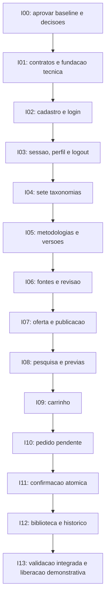

# Roadmap de implementação proposto — MVP Wiki-Chem

**Estado:** planejamento para aprovação; nenhuma tarefa de implementação abaixo foi executada nesta etapa documental. Base: `main@6f48aecbca3fce10518e6224731086ec74c48d5c`. Referências: [requisitos/decisões](../especificacoes/MVP-WIKI-CHEM-v1.md), [arquitetura/API](../arquitetura/ARQUITETURA-MVP.md), [modelo](../arquitetura/MODELO-DADOS.md) e [comércio](../arquitetura/ECOMMERCE.md).

## 1. Ponto de partida e governança

PRs #1/#2 integrados e [CI da base aprovado](https://github.com/dernivaljr/wiki-chem/actions/runs/40980122133) foram confirmados antes de iniciar a branch documental. A auditoria é evidência histórica, não o estado atualizado inteiro: a Etapa 01 corrigiu dependências, layout/foco/contraste e adicionou testes/CI. Não implementou catálogo, identidade, banco ou compra.

O escopo atual entrega somente estes cinco Markdown. A próxima etapa depende da aprovação das propostas P e resolução dos V aplicáveis. Seguir SDD: aprovar baseline/constituição, esclarecer requisitos, detalhar plano/tarefas, verificar consistência e só então implementar/validar incrementos. Nenhum merge deste PR é realizado pelo agente.

Não há calendário, estimativa de esforço, preço de produto, corpus técnico ou fornecedor assumido. Os incrementos são ordenados por dependência; uma PR por fatia verificável é recomendação, não regra já aprovada. Reabrir especificações antes de mudar comportamento acordado.

## 2. Dependências dos incrementos

Cada incremento deve terminar com testes de suas regras e integração mínima ao frontend, evitando um backend inteiro sem percurso verificável. Módulos podem receber esclarecimentos independentes, mas a implementação não deve atravessar uma decisão bloqueante sem aprovação registrada.

## 3. Backlog em tarefas pequenas

Artefatos citados são **locais futuros de implementação**, não arquivos criados por este PR. IDs RF remetem à tabela de critérios da especificação; MD remetem às invariantes do modelo.

| Tarefa | Escopo e origem | Critério de conclusão proposto | Dependência |
| --- | --- | --- | --- |
| I00.01 | Aprovar requisitos A e propostas P/V10 | Baseline revisada com registro do mantenedor; propostas não aprovadas permanecem identificadas, sem serem tratadas como implementação autorizada | Revisão deste PR |
| I00.02 | Resolver conteúdo/negócio/segurança | V01–V09 têm responsáveis e decisões ou bloqueios explícitos; constituição própria/forma de adoção SDD definida | I00.01 |
| I01.01 | Contratos e convenções — RF01–RF17 | Contrato executável inicial documenta DTOs gratuitos/protegidos, erros, paginação, valores e idempotência; exemplos sintéticos sem preços comerciais ou fontes inventadas | I00, V07 |
| I01.02 | Fundação backend e integração — RNF02/04 | Futuro backend TS com validação/erros/requestId e camada de dados; testes usam MySQL isolado e migrações, sem segredo em cliente; frontend atual/regressões continuam passando | I01.01, V07 |
| I01.03 | Estratégia de ambiente/teste — RNF03/05 | Plano de migração/rollback e execução automatizada em MySQL definido; nenhuma infraestrutura de produção presumida pronta | I01.02, V08 |
| I02.01 | Cadastro — RF01/MD01 | Migração de usuários, e-mail único/normalizado, senha adaptativa, rejeição de papel injetado e teste concorrente de duplicidade | I01, V06/V07 |
| I02.02 | Login real — RF02 | Credenciais válidas/ inválidas verificadas no servidor; sessão opaca criada/rotacionada; resposta e logs sem senha/hash/token; frontend substitui submit fictício | I02.01 |
| I03.01 | Sessão/CSRF/logout — RF02/RNF02 | Expiração absoluta/inatividade e revogação testadas; cookie anterior não autoriza; bloqueio de conta impede sessão; bootstrap/CSRF e login de origem indevida exercitados | I02, V06 |
| I03.02 | Perfil e rotas autenticadas — RF03/04 | Perfil próprio e edição permitida; troca de ID não expõe terceiros; `/consultas` deixa de ser publicamente utilizável por API; 401 preserva retorno interno seguro sem auto-compra | I03.01 |
| I03.03 | Provisionamento inicial de administrador — RF15 | Procedimento controlado aprovado em V09 cria o primeiro admin com trilha de responsabilidade; sem senha padrão versionada, autoelevação por cadastro ou endpoint público de promoção | I03.01, V09 |
| I04.01 | Sete taxonomias — RF05/MD02 | Sete entidades e sete associações N:N migradas; vocabulário aprovado distingue termos, edição de norma e não aplicável; índices e unicidade básicos exercitados | I01, V01 |
| I04.02 | Administração de termos — RF15 | Admin cria/depreca termo sem quebrar histórico; cliente não altera termos; IDs inválidos não são ignorados em silêncio | I03, I04.01, V09 |
| I05.01 | Metodologia/versão/conteúdo — RF08/MD02/08 | Identidade, rascunho e conteúdo separado persistem; leitura de prévia não consulta/serializa procedimento; nova versão não sobrescreve publicada | I04 |
| I05.02 | Edição administrativa mínima — RF15/16 | Formulário admin respeita tokens/identidade, controle de revisão e validação; HTML/script indevido não é executado; ações relevantes auditadas | I03, I05.01 |
| I06.01 | Origens e contribuições — RF17 | Fontes ou autoria original verificável, localizadores, condições/evidência e curadoria/revisor persistidos; fixtures claramente sintéticas | I05, V02/V09 |
| I06.02 | Revisão/publicação editorial — RF08/17 | Rascunho sem revisão/condição de uso não é aprovado; conteúdo completo exige revisão identificada; estado suspenso impede exposição/compra | I06.01 |
| I07.01 | Produto e preços — RF09/MD03 | Produto único por metodologia, preço imutável BRL, ponteiro corrente e revision; valores inválidos/cliente sem papel rejeitados; valores reais só após aprovação | I05, V05 |
| I07.02 | Oferta/publicação/retirada — RF08/09/15 | Publicação aponta versão própria permitida; oferta ativa requer preço; desativar venda preserva versões/histórico e atualiza revisão; concorrência com leitura de compra prevista | I06, I07.01 |
| I08.01 | Consulta e filtros REST — RF04–RF07 | Texto/sete filtros, OR/AND na mesma versão, termo curto, acento, wildcard literal, vazio, paginação e desempate testados; marcador pago não participa de busca/contagem | I03, I04, I07, V01 |
| I08.02 | Pesquisa React e prévias — RF07/16 | Painel existente recebe estado real; URL reproduz filtros, resposta obsoleta descartada; loading/vazio/falha e prévia informativa sem procedimento validados | I08.01 |
| I09.01 | Carrinho persistente — RF10/MD04 | Um carrinho por usuário, item único, revision, validação de propriedade, total corrente e conflitos por item; recarga/login recuperam estado | I03, I07 |
| I09.02 | UI de carrinho/adquirido — RF10/16 | CTA distingue adquirido/indisponível; revisão concorrente não sobrescreve; remoção é explícita, sem compra ou descarte silencioso de itens | I08, I09.01 |
| I10.01 | T1 e snapshots — RF11/13/MD04 | Criação de pedido pendente com um ou mais itens e total coerente é atômica; não gera direito; chave repetida retorna mesmo pedido; rollback não deixa pedido vazio | I09, V04 |
| I10.02 | Revisão de demonstração — RF11/16 | Avisos e confirmação explícita sem cobrança/dados financeiros; usuário vê snapshots exatos, prazo e comportamento de cancelamento/expiração | I10.01 |
| I11.01 | T2 e direitos — RF11/12/MD05–MD07 | Pedido concluído, todos os direitos, limpeza seletiva de carrinho, chave e evento comprometem juntos; falha entre escritas reverte efeitos; sem confirmação parcial | I10, V03/V04 |
| I11.02 | Idempotência/concorrência — RF12 | MySQL real demonstra clique repetido, mesma/diferente chave, dois pedidos/abas e edição concorrente de oferta; só uma aquisição da metodologia por usuário | I11.01 |
| I11.03 | Retomada/cancelamento/expiração — RF11/12/16 | Rede perdida depois de commit recupera mesmo recurso; sessão expirada não repete confirmação; pedido expirado não concede acesso; novo preço/versão exige nova prévia | I11.01 |
| I12.01 | Biblioteca e procedimento — RF14/MD08 | Direito fixa versão; checks por requisição; marcador integral só é obtido com titular/direito/versão permitidos; alteração de rota/versionId, logout e conta bloqueada não ampliam acesso | I11, V03 |
| I12.02 | Histórico/perfil — RF03/13 | Paginação própria, estados de demonstração e snapshots preservados após mudar preço/título; pedido alheio não é retornado; nenhum procedimento em DTO de pedido | I11 |
| I12.03 | Venda retirada versus suspensão — RF14/15/17 | Biblioteca mantém versão retirada de venda; impedimento expresso bloqueia conteúdo com mensagem e auditoria, preservando histórico; restauração conforme regra aprovada | I06, I12.01, V03/V09 |
| I13.01 | Percurso integrado e segurança — RF01–RF17 | Cadastro/login→filtros→prévia→carrinho→demonstração→biblioteca executado em ambiente integrado; cenários negativos da seção 4 passam | I02–I12 |
| I13.02 | UX/acessibilidade/regressões — RF16 | Novas telas preservam identidade e funcionam em 320/375/768/1280 px; semântica das abas, foco SPA, labels, estados/404 e teclado verificados; testes anteriores adaptados sem certificar simulações | I13.01 |
| I13.03 | Preparação de liberação — RNF04/05/06 | CI com testes novos aprovado; backup/restauração, migração, segredos/cache, logs e orçamento de resposta avaliados; conteúdo/preços/condições aprovados; ambiente claramente demonstrativo | I13.01/02, V02–V09 |

## 4. Matriz mínima de rastreabilidade e testes

| Requisitos/invariantes | Evidências a exigir na implementação | Incrementos |
| --- | --- | --- |
| RF01/MD01 | Cadastro válido/inválido/duplicado simultâneo e tentativa de promover papel; senha não exposta | I02 |
| RF02/03/04 | Login inválido; expiração, CSRF, logout/revogação, bloqueio e isolamento entre dois usuários; retorno interno seguro | I02/03 |
| RF05/06 | Sete facetas isoladas/combinadas e multivalor; mesma versão; texto curto/acentos/literais; zero resultado; limites e paginação estável | I04/08 |
| RF07/08/17/MD02/08 | Prévia suficiente revisada, fontes/permissões, rascunho não publicado, marcador exclusivo do procedimento ausente em DTOs/índice | I05/06/08 |
| RF09/15/MD03 | Preço BRL validado, novo preço imutável, controle admin, disponibilização/retirada e revisão concorrente | I07 |
| RF10/MD04 | Recarregar carrinho, revision divergente, item repetido/adquirido, total do servidor e proprietário correto | I09 |
| RF11/12/MD05/06/07 | T1 sem direito; T2 atômica; duas abas/chaves; erro entre escritas; preço/versão alterados; resposta perdida; cancelado/expirado | I10/11 |
| RF13 | Item histórico retém valor/título/versão; pedidos alheios não enumerados e histórico paginado | I12 |
| RF14/MD08/09 | Acesso direto sem compra/sem sessão negado; direito correto libera só versão adquirida; suspensão, venda retirada, logout/bloqueio testados | I12 |
| RF15/17 | Cliente não administra; admin não ganha compra automaticamente; revisão/condições/auditoria registradas; evidência privada não exposta | I04–I07/I12 |
| RF16/RNF04/05 | E2E do fluxo e exceções, teclado/foco/contraste/responsividade, CI/restore/migrações e metas de operação aprovadas | Todos/I13 |

Organização futura sugerida: módulos backend por caso de uso; testes de regras/contrato próximos ao módulo; integração MySQL dedicada e jornadas de navegador no frontend. Confirmar estrutura em V07. A coluna de implementação só poderá ser preenchida com caminhos/commits reais quando cada tarefa for executada; não inventar evidência agora.

## 5. Gates de aceite e liberação

1. **Antes do backend:** V07 e contratos/segurança relevantes aprovados; constituição/baseline esclarecidas; definição de sessão e cadastro não fica implícita em um protótipo.
2. **Antes do catálogo publicado:** V01/V02/V09 e processo de revisão/condição de uso demonstráveis; nenhum corpus técnico ou referência foi inventado por esta etapa.
3. **Antes da compra:** V03–V05, integridade MySQL e testes de autorização/concorrência; preços reais aprovados por responsável, sem confundir fixture com oferta.
4. **Antes da liberação demonstrativa:** RF01–RF17 e RNFs aplicáveis aprovados com evidências; os pontos sem definição ficam como bloqueio explícito, não como requisito “atendido”.

Versão inicial de filtros/curadoria/preços/condições pode ser pequena, mas precisa representar casos verificados em todos os sete eixos e exceções aprovadas. Quantidade real e capacidade esperada são decisões V01/V02/V08, sem meta inventada neste roadmap.

## 6. Validação desta entrega documental

- Pré-condições de merge/CI da main verificadas e registradas na especificação.
- Revisão de consistência entre RF, P/V, contratos, entidades, estados e tarefas; diagramas Mermaid nativos incluídos.
- Verificação local executada: cinco entregáveis, 24 links locais válidos, 58 IDs definidos e sem referências desconhecidas, oito blocos Mermaid, cercas de código e encoding sem erros; relações ER passaram pela checagem estrutural. Diff conferido para conter somente os cinco Markdown.
- Não instalar pacotes, executar migrações, configurar banco/serviços, alterar CI ou modificar aplicação para validar documentos. O CI já existente pode validar a regressão da branch; resultado de CI não aprova requisitos nem comprova MVP implementado.
- CI de regressão documental aprovado no commit `7791496fe4d3cf688ba9fe663ff67b0ac0813f18`: [execução 40983062010](https://github.com/dernivaljr/wiki-chem/actions/runs/40983062010). Os checks do PR identificam os resultados de revisões posteriores.
- Renderização conferida no visualizador do GitHub: os oito blocos carregaram, sendo três ER no modelo, dois fluxos no documento comercial e um diagrama em cada um dos outros três documentos, sem erro de parser observado. Não há CLI Mermaid instalada e não foram instaladas dependências; a checagem pelo navegador não representa aprovação semântica dos requisitos ou decisões.

## 7. Evolução posterior

Somente após plataforma funcional: avaliar pacotes/assinaturas, pagamentos reais, atualizações comerciais e IA/RAG em especificações próprias. O estudo de IA deve avaliar viabilidade técnica, custo, qualidade, rastreabilidade e permissões. Não selecionar provedores nem condicionar o MVP a embeddings, busca vetorial ou geração automática.
