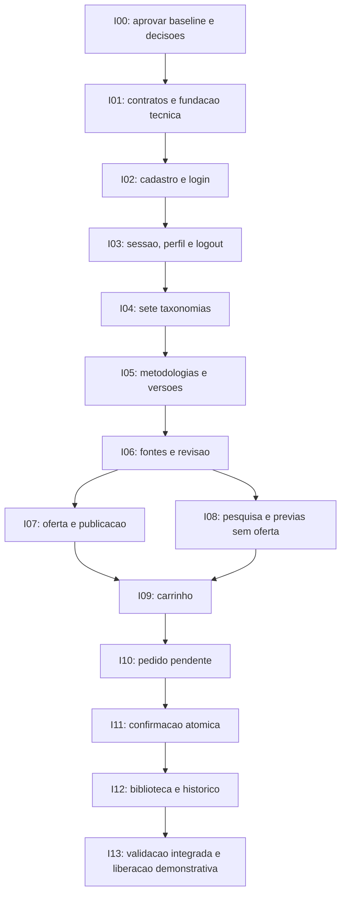

# Roadmap de implementação proposto — MVP Wiki-Chem

**Estado:** planejamento incremental do MVP; infraestrutura, identidade, catálogo editorial e pesquisa implementados; ofertas/preços/carrinho implementados; confirmação, pedidos e direitos pendentes. Referências: [requisitos](../especificacoes/MVP-WIKI-CHEM-v1.md), [arquitetura](../arquitetura/ARQUITETURA-MVP.md), [modelo](../arquitetura/MODELO-DADOS.md) e [comércio](../arquitetura/ECOMMERCE.md).

## 1. Método incremental e estado

O desenvolvimento parte de requisitos verificáveis, esclarece decisões, define tarefas pequenas e valida incrementos com testes. A interface React é preservada. O backend dispõe de infraestrutura e identidade persistente. Cadastro/login/sessão/logout/perfil estão conectados à interface; catálogo editorial e pesquisa estão implementados; ofertas/preços/carrinho estão implementados e checkout, pedidos e direitos permanecem planejados.

P03, candidatas C01–C05, permissões de conteúdo e preços comerciais continuam em validação. As tecnologias da fundação foram adotadas conforme A09. Fixtures FX01–FX05 serão implementadas somente nos incrementos comerciais pertinentes.

Não se pressupõem calendário, esforço, corpus autorizado ou infraestrutura de produção pronta. Mudanças de comportamento exigem revisão dos requisitos antes das tarefas dependentes.

## 2. Dependências dos incrementos

Cada incremento deve terminar com testes de suas regras e integração mínima ao frontend, evitando um backend inteiro sem percurso verificável. Módulos podem receber esclarecimentos independentes, mas a implementação não deve atravessar uma decisão bloqueante sem aprovação registrada.

## 3. Backlog em tarefas pequenas

Artefatos citados são destinos de implementação; a seção 6 distingue o que existe do que continua planejado. IDs RF remetem à tabela de critérios da especificação; MD remetem às invariantes do modelo.

| Tarefa | Escopo e origem | Critério de conclusão proposto | Dependência |
| --- | --- | --- | --- |
| I00.01 | Aprovar requisitos A e propostas P/V10 | Baseline revisada com registro do mantenedor; propostas não aprovadas permanecem identificadas, sem serem tratadas como implementação autorizada | Validação dos requisitos |
| I00.02 | Resolver conteúdo/negócio/segurança | V01–V09 têm responsáveis e decisões ou bloqueios explícitos; constituição própria/forma de adoção SDD definida | I00.01 |
| I00.03 | Validar candidatas C01–C05 — RF05/07/17 | Curadoria verifica as cinco referências reais e o mapeamento dos sete filtros; registra escopo/limitações e decide entrada no catálogo; nenhuma candidata é publicada por ter link público | I00.01, V01/V02 |
| I01.01 | Contratos e convenções — RF01–RF17 | Contrato executável inicial documenta DTOs gratuitos/protegidos, erros, paginação, valores e idempotência; exemplos sintéticos sem preços comerciais ou fontes inventadas | I00, V07 |
| I01.02 | Fundação backend e integração — RNF02/04 | Backend TS com validação/erros/requestId e camada de dados; testes usam MySQL isolado e migrações, sem segredo em cliente; frontend atual/regressões continuam passando | I01.01, V07 |
| I01.03 | Estratégia de ambiente/teste — RNF03/05 | Plano de migração/rollback e execução automatizada em MySQL definido; nenhuma infraestrutura de produção presumida pronta | I01.02, V08 |
| I01.04 | Fixtures monetárias de desenvolvimento — RF09/11/13 | FX01–FX05 ficam isoladas em dev/test com aviso DEMO e bloqueio em produção; somas 2750/12000 centavos verificadas; alteração 1000→1250 exercita revalidação/histórico; sem atribuir esses preços a C01–C05 ou forjar fontes/permissões | I01.01, V07 |
| I02.01 | Cadastro — RF01/MD01 | Migração de usuários, e-mail único/normalizado, senha adaptativa, rejeição de papel injetado e teste concorrente de duplicidade | Fundação I01.02, contratos de identidade, V06/V07 |
| I02.02 | Login real — RF02 | Credenciais válidas/ inválidas verificadas no servidor; sessão opaca criada/rotacionada; resposta e logs sem senha/hash/token; frontend substitui submit fictício | I02.01 |
| I03.01 | Sessão/CSRF/logout — RF02/RNF02 | Expiração absoluta/inatividade e revogação testadas; cookie anterior não autoriza; bloqueio de conta impede sessão; bootstrap/CSRF e login de origem indevida exercitados | I02, V06 |
| I03.02 | Perfil e rotas autenticadas — RF03/04 | Perfil próprio e edição permitida; troca de ID não expõe terceiros; `/consultas` deixa de ser publicamente utilizável por API; 401 preserva retorno interno seguro sem auto-compra | I03.01 |
| I03.03 | Provisionamento inicial de administrador — RF15 | Comando operacional protegido aprovado na matriz V07/V09 cria primeiro admin de forma idempotente, com responsável auditado; sem senha padrão/argumentos/logs de segredo, seed comercial, autoelevação por cadastro ou endpoint público de promoção; testes de repetição e acesso indevido passam | I03.01, V07/V09 |
| I04.01 | Sete taxonomias — RF05/MD02 | Sete entidades e sete associações N:N migradas; vocabulário aprovado distingue termos, edição de norma e não aplicável; índices e unicidade básicos exercitados | I01, V01 |
| I04.02 | Administração de termos — RF15 | Admin cria/depreca termo sem quebrar histórico; cliente não altera termos; IDs inválidos não são ignorados em silêncio | I03, I04.01, V09 |
| I05.01 | Metodologia/versão/conteúdo — RF08/MD02/08 | Identidade, rascunho e conteúdo separado persistem; leitura de prévia não consulta/serializa procedimento; nova versão não sobrescreve publicada | I04 |
| I05.02 | Edição administrativa mínima — RF15/16 | Formulário admin respeita tokens/identidade, controle de revisão e validação; HTML/script indevido não é executado; ações relevantes auditadas | I03, I05.01 |
| I06.01 | Origens e contribuições — RF17 | Formulário único persiste autoria/curadoria, referências, localizadores e condições/evidência; revisão identifica admin da sessão, sem criar papel/fluxo adicional obrigatório; referências das candidatas não são autorizações | I05, V02/V09 |
| I06.02 | Revisão no ato de publicar — RF08/17/P09 | Apenas DRAFT/PUBLISHED/SUPERSEDED; publish exige revisão explícita, nota, responsável, expectedRevision e condições válidas na mesma transação; rascunho incompleto/sem permissão ou edição concorrente é rejeitado; não há submit-review/approve separados | I06.01, V09 |
| I07.01 | Produto e preços — RF09/MD03 | Produto único por metodologia, preço imutável BRL, ponteiro corrente e revision; valores inválidos/cliente sem papel rejeitados; valores reais só após aprovação | I05, V05 |
| I07.02 | Oferta/publicação/retirada — RF08/09/15 | Publicação aponta versão própria permitida; atualização fica elegível aos titulares da metodologia sem alterar direitos/pedidos; publicar não reativa venda automaticamente; desativar preserva histórico e atualiza revisão; concorrência com compra exercitada | I06, I07.01 |
| I08.01 | Consulta e filtros REST — RF04–RF07 | Texto/sete filtros, OR/AND na mesma versão, termo curto, acento, wildcard literal, vazio, paginação e desempate testados; marcador pago não participa de busca/contagem | I03, I04, I06; curadoria real V01 |
| I08.02 | Pesquisa React e prévias — RF07/16 | Painel existente recebe estado real; URL reproduz filtros, resposta obsoleta descartada; loading/vazio/falha e prévia informativa sem procedimento validados | I08.01 |
| I09.01 | Carrinho persistente — RF10/MD04 | Um carrinho por usuário, item único, revision, validação de propriedade, total corrente e conflitos por item; recarga/login recuperam estado | I03, I07 |
| I09.02 | UI de carrinho/adquirido — RF10/16 | CTA distingue adquirido/indisponível; revisão concorrente não sobrescreve; remoção é explícita, sem compra ou descarte silencioso de itens | I08, I09.01 |
| I10.01 | T1 e snapshots — RF11/13/MD04 | Criação de pedido pendente com um ou mais itens e total coerente é atômica; não gera direito; chave repetida retorna mesmo pedido; rollback não deixa pedido vazio | I09, V04 |
| I10.02 | Revisão de demonstração — RF11/16 | Avisos e confirmação explícita sem cobrança/dados financeiros; usuário vê snapshots exatos, prazo e comportamento de cancelamento/expiração | I10.01 |
| I11.01 | T2 e direitos — RF11/12/MD05–MD07 | Pedido concluído, todos os direitos, limpeza seletiva de carrinho, chave e evento comprometem juntos; falha entre escritas reverte efeitos; sem confirmação parcial | I10, V03/V04 |
| I11.02 | Idempotência/concorrência — RF12 | MySQL real demonstra clique repetido, mesma/diferente chave, dois pedidos/abas e edição concorrente de oferta; só uma aquisição da metodologia por usuário | I11.01 |
| I11.03 | Retomada/cancelamento/expiração — RF11/12/16 | Rede perdida depois de commit recupera mesmo recurso; sessão expirada não repete confirmação; pedido expirado não concede acesso; novo preço/versão exige nova prévia | I11.01 |
| I12.01 | Biblioteca por metodologia — RF14/MD05/08 | Direito metodológico, original obtida do item e atual do catálogo; leitura padrão da atual e query versionId para histórico publicado elegível; outra metodologia/rascunho negados; sessão/direito verificados por requisição; conteúdo só com origem autorizada | I11, V03 |
| I12.02 | Histórico/perfil — RF03/13 | Paginação própria, estados de demonstração e snapshots preservados após mudar preço/título; pedido alheio não é retornado; nenhum procedimento em DTO de pedido | I11 |
| I12.03 | Venda retirada versus suspensão — RF14/15/17 | Retirada de venda preserva biblioteca/atualizações; suspensão bloqueia a versão alvo sem fallback silencioso; seleção explícita de outra histórica ALLOWED é validada; conta bloqueada/direito revogado negam todas; restauração é auditada | I06, I12.01, V03/V09 |
| I12.04 | Atualizações sem recompra — RF13/14/P03 | Adquirir v1, publicar v2, ler v2 e v1, sem novo pedido/direito/cobrança; snapshot original/valor permanece; recompra recebe ALREADY_OWNED; DRAFT e versão de outra metodologia negados; matriz de testes da seção 8.1 de ECOMMERCE coberta | I12.01/02/03, V03 |
| I13.01 | Percurso integrado e segurança — RF01–RF17 | Cadastro/login→filtros→prévia→carrinho→demonstração→biblioteca executado em ambiente integrado; cenários negativos da seção 4 passam | I02–I12 |
| I13.02 | UX/acessibilidade/regressões — RF16 | Novas telas preservam identidade e funcionam em 320/375/768/1280 px; semântica das abas, foco SPA, labels, estados/404 e teclado verificados; testes anteriores adaptados sem certificar simulações | I13.01 |
| I13.03 | Preparação de liberação — RNF04/05/06 | Testes automatizados aprovados; backup/restauração, migração, segredos/cache, logs e orçamento de resposta avaliados; conteúdo/preços/condições aprovados; ambiente claramente demonstrativo | I13.01/02, V02–V09 |

## 4. Matriz mínima de rastreabilidade e testes

| Requisitos/invariantes | Evidências a exigir na implementação | Incrementos |
| --- | --- | --- |
| RF01/MD01 | Cadastro válido/inválido/duplicado simultâneo e tentativa de promover papel; senha não exposta | I02 |
| RF02/03/04 | Login inválido; expiração, CSRF, logout/revogação, bloqueio e isolamento entre dois usuários; retorno interno seguro | I02/03 |
| RF05/06 | Sete facetas isoladas/combinadas e multivalor; mapeamento exemplificativo C01–C05 após validação; mesma versão, texto curto/acentos/literais, vazio, limites/paginação | I00.03/I04/I08 |
| RF07/08/17/MD02/08 | Prévia suficiente revisada, fontes/permissões, rascunho não publicado, marcador exclusivo do procedimento ausente em DTOs/índice | I05/06/08 |
| RF09/15/MD03 | BRL em centavos, fixtures FX01–FX05 isoladas, preço imutável, controle admin e revisão concorrente; fixtures não escolhem preço de candidata real | I01.04/I07 |
| RF10/MD04 | Recarregar carrinho, revision divergente, item repetido/adquirido, total do servidor e proprietário correto | I09 |
| RF11/12/MD05/06/07 | T1 sem direito; T2 atômica; duas abas/chaves; erro entre escritas; preço/versão alterados; resposta perdida; cancelado/expirado | I10/11 |
| RF13 | Item histórico retém valor/título/versão; pedidos alheios não enumerados e histórico paginado | I12 |
| RF14/MD05/08/09 | Direito libera original/histórico/atualizações publicadas da mesma metodologia; nega rascunho/outra metodologia; não reescreve aquisição; suspensão por versão e bloqueio global exercitados | I12 |
| RF15/17/P09 | Cliente não administra; bootstrap seguro/idempotente; publish com revisão sobre expectedRevision, autoria e condições; sem fases editoriais extras; admin não ganha direito de compra; evidência privada não exposta | I03.03/I04–I07/I12 |
| RF16/RNF04/05 | E2E do fluxo e exceções, teclado/foco/contraste/responsividade, restauração/migrações e metas de operação aprovadas | Todos/I13 |

Organização futura sugerida: módulos backend por caso de uso; testes de regras/contrato próximos ao módulo; integração MySQL dedicada e jornadas de navegador no frontend. A fundação aplica essa organização. A coluna de implementação só poderá ser preenchida com artefatos e testes verificáveis quando cada tarefa for executada; não inventar evidência agora.

## 5. Gates de aceite e liberação

1. **Antes do backend:** A09 adotada e contratos/segurança relevantes aprovados; constituição/baseline esclarecidas; definição de sessão e cadastro não fica implícita em um protótipo.
2. **Antes do catálogo publicado:** V01/V02/V09 e processo de revisão/condição de uso demonstráveis; nenhum corpus técnico ou referência foi inventado por esta etapa.
3. **Antes da compra:** V03–V05, integridade MySQL e testes de autorização/concorrência; preços reais aprovados por responsável, sem confundir fixture com oferta.
4. **Antes da liberação demonstrativa:** RF01–RF17 e RNFs aplicáveis aprovados com evidências; os pontos sem definição ficam como bloqueio explícito, não como requisito “atendido”.

O recorte proposto tem cinco candidatas reais, com sete eixos exemplificados na especificação. Sua inclusão, conteúdo e condições de uso precisam de V01/V02; não é corpus autorizado nem compromisso de publicação. Capacidade esperada continua em V08. As cinco fixtures de preço são de desenvolvimento e não aumentam o catálogo real.

## 6. Rastreabilidade da fundação técnica

| Tarefa | Situação | Artefatos e evidência de aceitação |
| --- | --- | --- |
| I00.01/02 | Parcial | A09 resolve tecnologias; decisões de negócio e formalização SDD permanecem explícitas |
| I01.01 | Parcial | Contratos Zod de saúde, identidade e perfil; DTOs editoriais, ofertas e carrinho implementados; contratos de pedidos/direitos planejados |
| I01.02 | Implementada no recorte autorizado | backend/src/: rota/serviço/repositório, requestId, pool, validação e proxy; testes de unidade/contrato/MySQL |
| I01.03 | Parcial | Migração controlada e teste de falha DDL; backup/restauração e implantação em V08 |
| I01.04 | Implementado no recorte A13 | FX01–FX05 originais em testes, bloqueadas em produção, com somas verificáveis; nenhuma semente comercial real |
| I02/I03 | Implementados no recorte de identidade | Cadastro/login/sessão/logout/perfil e bootstrap inicial; Argon2id, CSRF, origem, limites, expiração, MySQL e navegador. Recuperação/e-mail verificado fora do incremento |
| I04–I06 | Implementados no recorte A11 | Taxonomias N:N, rascunhos, conteúdo separado, fontes/autoria, revisão e publicação; vocabulário e permissões reais continuam pendentes |
| I08 | Implementado no recorte A12/A13 | Texto, sete filtros, prévias, URL, paginação e oferta/preço quando cadastrados |
| I07/I09 | Implementados no recorte A13 | Produto/preço BRL, imutabilidade, disponibilidade e carrinho persistente por usuário, sem direito adquirido |
| I10–I13 | Pendentes | Confirmação demonstrativa, pedidos, direitos, biblioteca e liberação demonstrativa |

A verificação de identidade cobre os critérios de identidade/perfil de RF01–RF03 e proteção de rotas de RF04 em MySQL/navegador, conforme [Identidade](../arquitetura/IDENTIDADE.md). RF04–RF06 têm pesquisa real no recorte A12, descrita em [Pesquisa de metodologias](../arquitetura/PESQUISA-METODOLOGIAS.md). Apresentação com respostas controladas não substitui integração real. [Catálogo editorial](../arquitetura/CATALOGO-EDITORIAL.md) acrescenta os critérios estruturais/editoriais de RF05/08/15/17 e MD02/08. RF07 recebe apresentação comercial no recorte A13, descrita em [Ofertas e carrinho](../arquitetura/OFERTAS-CARRINHO.md). Direitos e checkout permanecem futuros; ofertas não bloqueiam a pesquisa editorial.

## 7. Evolução posterior

Somente após plataforma funcional: avaliar pacotes/assinaturas, pagamentos reais e outros recursos comerciais em especificações próprias, sem mudar silenciosamente a proposta de atualizações incluídas P03. IA/RAG permanece integralmente fora do MVP e de todas as decisões/dependências técnicas deste roadmap. Eventual estudo posterior exige escopo próprio para viabilidade, custo, qualidade, rastreabilidade e permissões; não selecionar provedores, SDKs, embeddings ou banco vetorial agora.
